# Nirvana Desktop


*[Polska wersja: README.pl.md](README.pl.md)*

A lightweight desktop environment for Linux (based on a minimal Devuan) in the spirit
of the **classic desktops of the 1990s**: bevelled gray windows, a menu bar at the top and icons
on the desktop. Written in C++ and FLTK 1.4.

- **Simple mode**: the user only sees their own Nirvana HD disk (that is `$HOME`), as on Android.
  Applications are AppImage files in the hidden `~/.nirvana-apps`, opened with the
  **Applications** icon on the desktop; installing means opening or dragging a file.
- **Rambler, a file manager** (component `nirvana-denise`): a single window that browses folders
  (back, forward, parent folder, location field), with its own Window and Icons menus.
- **English by default**, Polish when the system locale is Polish (see [Languages](#languages)).

> **Settings from older versions** (Polish file names and keys until 0.0.6) are moved to the
> current English ones on the first start of a newer version.

What changed in each version: [CHANGELOG.md](CHANGELOG.md).

## Components

| Package             | Role                                   | Status      |
|---------------------|----------------------------------------|-------------|
| `nirvana-platinum`  | look library: colours, frames, icons, window chrome | prototype |
| `nirvana-denise`    | Rambler: file manager + desktop         | prototype   |
| `nirvana-insight`   | X11 window manager (Xorg/XLibre), Platinum frames | works |
| `nirvana-gary`      | application switcher (for now inside the Rambler process) | works |
| `nirvana-alice`     | control panels: User, Appearance, Network, Power, Date & Time, Printers, Shader | works |
| `nirvana-shader`    | full-screen GLSL effects (a small compositor) | works |
| `nirvana-shell`     | Nirvana Shell - terminal emulator       | works |
| `nirvana-paula`     | sound                                   | planned     |
| `nirvana-dm-greeter` | Nirvana-DM - the login screen (a LightDM greeter) | works |
| `nirvana-portal`     | the Nirvana file dialog for other programs (xdg-desktop-portal) | works |
| `nirvana-polkit-agent` | the password window of polkit (pkexec, disks, updates) | works |
| `nirvana-guru`      | error window                            | planned     |

## Installing on Devuan 6 "Excalibur" (Debian 13)

Unpack the sources and run the installer:

    tar xzf nirvana-desktop-0.0.46.tar.gz && cd nirvana-desktop
    sudo ./install.sh                 # or: sudo ./install.sh --login-screen

The installer:

1. installs the build tools and libraries (apt),
2. builds Nirvana Desktop (the first time it downloads FLTK 1.4 from GitHub – internet needed),
3. creates the package `build-deb/nirvana_<version>_amd64.deb` and installs it with apt –
   together with the programs Nirvana Desktop uses: NetworkManager, udisks2, polkit
   PulseAudio/PipeWire, bubblewrap, xdg-desktop-portal…
4. adds the X server if it is missing and offers PipeWire if there is no sound.

The version number is in the `VERSION` file and goes up with every released package. Running
the installer from a newer package replaces the installed version.

Options:

| option | what it does |
|---|---|
| `--login-screen` | installs LightDM and makes Nirvana Desktop the default session |
| `--xinitrc` | writes `~/.xinitrc` with `exec nirvana-session` (then `startx` is enough) |
| `--package-only` | only builds the `.deb` (e.g. for another computer: `sudo apt install ./nirvana_*.deb`) |
| `--no-x` | does not install the X server |
| `--yes` | no questions |
| `--uninstall` | `apt remove nirvana`; settings in the home folder are kept |

After installation choose the **Nirvana Desktop** session on the login screen or run
`startx /usr/bin/nirvana-session` from the console. The session starts the D-Bus session
bus itself (`dbus-run-session`), the XDG autostart programs (`nirvana-autostart`, e.g. PipeWire)
and a polkit agent. `nm-applet` is skipped – Nirvana Desktop has its own network menu
(`NIRVANA_NM_APPLET=1` brings it back).

If the network adapters are described in `/etc/network/interfaces`, NetworkManager will
not manage them – the installer reminds you; keep only `lo` there.

## Building

Dependencies (Devuan/Debian):

    sudo apt install build-essential cmake git libx11-dev libxft-dev \
        libxinerama-dev libxcursor-dev libxfixes-dev libxrender-dev \
        squashfs-tools bubblewrap libdbus-1-dev udisks2 polkitd \
        network-manager network-manager-openvpn \  # network and VPN
        libxss-dev pulseaudio-utils alsa-utils \  # sound and power applets
        gettext \                                 # translations (msgfmt)
        libgl-dev libxcomposite-dev libxdamage-dev \ # nirvana-shader (full-screen effects)
        libcups2-dev                              # printers (optional)
        liblightdm-gobject-dev libglib2.0-dev     # Nirvana-DM, file dialog portal (optional)
        libpolkit-agent-1-dev libpam0g-dev        # password window, screen lock (optional)

Optional: `power-profiles-daemon` (power profiles). Without PAM another screen locker
(`xsecurelock`, `i3lock`, `slock`) is used. On Rocky: `libXScrnSaver-devel pulseaudio-utils`.

If FLTK 1.4 is not installed, CMake downloads and builds version 1.4.4 itself:

    cmake -S . -B build -DCMAKE_BUILD_TYPE=Release
    cmake --build build -j

With your own FLTK: `-DFLTK_DIR=/path/to/share/fltk`.

## Running

**Full session** (insight + Rambler desktop), e.g. in a nested X server:

    Xephyr :2 -screen 1024x768 &
    DISPLAY=:2 ./session/nirvana-session

After installation (see above): `startx /usr/bin/nirvana-session` or the "Nirvana Desktop"
session on the login screen (file `/usr/share/xsessions/nirvana.desktop`).

**Rambler alone under another desktop** (e.g. GNOME on Rocky/RHEL):

    ./build/nirvana-denise --center                  # the whole area under the GNOME panel
    ./build/nirvana-denise --center --size 1024x768  # a 1024x768 window in the middle

`--center` (or the variable `NIRVANA_CENTER=1`) puts the desktop in the middle of the work
area, i.e. avoiding the desktop panels, so the GNOME top bar does not cover the Nirvana
Desktop menu bar. Without `--size` the desktop fills the whole work area. Folder window
positions are saved relative to the desktop, so they move together with it.

Rambler options: `--home DIR`, `--size 1024x768`, `--center`.
Another system font (for example a free bitmap-style one) can be set with `NIRVANA_SYSTEM_FONT`.

## Insight: window handling

- title bar: dragging moves the window, a double click iconifies it
- buttons: close (on the left, politely via `WM_DELETE_WINDOW`), iconify and zoom (on the right),
  in the scheme colors, with a contrasting rim and accent-filled glyphs
  (in the style of old home-computer window gadgets), also shown in inactive windows
- **Iconification to the desktop:** the window disappears and its icon appears on the
  desktop (in the left column, below the disks) – the program's picture from `_NET_WM_ICON`
  and the window title on a yellow label, so minimized windows stand out from disks and
  files. The outlines fly from the window into its icon, and back when a double click on the
  icon brings the window back. "Minimize" inside
  the program itself (e.g. a web browser) works the same way; "Hide" from the application menu
  hides windows without icons. Icons survive Reset Nirvana.
- **undecorated windows** (`_MOTIF_WM_HINTS` without decorations – skinned players such as
  qmmp or Audacious, programs with their own title bar) get no frame: they draw and move
  themselves, Insight only handles focus, stacking, iconification and the work area
- right and bottom frame edges and the bottom-right corner: resizing (not for windows with a fixed
  size such as Preferences – they get no zoom button either)
- clicking an application window activates it and raises it; clicking the desktop deactivates
  windows, and clicking the menu bar does not change the active window (the menu acts on it)
- Rambler folders and dialogs are ordinary X windows, so they behave like any application
- windows never go under the menu bar or onto the dock: Insight publishes `_NET_WORKAREA`, so
  programs (GTK, Qt, browsers) open inside that area and windows that are too large are
  trimmed; maximizing from a program's title bar (`_NET_WM_STATE_MAXIMIZED_*`) works like
  zoom; the Rambler desktop always stays at the bottom
- Flatpaks: the session passes the display and desktop name to D-Bus services, and
  `nirvana-portals.conf` points xdg-desktop-portal to the GTK backend
- no compositor: applications draw straight to the screen (less memory)
- **Classic 16-bit windows** (Preferences > Desktop > Window Behavior): a switch for the
  gadget style of the 16-bit home-computer desktops, drawn by Nirvana from scratch. The title
  bar is a row of beveled cells, filled with the selection color in the active window, with the
  title on the left; close gadget on the left, zoom and **depth gadget** on the right (no
  iconify button, no shading on a double click), and a size gadget in the bottom-right corner
  of the frame (the only place that resizes). A click activates a window **without raising
  it**; the depth gadget sends the top window to the very back and brings any other one to
  the front, the keyboard focus stays where it was. Dialogs only get the depth gadget.
  It is called "classic 16-bit" and not after any product on purpose – no trademarked names.
- **Move and resize with an outline** (same panel, can be combined with either style): while
  dragging only an XOR outline moves (the X server is grabbed so it leaves no traces, at most
  30 s), the window jumps to its place on release – handy on slow graphics.
  Both switches apply at once to all open windows (`desktop.conf`, `_NIRVANA_DESKTOP`).
- **interface scale** (HiDPI): see [Appearance](#appearance-nirvana-alice-panel)

## Applications (AppImage)

- **Icons and names**: Rambler reads the icon (`.DirIcon`, PNG or SVG) straight from the
  squashfs image inside the AppImage, **without running it**. It computes the image offset
  from the ELF header and uses `unsquashfs`.
- **Name with version**: `Editor-1.4.2-x86_64.AppImage` → "Editor 1.4.2". When the file
  name has no version, Rambler takes it from `X-AppImage-Version` in the .desktop file. That way
  several versions of the same program can be told apart and installed side by side.
  Icons and .desktop data are cached in `~/.cache/nirvana/icons`.
- **Where applications live**: in the hidden folder `~/.nirvana-apps`, so they do not clutter
  Nirvana HD. The **Applications** icon on the desktop opens it. Right-click an application
  there and choose **Put on Dock** to keep it at hand; right-click a dock tile for **Open** and
  **Unpin from Dock**. An old `~/Applications` (`~/Aplikacje`) folder is moved there
  automatically, together with dock entries and remembered windows.
- **Installation**: opening an AppImage from outside the Applications folder (e.g. from
  Downloads) asks whether to install it and **in which category** (Games, Internet, Office,
  Graphics, Multimedia, Development, Education, Science, System, Accessories, Other). The
  category from the AppImage is preselected. The file goes to that category folder, and its
  contents are extracted to `~/.local/share/nirvana/apps/`. No FUSE, and the AppImage
  runtime is not executed.
- **Category folders**: the suggested category follows `Categories=` from the .desktop file
  inside the AppImage. A folder is created with the first application of its kind. Each
  category folder has its own icon – a folder (or drawer) with an emblem: a gamepad, a globe,
  a page with a pencil, a palette, a film frame, `</>`, a graduation cap, a flask, a gear,
  a calculator and a cardboard box.

  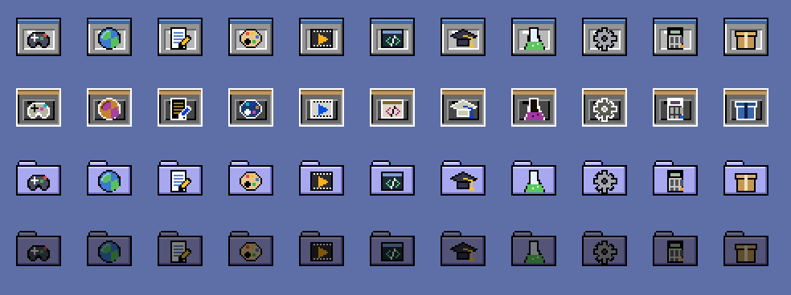

  | Category | Folder | Category | Folder |
  |-----------|--------|-----------|--------|
  | Game | Games | Office | Office |
  | Graphics | Graphics | Development | Development |
  | AudioVideo, Audio, Video | Multimedia | Education | Education |
  | Network | Internet | Science | Science |
  | System, Settings | System | Utility | Accessories |

  An AppImage without a category goes to the `Other` folder. An AppImage dragged straight into
  the Applications folder also goes to its category folder. Installing a version that is
  already installed asks whether to replace it or run it. In Polish the category
  folders are `Gry`, `Grafika`… – existing folders are kept when the language changes.

  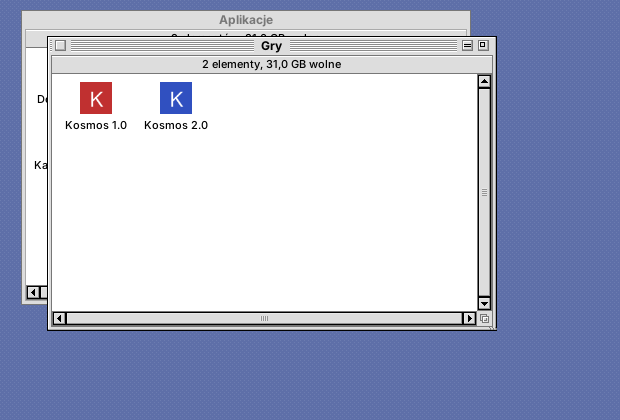
- **The right processor**: an AppImage built for another processor (e.g. ARM64 on an x86-64
  computer) is not installed or started - the error window says which version to download.
- **Missing system libraries**: before starting, Rambler reads the ELF headers of the
  application (AppRun, `usr/bin`, the Qt X11 plugin `libqxcb.so` and the libraries they pull in)
  and checks which libraries are neither inside the AppImage nor in the system. Qt 6 programs
  often need `libxcb-cursor0`, `libxcb-icccm4`, `libxkbcommon-x11-0`… - Qt then only says
  "could not load the Qt platform plugin xcb" (and the hint about xcb-cursor0 is printed even
  when something else is missing). Rambler names the libraries and offers **Install** (the
  packages through `nirvana-libs-helper`, only libraries from its fixed list) or **Run Anyway**.
  From a terminal: `nirvana-denise --missing-libs FILE.AppImage`.
- **Running in a sandbox** (bubblewrap): the whole system is read-only, writing is only
  possible in Nirvana HD, other users, `/root`, `/mnt` and `/media` are invisible, with its
  own `/tmp` and its own process namespace; the application itself is read-only.
  Without bubblewrap the application starts normally and the installation dialog warns about it.
- **Different runtimes**: the squashfs image is searched for after the ELF header (with a
  superblock check), so it also works with runtimes that add padding. When there is no
  squashfs inside (e.g. DwarFS in "uruntime"), the AppImage extracts itself with
  `--appimage-extract`, but in a sandbox without network that can only write to a temporary
  directory. The icon of such an application appears after installation.
- Test AppImages: `tools/test-appimages.sh DIR`. "Clock" writes
  `~/sandbox.txt` with what it sees from inside the sandbox.

## Window animations

As on the classic desktops: when windows open, close and zoom, rectangle outlines fly across the
screen ("zoom rects"). Rambler folders fly out of the icon they were opened from and return
to it when closed. The drawing method is chosen automatically:
- **XOR on the screen**: in the Nirvana Desktop session on Xorg/XLibre without a compositor. The lightest.
- **A window cut to the shape of the outlines** (X SHAPE extension): under XWayland
  (e.g. GNOME on Wayland in Rocky/RHEL 10) and on desktops with a compositor, where
  drawing on the root window would be invisible or painted over.


- `NIRVANA_ANIMATIONS=0`: turns animations off (overrides the Appearance panel)
- `NIRVANA_ANIM_MS=200`: slower frames (for testing; 12 ms by default)
- `NIRVANA_ANIM_NOGRAB=1`: no X server grab during the animation (for screenshots)
- `NIRVANA_ANIM_MODE=xor` or `shape`: forces the drawing method
- If FLTK was built with the Wayland backend, animations only work in X11 mode:
  run with `FLTK_BACKEND=x11`.

## Disks, discs and encrypted volumes

A connected USB stick, USB disk, memory card, CD/DVD or data partition appears on the desktop
below Nirvana HD, with an icon that matches the kind of medium:

- **double-click** mounts the disk and opens its window,
- **an encrypted disk (LUKS)** has a padlock icon; double-clicking asks for the password,
  unlocks and mounts it (wrong password: a message and another try),
- **dragging a disk icon to the Trash ejects it** (the Trash turns into an eject symbol): unmount, LUKS close, disc eject or USB disk power-off; **Eject** in the disk
  icon's context menu (right mouse button, `Ctrl+Y`) does the same,
- files dropped on a disk icon are **copied** to it (the disk mounts itself),
- windows showing a disk close when the disk is ejected or removed,
- sandboxed AppImage applications see the user's mounted media.

Removable media are shown, as well as internal partitions with a file system or LUKS,
unless they are part of the system (mounted as `/`, `/boot`, swap etc.).

Under the hood: detection through `lsblk` (udev), and mounting, unlocking and ejecting through
**UDisks2** over D-Bus (the same service GNOME and KDE use). The LUKS password is passed
directly in the D-Bus call and never ends up in the arguments of any process.
Devuan needs `udisks2` and polkit with elogind; Rocky: `udisks2`, `dbus-devel`.

## Application switcher (gary)

The top-right corner of the menu bar shows the icon and name of the frontmost application.
Clicking it shows:

- the list of running applications with icons; choosing one brings all its windows to the
  front, hidden applications have a greyed icon,
- **Hide …**, **Hide Others**, **Show All**, **Quit …**,
- the **Rambler Windows** submenu: open folders, collapse/expand/close all.

An application is a group of windows with the same `WM_CLASS`. AppImages started from Rambler
appear under their own name and icon (e.g. "Clock" instead of "XClock"); the mapping is
remembered in `~/.config/nirvana/app-classes`.

**Alt+Tab** (Insight): hold Alt and press Tab - a panel with a preview of every window appears,
the most recently used first, the previous one already chosen. Tab (and the arrows) move on,
Shift+Tab goes back, a click or releasing Alt chooses, Escape cancels. A minimized window
(striped preview) comes back from its desktop icon. There is no compositor, so each preview is
taken while its window is on top (a moment after it gets the focus, then every 3 s); a window
never active yet shows its initial.

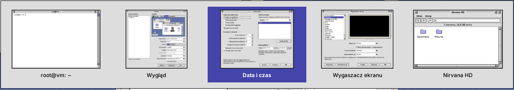

It works on the EWMH standard (`_NET_CLIENT_LIST`, `_NET_ACTIVE_WINDOW`, `WM_CHANGE_STATE`,
`_NET_CLOSE_WINDOW`), so also under GNOME, KDE or Openbox. Under another window manager the
desktop window does not take focus, so clicking the menu bar does not change the active application.

## Rambler: working with files

- **One window**: opening a folder shows it in the same window. Above the contents there is
  the window's own menu bar (**Window**, **Icons**) and a navigation bar: back, forward,
  parent folder and the location field (`~` = home folder; type a path and press Enter –
  a file path opens its folder with the file selected). Shortcuts: `Alt+←` back, `Alt+→`
  forward, `Ctrl+↑` parent folder. Going up selects the folder you came from.
- **More windows**: **Window > New Window** (`Ctrl+Shift+N`) or `Ctrl` + double-click on a folder.
  Desktop icons (Nirvana HD, disks, Trash) open in the most recently used window.
- **Opening**: double-click or Enter. An AppImage from another folder offers installation.
- **Double-clicking the empty desktop** opens the file manager (the Nirvana HD window); if it
  is already open, it is brought to the front.
- **Desktop icons** in the left column: Nirvana HD, **Applications**, **Preferences**, disks,
  iconified windows; the **Trash** always stays in the same place at the bottom, above the
  dock – adding to or emptying the dock does not move it.
- **Context menus** (right mouse button):
  - desktop icons: Open, Information, Eject, Format Disk, Empty Trash, Restore (window icons);
    `Ctrl+O`, `Ctrl+I`, `Ctrl+Y` work on the selected desktop icon,
  - dock tiles: Open, Unpin from Dock,
  - icons in a folder window: Open, Put on Dock / Unpin from Dock, Information, Rename,
    Duplicate, Copy, Delete; empty space in a window: New Folder, Paste, Update, Select Contents,
  - the empty desktop: Open Nirvana HD, Desktop Appearance.
- **Folder windows do not cover the desktop**: when opened and when zoomed they leave the
  column of icons at the left edge free (Nirvana HD, disks, window icons, the Trash above
  the dock) as well as the dock at the bottom. Zooming other programs does the same.
  Remembered windows that are too large are shrunk to this area when they open.
  **Preferences → Desktop** turns this off: without *Keep the desktop icons free* windows use the
  whole screen below the menu bar (no icon column, no gaps), without *Keep windows above the dock*
  they reach the bottom edge. The change applies at once (`~/.config/nirvana/desktop.conf`).
- **Selecting**: click, Shift/Ctrl+click adds or removes, rubber-band selection with the mouse, `Ctrl+A`.
- **Renaming**: `F2` or a click on the name of an item that is already selected.
  Renaming a folder updates its open windows and remembered positions.
- **Dragging**: between windows moves, with `Ctrl` copies; onto a folder in a window drops into
  it; onto the Trash icon throws away, onto Nirvana HD moves to the home folder. A missed drop
  "flies" back to its place.
- **From other programs** (XDND, e.g. a browser, another file manager): files are copied
  into the folder they were dropped on; files dropped on the Trash go to the Trash.
- **Icons > Copy / Paste** (`Ctrl+C` / `Ctrl+V`), **Icons > Duplicate** (`Ctrl+D`) creates
  "name copy". Copy also puts `file://` addresses on the system clipboard.
- **Name conflicts** ask whether to replace; a folder cannot be dropped into itself.
- **View**: `Ctrl+1` icons, `Ctrl+2` list (remembered for each window). In the list, a click
  on a header sorts by name, date, size or kind; a second click reverses the order.
  Columns that do not fit are hidden.
- **Automatic refresh** (inotify): changes made elsewhere show up by themselves, the Trash
  icon switches between full and empty.

### Menu bar

On the right, packed against the edge with equal gaps (each icon has 4 px on each side and its
own width): updates, power, volume, network, the clock and the application switcher (depth
gadget). In the middle, like the screen title bars of old home computers, the used
memory and the used space on the disk holding the home folder, each out of the total, e.g.
`512MB used memory of 16GB     40GB used disk of 512GB     38MB used by Nirvana` (below 1 GB in MB,
below 10 GB with one decimal). The last value is the memory of Nirvana Desktop itself: all
`nirvana-*` processes of the user (window manager, desktop, terminals, panels, shader), counted
as PSS – shared libraries split between the processes, so it is the real cost. Not included:
what the X server keeps for Nirvana's windows (pixmaps, glyphs) and the services the session
starts (the session D-Bus, PipeWire, the polkit agent). With `nirvana-shader` running on a
computer without a GPU, most of it is the OpenGL software renderer (llvmpipe), so the shader's
part is shown separately: `99MB used by Nirvana (shader 81MB)`. The values refresh
every 3 seconds; the tooltip shows the free amounts and the memory of each Nirvana program. On a narrow screen the
text gets shorter.


### Menus

| Menu | Items |
|------|---------|
| **Nirvana** (logo and name) | About This Computer, Preferences (window with panels), Execute Command `Ctrl+E` (remembers the history and suggests programs from `$PATH` and your AppImages; ↑↓, Tab, Enter), Nirvana Shell `Ctrl+T`, Open System Log, Reset Nirvana |

**Open System Log** shows the first log it can read: `journalctl`, `/var/log/syslog` or
`/var/log/messages` (readable for the `adm` group), `dmesg`; when none is readable it asks for
the administrator password (pkexec – only reading the file runs as root), and as a last resort
shows the log of the session (`~/.xsession-errors`).
| **System** | Lock Screen, Sleep, Hibernate, Log Out `Ctrl+Q`, Restart, Shut Down |
| **Special** | Format Disk, Empty Trash, Force Quit a Window… `Ctrl+Alt+K` (like xkill: a skull cursor, click the window of a program that hangs, confirm; the right button or Esc cancels; Nirvana's own windows are protected) |

**About This Computer** shows the system in the manner of neofetch: a large logo with the
color swatches on the left and `user@host` with the parameters on the right – OS, host, kernel,
uptime, packages (dpkg/rpm, Flatpak, AppImage), shell, resolution, desktop environment, window
manager and its theme, theme, icons, font, cursor, terminal and its font, CPU, GPU, memory,
disk, battery, local IP and locale. The other two tabs hold the **Licence** (GPL-3.0) and the
**Acknowledgements**.

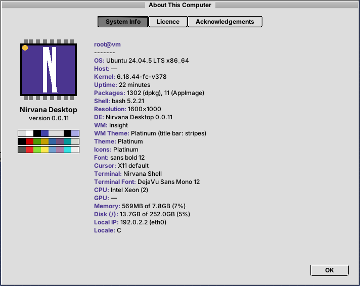

In every file manager window:

| Menu | Items |
|------|---------|
| **Window** | New Window `Ctrl+Shift+N`, New Folder `Ctrl+N`, Back `Alt+←`, Forward `Alt+→`, Open Parent `Ctrl+↑`, Close `Ctrl+W`, Update `Ctrl+R`, Select Contents `Ctrl+A`, Clean Up `Ctrl+.`, Show Hidden Files `Ctrl+H`, View as (icons/list), Sort, Icon Size (small/normal/large) |
| **Icons** | Open `Ctrl+O`, Copy, Paste, Duplicate, Rename `F2`, Delete `Ctrl+Backspace`, Information `Ctrl+I`, Set as Wallpaper, Snapshot `Ctrl+S`, Unsnapshot, Put on Dock `Ctrl+L`, Remove from Dock `Ctrl+K` |

Items that would do nothing at the moment are greyed out, e.g. Eject without a selected disk,
Hibernate when the computer cannot hibernate,
or Back at the start of the history. The System menu asks before logging out,
restarting and shutting down, and refuses to sleep in presentation mode.

- **Icons in windows** can be moved with the mouse within the window. The others stay where
  they are.
- **Snapshot** saves positions permanently (of the selected icons or of the whole window),
  **Unsnapshot** releases them, **Clean Up** puts everything back on the grid. Positions are in
  `~/.config/nirvana/icon-positions`.
- **Icon Size**: small 16 px, normal 32 px, large 64 px (pixels doubled, sharp, retro
  style). The size is remembered for each window.
- **Information**: size (folders are counted), location, creation, modification and access
  dates, owner, permissions. The window can also set:
  - the *Read only* and *Program* flags (execute permission),
  - a comment (`user.xdg.comment`),
  - for programs and AppImages, start arguments ("ToolTypes"), added every time it is started.

  A file with the *Program* flag opens in Nirvana Shell.
- **Dock** (a strip of tiles): *Put on Dock* places the icon of a file,
  folder or application on the strip in the bottom-left corner of the screen, *Remove from Dock*
  takes it off (the file stays where it is).
  - Tiles in the scheme colours touch each other and the screen edges.
  - Names appear in tooltips. AppImages have their own icon and a name with the version.
  - A single click opens.
  - The tab on the left collapses the strip, and that state is remembered.

  The list of icons is in `~/.config/nirvana/dock`.

  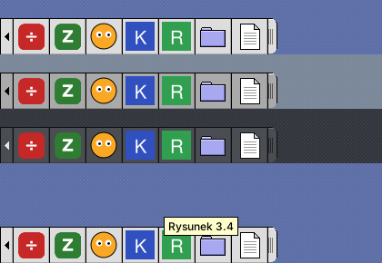
- **Format Disk**: select a disk icon on the desktop and choose FAT32, exFAT, ext4 or NTFS
  (UDisks2). Unformatted USB sticks also appear on the desktop.
- **Reset Nirvana** restarts Insight and Rambler. Program windows stay open.
- **If Rambler crashes**, the session starts it again instead of logging you out (the
  reason goes to `~/.xsession-errors`). Only five crashes within 30 seconds end the session.


Window positions and view modes: `~/.config/nirvana/windows`.

## Appearance (nirvana-alice panel)

Nirvana logo → **Preferences… → Appearance** opens a panel with the list of colour schemes and a
preview. Clicking a scheme changes the panel itself right away, and **Apply**/**OK** switches
the whole system: Rambler and Insight reload the palette without a restart.

- **Colour scheme**: built-in *Platinum*, *Graphite* (dark), *Retro Blue* (gray with a blue
  accent) and *Glacier* (cool silver windows, glass title bars in deep blue – best with the
  *Glacier* wallpaper), plus over 40 schemes from
  [Redmond97 SE](https://codeberg.org/Sliver_X/Redmond97-SE) (GPL-3.0).
- **Retro 16** – five schemes in the spirit of the 16-bit home computer desktops, named after
  their eras: *1.3* (blue desktop, white bars, orange highlights), *2.1* (light gray, blue bars),
  *3.1* (eight-color gray, steel blue and beige), *3.9* (gradient bars, warm accent) and *4.1*
  (glass bars, deep blue). They also bring the classic 16-bit window gadgets (close on the left,
  zoom and depth on the right, size gadget in the corner) – a scheme can ask for them with
  `window_style=classic`; the window behavior (click without raising) stays a switch in
  Preferences > Desktop. No product names on purpose, the colors and gadgets are Nirvana's own.
- **Default look**: the *In Tenebris* scheme, the *Bricks* pattern and Platinum icons.
- **Title bar**: as in the scheme, Platinum stripes, solid colour, gradient or glass (a shine on
  the upper half, the darker middle, as on the glossy desktops of the 2000s); with glass the menu
  bar at the top and the bars of the folder windows are glass too.
- **Desktop background**: *Pattern*, *Solid color* or *Gradient*.
  - Colours are picked from two swatches. The second gradient colour is by default a darker
    (or, on a dark background, lighter) version of the first one. *From scheme* returns to the
    scheme colours.
  - Gradient: vertical, horizontal, diagonal or radial. It is dithered (Bayer matrix), so even
    subtle transitions show no banding.
  - 20 patterns in two shades of the desktop colour: plain, dots, polka dots, grid, fine grid,
    checkerboard, diagonal stripes, horizontal and vertical stripes, bricks, raster,
    diamonds, crosses, zigzag, herringbone, weave, waves, scales, stars, sand.
  - The wallpaper lies on this background: it shows in the bars with the *Fit* layout, around a
    *Center* image and under transparent parts of PNG files.

  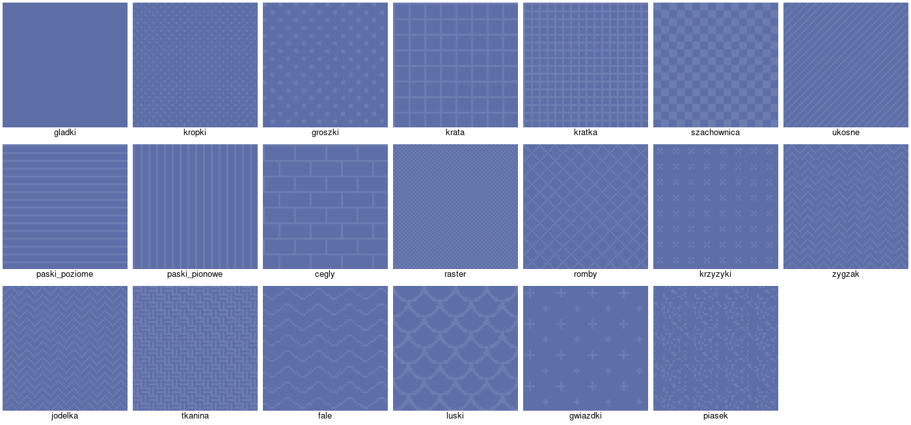
  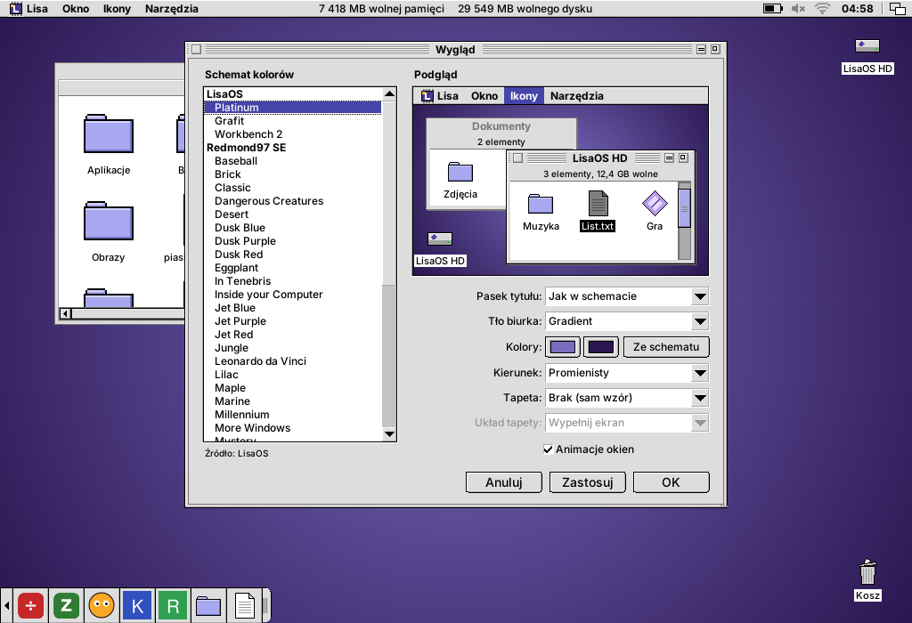

- **Wallpaper**: chosen from the list or with *Other File…* (PNG, JPEG, GIF, BMP, SVG, XPM).
  - The list contains the Nirvana Desktop wallpapers (*Nirvana Desktop*, *Glacier*, *Mountains at Dawn*,
    *Copper*, *Platinum*), system wallpapers from `/usr/share/backgrounds` and
    `/usr/share/wallpapers`, and images from `~/Pictures` (`~/Obrazy`).
  - Layouts: *Fill screen* (crops), *Fit* (the whole image, pattern in the bars),
    *Stretch*, *Center* and *Tile*.
  - Large photos are scaled down in steps, so there are no jaggies or moiré.
  - In Rambler: select an image and choose **Icons → Set as Wallpaper**.
  - Your own wallpapers can be added to `~/.local/share/nirvana/wallpapers`.
  - *Nirvana Desktop* (2560×1440, glossy, with light ribbons and a mirrored floor) is made by the script
    `tools/wallpaper-nirvana-desktop.py [file] [width height]`, so it can be generated at the
    resolution of your own screen.
- **Icon style**: *Retro* or *Platinum*. The change applies
  immediately, also in open windows and on the dock.
  - Retro: original drawings in the style of early-1990s home computers, in a palette of
    greys, navy and beige with black outlines.
  - Folders are drawers, and documents are "projects" with a folded corner. Programs look like
    a little window with close and depth gadgets.
  - Disks are hard-drive boxes with an LED (Nirvana HD with a navy label), and removable media
    are 3.5" floppies. The Trash has a lid with a handle.
  - A selected icon has inverted colours (a *complement* highlight).
  - A sheet with all icons: `tools/icon-sheet.cxx`.

  
  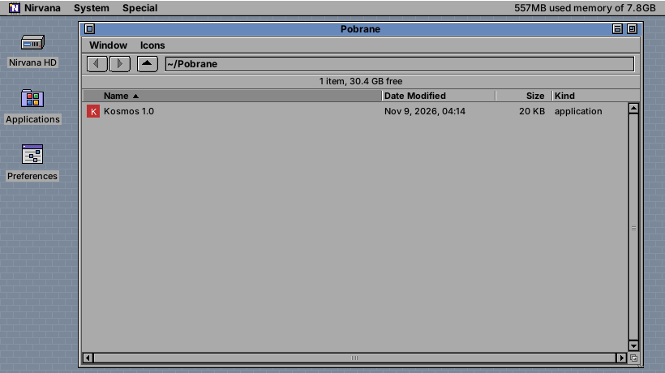
- **Window animations**: on or off.
- **Interface scale**: *Automatic* (from the `Xft.dpi` setting, e.g. 192 dpi = 200%)
  or 100–300%. It scales everything at once: the menu bar, windows, fonts, icons, frames
  and the dock; the wallpaper is rendered at the full screen resolution. After a change the
  desktop and the window manager restart (as with **Special → Reset Nirvana**), open programs
  stay. To try it: `NIRVANA_SCALE=150 nirvana-session`.


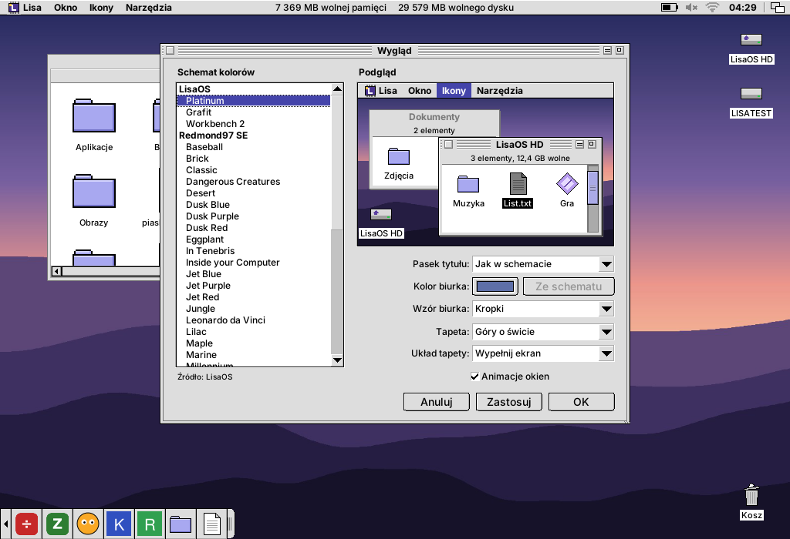
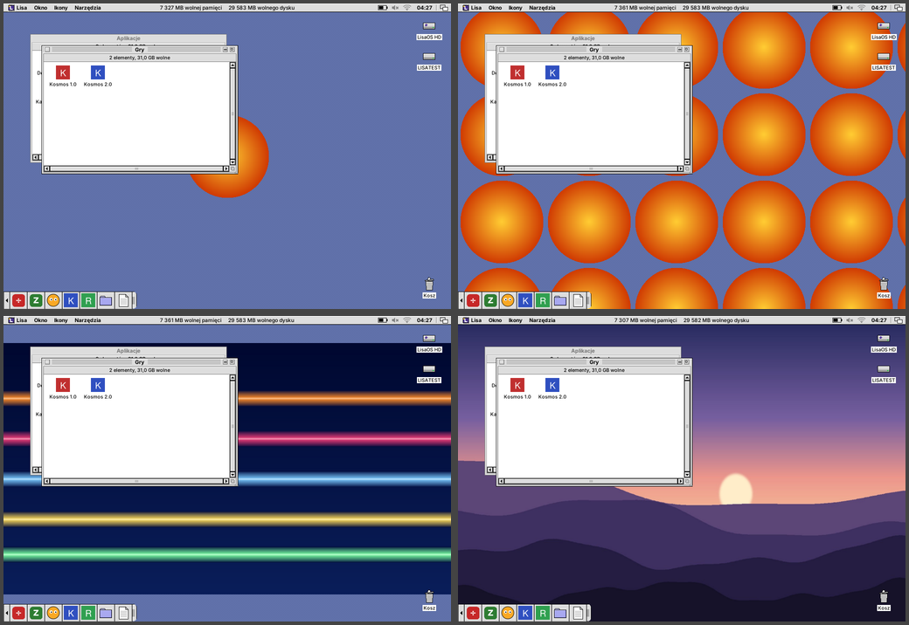

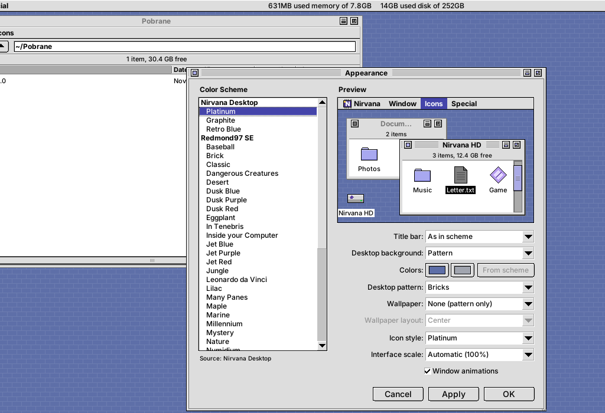

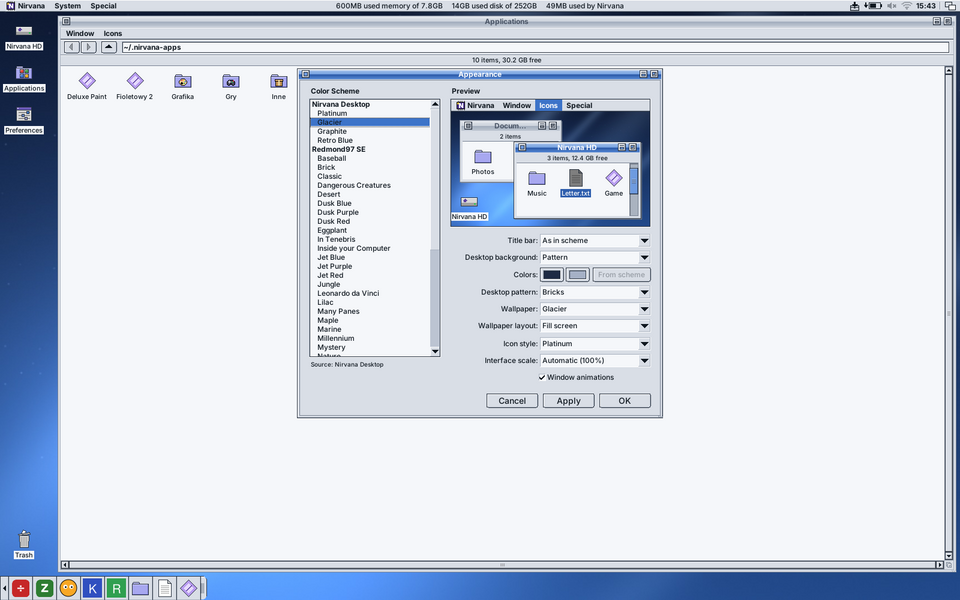

Settings: `~/.config/nirvana/appearance.conf`. Schemes are simple `key=value` files in the
`schemes/` directory, searched in `~/.local/share/nirvana/schemes`,
`<prefix>/share/nirvana/schemes`, `/usr/local/share/...` and `/usr/share/...` in that order.
To add your own scheme just put it there, e.g. `~/.local/share/nirvana/schemes/mine.conf`


```ini
name=My scheme               # name
title_style=stripes          # title bar: stripes | solid | gradient
window=#DDDDDD               # window background
text=#000000                 # text
content=#FFFFFF              # inside of lists and fields
content_text=#000000         # text inside lists and fields
selection=#4444AA            # selection
selection_text=#FFFFFF       # selected text
border=#000000               # border
title=#4444AA                # title bar (solid/gradient style)
title2=#8888DD               # second gradient colour
title_text=#FFFFFF           # title bar text
title_inactive=#AAAAAA       # inactive title bar
title_inactive_text=#555555
accent=#AAAAE6               # scroll bar thumb (optional)
desktop=#5E6FA8              # desktop (optional)
```

The Redmond97 SE schemes can be recreated with `tools/import-redmond97.py`
(colours from `builder/presets/theme_*.conf`).

## Network: Wi-Fi, Ethernet, VPN, hotspot

Nirvana Desktop manages the network through NetworkManager (`nmcli` and D-Bus). On Devuan:
the `network-manager` package (works without systemd, with elogind).

- **Menu bar icon**: Wi-Fi signal strength, a wired network symbol, a padlock with an active
  VPN. The menu offers:
  - Wi-Fi networks in range with a padlock and signal bars,
  - connecting and disconnecting the cable,
  - turning Wi-Fi on and off,
  - VPN,
  - airplane mode.
- **Network panel** (logo → Preferences… → Network):
  - every connection with its addresses (IPv4, gateway, DNS, IPv6, MAC, speed),
  - manual or automatic IPv4 settings,
  - the list of Wi-Fi networks: connecting, hidden networks ("Other Network…"), forgetting,
  - hotspot (sharing the internet connection over Wi-Fi),
  - airplane mode.
- **VPN**: importing a configuration file and connecting with one click:
  - WireGuard (`.conf` with `[Interface]`), built into NetworkManager,
  - OpenVPN (`.ovpn`), package `network-manager-openvpn`,
  - Cisco VPNC (`.pcf`), package `network-manager-vpnc`.

  Profiles of other plugins (OpenConnect, L2TP, PPTP, strongSwan…) are listed too and connect
  from the panel. The VPN login and password are asked for when connecting.
- **Passwords** never appear on a command line:
  - Wi-Fi and hotspot go through D-Bus (`AddAndActivateConnection`),
  - VPN goes through a temporary `passwd-file` (0600), deleted right after connecting.
- Enterprise Wi-Fi (WPA Enterprise / 802.1X) is not supported yet: use `nmtui`.


Testing without a Wi-Fi adapter: `NIRVANA_NMCLI=tools/fake-nmcli.sh` fakes a `wlan0` adapter
and a few networks (everything else is passed on to the real `nmcli`).

## Bluetooth

- **Applet in the menu bar** (next to the network): the rune is dimmed when Bluetooth is off,
  a dot shows a connected device, it blinks while something is being switched. The menu:
  turn Bluetooth on/off, the paired devices with a check mark at the connected ones (a click
  connects or disconnects, the battery level in brackets), Add a Device…, Bluetooth Settings….
  Without an adapter or without `bluez` the applet is hidden.
- **Preferences > Bluetooth:** on/off, visible to other devices, the computer's name, a list of
  devices (name, kind – headphones, keyboard, mouse, phone… – and state: connected with battery,
  paired, nearby with signal strength), Search / Stop, Pair, Connect / Disconnect, Forget;
  a double click pairs a new device or connects a paired one.
- **Pairing** with the code check: "Does the device show 482913?" in a dialog, a PIN for older
  devices, the code to type on a keyboard shown in the panel. After pairing the device is
  trusted and connected at once.
- Works through `bluetoothctl` (package `bluez`, recommended by the .deb): reads in
  non-interactive mode, a background `bluetoothctl` reports changes, and the panel keeps an
  interactive session with its own agent while it is open (searching stops when it closes).
  A soft rfkill block is lifted when turning on (`rfkill`). Readable messages for typical
  BlueZ errors (device off, codes did not match, no audio service – PipeWire/PulseAudio with
  Bluetooth support is needed for headphones).
- Testing without hardware: `NIRVANA_BLUETOOTHCTL=/path/to/a/fake/bluetoothctl`.

## NirvanaSHIELD: which programs may use the internet

A firewall in the spirit of the simple whitelist firewalls: **no program gets to the internet
until you allow it.** Made so that a child and a grandparent can use it.

- **Preferences > NirvanaSHIELD:** a big shield and one sentence say what is going on; three big
  buttons for the whole computer – **Protect** (only the green ones), **Block all internet**,
  **Switch protection off**; and a list of your programs (from the menus and your AppImages) with
  one big switch each: **HAS INTERNET** / **NO INTERNET**. Programs that just tried to get out
  come first, with an orange note. *Find* and *Add another program…* for programs not in the
  menus.
- **When a program asks:** a notification "May “Firefox” use the internet?" with **Allow** and
  **No** (with a sound, like all notifications). The shield in the menu bar also lists the
  programs that asked.
- **Parental lock** ("Changes need the parent's password"): then every change asks for the
  administrator password. **Home network always allowed**: printers, shared folders and other
  computers at home stay reachable.
- **System services always work** (updates, DHCP, time, printing, Bluetooth) – only the programs
  of people's accounts are filtered. Incoming connections from outside are dropped (replies,
  ping and DHCP pass; the home network too when allowed).
- **How it works:** the service `nirvana-shield` (root; `/etc/init.d/nirvana-shield`, a systemd
  unit too) loads nftables rules (`table inet nirvana_shield`): user packets get out only from a
  group of processes (a net_cls cgroup). The kernel tells the service about every program start
  and the allowed ones go into the group – the program file, the AppImage, or the script an
  interpreter runs (`firefox` the script and `/usr/lib/firefox-esr/firefox-esr` the program are
  switched together). Programs started by an allowed program are allowed too. Blocked attempts
  come from the kernel log (rate-limited `log` rule) and are matched to the program by its socket.
  Settings: `/etc/nirvana-shield.conf`; control: `/run/nirvana-shield.sock` (each user changes
  only their own list). Stopping the service removes the rules; if it crashes they stay (fails
  closed).
- **Switching on:** the panel's big button (administrator password) enables and starts the
  service. Needs `nftables` (recommended by the package) and the net_cls cgroup controller
  (standard Debian/Devuan kernels have it).
- **Limits:** Flatpak and Snap programs are not told apart yet; allowing a script interpreter
  (python3, sh) allows every script it runs; a program allowed in a terminal also allows what is
  started from that terminal.

## Notifications

- Rambler is the desktop's **notification server** (`org.freedesktop.Notifications` on the session
  bus), so notifications of any program – web browsers, messengers, mail, `notify-send` – show up.
- Each one is a small window at the top right below the menu bar, **in the current appearance**
  (the scheme's title bar, or the classic 16-bit gadgets): the program's name in the title bar,
  its picture (`image-data`, an icon name or a file), the summary in bold, the text (markup tags
  removed) and up to 3 action buttons. A click on the notification runs its default action (e.g.
  opens the chat) and closes it; the close box closes it only. Urgent notifications have a red
  stripe and stay until clicked; the others go after ~5 s (longer texts stay longer, the pointer
  over a window keeps it). At most 5 at once, the newest on top.
- **Sound:** the notification's own sound (`sound-file`, `sound-name` from the sound theme), or
  Nirvana's built-in chime (two short bell notes, made at the first use); played with paplay,
  pw-play or aplay. `suppress-sound` is respected; several at once play one sound.
- **The bell in the menu bar:** a red dot for unread notifications; the menu lists the recent ones
  (only in memory – a click shows one again), **Do Not Disturb** (no windows and no sound – urgent
  ones still show; the bell is crossed out), **Notification Sound** and **Clear Notifications**.
  Settings in `~/.config/nirvana/notify.conf`.
- If another notification program already owns the service (dunst, xfce4-notifyd…), it stays in
  charge and the menu says so; the session does not start them from autostart.
  `NIRVANA_NOTIFICATIONS=0` leaves notifications to another program.

## Clipboard history

- An applet in the menu bar remembers the **texts copied in any program** (the last 25, newest
  first, each text once). A click on the icon – or **Ctrl+Alt+V** anywhere, the menu opens at the
  mouse pointer – shows the history; choosing an entry puts it back into the clipboard (and the
  middle-button selection), ready for Ctrl+V.
- **Pause Recording** (the icon dims) – e.g. while copying passwords; **Clear History** forgets
  everything and empties the clipboard.
- The history lives **only in memory** – it is gone after logging out and never written to disk.
  Nirvana does not take the clipboard over after every copy, so the program that copied keeps
  all its formats (formatted text, pictures); only plain text is remembered.

## Nirvana Shell (terminal)

`nirvana-shell` is an xterm-compatible terminal emulator (`TERM=xterm-256color`),
built on the libvterm library (bundled in `third_party/`, MIT; the system one is used
if available). Start it from the logo → Nirvana Shell, in Rambler with `Ctrl+T` (in the
folder of the active window) or with
`nirvana-shell [--working-directory DIR] [-e command]`.

- **Display:** 256 colours and truecolor, bold, italic, underline, alternate screen. vim,
  htop, mc and less work in it.
- **Mouse in programs:** supported. Shift + click always selects text.
- **Scrollback:** 5000 lines, scroll bar, mouse wheel, Shift+PgUp/PgDn.
- **Selection and clipboard:**
  - the selection goes straight to the X selection; the middle button pastes,
  - a double click selects a word, a triple click a line,
  - Ctrl+Shift+C copies, Ctrl+Shift+V pastes (bracketed, if the program asks for it).
- **Windows:** Ctrl+Shift+N opens a new one in the same directory, Ctrl+Shift+W closes.
  Before closing a window where something is running, the terminal asks.
- **Look:**
  - a right click opens the menu, with colour profiles: Classic (light), Dark,
    Green phosphor, Amber, Retro blue, Like the color scheme,
  - Ctrl+Shift+= / - / 0 changes the font size.
- **Settings:** `~/.config/nirvana/terminal.conf` (profile, font, size, columns,
  rows, scrollback).


## System tray

Icons of programs running in the background (messengers, cloud storage, game launchers, nm-applet...)
sit in the menu bar, to the left of the power applet. Rambler supports both protocols:

- **StatusNotifierItem** (D-Bus): Qt 5/6, KDE, Electron, libappindicator / Ayatana.
  - When there is no other one in the session, Rambler itself is
    `org.kde.StatusNotifierWatcher`. Under KDE it registers as an extra host of the existing one.
  - Icons come from the icon theme. If one is missing, it tries the `-symbolic` version and
    ever shorter names, and as a last resort the pixels sent by the program. Symbolic icons
    take the menu bar text colour.
  - A left click is *Activate*, and when the program does not support it, it opens the menu.
    A right click opens the program's menu (dbusmenu: check marks, submenus, separators,
    disabled items) as a Platinum menu. A middle click is *SecondaryActivate*, and the mouse
    wheel is *Scroll*.
  - The tooltip shows the title and description (without HTML). The icon disappears when the
    program sets the *Passive* status.
- **XEmbed** (`_NET_SYSTEM_TRAY_S0`): GTK 2/3 `StatusIcon`, Wine, older programs.
  - The icon window is embedded in the bar on a background in the scheme colour, and clicks go
    straight to the program.
- The bar rearranges itself as icons come and go. When a program quits, its icon disappears.
- After **Reset Nirvana** the icons come back: XEmbed programs dock again after the `MANAGER`
  announcement, and Rambler itself finds the D-Bus icons that are already on the bus.
- `NIRVANA_NO_TRAY=1` turns the tray off (e.g. when the session has its own).


## Sound

A speaker icon in the menu bar. A click opens a small window with:

- output volume and mute, and the choice of output (including the port: speakers or
  headphones). When the output changes, programs that are playing move to the new one,
- microphone volume and mute, and the choice of input,
- the volume of every application that is playing.

The mouse wheel over the icon changes the volume. The multimedia keys (volume, mute,
microphone, brightness) show an OSD bar at the bottom of the screen. Under GNOME/KDE that
desktop handles them.

Works with PulseAudio and PipeWire (`pactl`). Without a sound server it uses plain ALSA
(`amixer`: Master and Capture).


## Clock, calendar, pomodoro, timer and stopwatch

The clock at the right end of the menu bar shows the time and, if chosen, the seconds, the date
and the day of the week (12- or 24-hour). A click opens:

- the time with seconds and the full date,
- a **month calendar** – the arrows or the mouse wheel change the month, a click on the title
  goes back to today; weekends are dimmed, today is highlighted,
- three tools, each in its own tab:
  - **Pomodoro**: work and breaks (25/5 min, a long 15 min break after 4 rounds – all can be
    changed), Start/Pause, Skip, Reset; a red tomato for work, a green one for a break,
  - **Timer**: presets of 1–60 minutes, +1 min, Start/Pause, Reset,
  - **Stopwatch** with tenths of a second and laps.

A running (or paused) tool shows its time in the menu bar next to the clock, so it stays in
sight with the window closed. When time is up a sound plays (the freedesktop sound theme through
`paplay`/`pw-play`, otherwise the bell) and a window says so – for the pomodoro with a button
for the next phase (or the next phase starts by itself, if so set).


### Date & Time (Preferences)

- the clock in the menu bar: 24-hour, seconds, date, day of the week – with a live preview,
- pomodoro: the lengths of work and breaks, the number of rounds, starting the next phase by
  itself, the sound,
- **time zone**: a region and a city from the tz database; set for the whole system,
- **date and time** by hand, and whether network time is working (systemd-timesyncd through
  `timedatectl`, otherwise a running chrony, ntpsec or openntpd).

The system settings go through `/usr/libexec/nirvana-time-helper` with pkexec (it accepts only a
zone that exists and a date in a fixed format); like the updates, administrators at the computer
are not asked for a password. Without systemd the zone is set by `/etc/localtime` and
`/etc/timezone` (Devuan) and the time with `date` + `hwclock`.

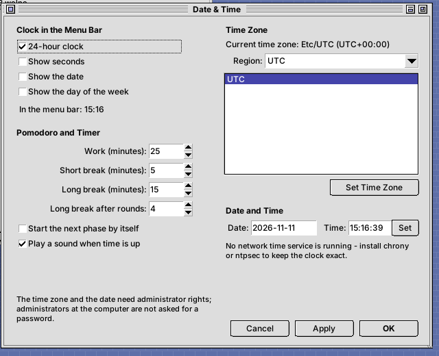

## Printers

A printer icon appears in the menu bar when CUPS has a printer or a print job. A blue badge
shows the number of jobs, red when the default printer has stopped (out of paper, a jam, an
open cover…). The small window shows each printer with its state, the jobs with a **×** to
cancel each one, **Cancel All My Jobs**, **Print Test Page** and **Printer Settings…**.

**Preferences → Printers**:

- the printers with their description, driver, connection, state and waiting jobs; **Set as
  Default** (for you, `lpoptions`), **Print Test Page**, **Pause/Resume**, **Remove**,
- **Add Printer…**: *Search* lists what CUPS finds (USB, network, IPP/AirPrint); an address can
  be typed too (`ipp://192.168.1.20/ipp/print`, `socket://…`). Network printers that speak IPP
  get **driverless** printing (IPP Everywhere) at the top of the list; otherwise the drivers of
  the manufacturer are offered,
- **missing drivers**: when there is no driver for the manufacturer, the window says so and
  **Install Drivers…** offers the right packages (HPLIP for HP, brlaser for Brother, ESC/P-R
  for Epson, Gutenprint, SpliX, foo2zjs, Foomatic, the manufacturer PPDs, cups-filters) – the
  package names are chosen for apt, dnf, pacman or zypper; the list of drivers fills in at once,
- **no CUPS at all**: the panel offers to install (or start) the printing system.

Adding, removing, pausing and installing go through `/usr/libexec/nirvana-print-helper` with
pkexec (only checked names, addresses of known kinds and drivers CUPS itself offers);
administrators at the computer are not asked for a password. Reading the state, cancelling your
own jobs, the test page and your default printer need no rights.

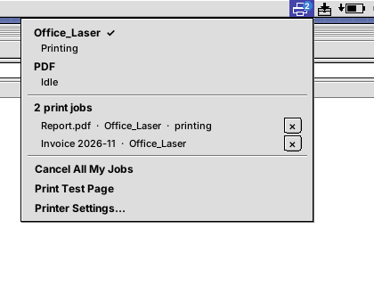
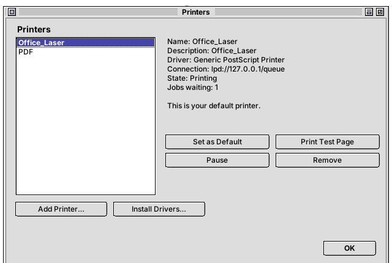

## Nirvana-DM: the login screen

`--login-screen` of `install.sh` installs LightDM with **Nirvana-DM** (and the package itself
makes LightDM use it: `/usr/share/lightdm/lightdm.conf.d/50-nirvana-dm.conf`). A simple screen
in the style of the 1990s: the desktop background, a menu bar with the logo and the clock, and a
window in the middle with the users (their `~/.face` picture or a figure; a green dot for those
already logged in, *Other…* for typing a name), the password and the session.

- **Theme** – any color scheme, **Background** – the patterns and the Nirvana wallpapers,
  **Language** – the language of the screen; the choice applies at once and is saved in the home
  folder of the login screen (`/var/lib/lightdm/.config/nirvana`), so **it stays after a restart**,
- **Special** – Sleep, Restart, Shut Down (when the system allows them),
- the last user is chosen again next time, the session follows the user's last one.

LightDM does the security-sensitive part (the X server, PAM, the session, elogind); Nirvana-DM
is only the screen in front of it. `nirvana-dm-greeter --test` shows a preview in a window.
Back to another greeter: `greeter-session=…` in `/etc/lightdm/lightdm.conf.d/`.

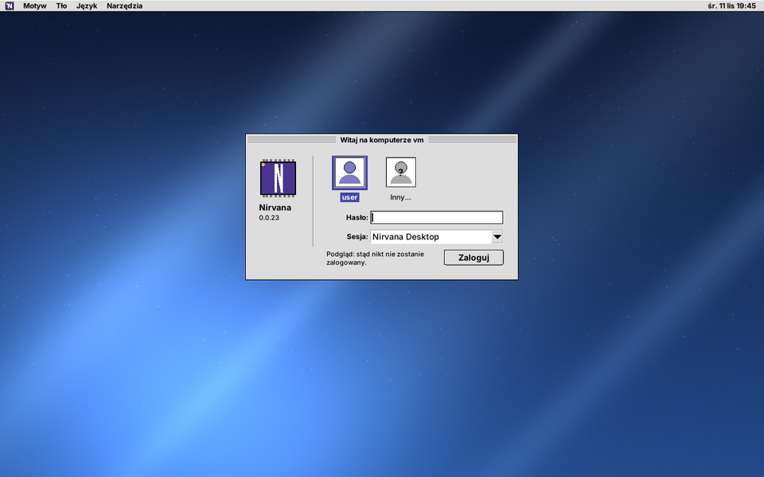

### User (Preferences)

**Preferences → User** holds the basic settings of your account:

- **Picture** – a picture file (cut to a square) or one of eight built-in pictures; Nirvana-DM
  shows it next to your name. It is saved as `~/.face` and copied to
  `/var/lib/AccountsService/icons`, because the login screen cannot look into a closed home folder,
- **Full name** – shown on the login screen instead of the login name,
- **Change Password…** – the current and the new password; the system program `passwd` checks
  and saves it (with its rules for length and strength),
- **Log in automatically** – LightDM starts your desktop without the login screen
  (administrators only),
- the login name, the account type, the home folder, the shell and the groups.

The picture, the name and automatic login go through `nirvana-user-helper` (pkexec, polkit
action `org.nirvana-desktop.user`): it only ever changes the account of the person who runs it,
and reads the picture as data (a PNG up to 1 MB), never as a path. You confirm with your own
password; administrators at the computer are not asked.

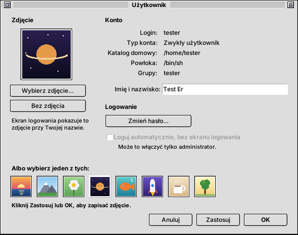

## Screen saver and screen lock

**Preferences → Screen Saver** chooses the saver - Black Screen, Starfield, Bouncing Lines,
Nirvana Logo, Pipes, Plasma, Clock, Snow, Fireworks, Game of Life, Maze (carved and then
walked through), Spirograph, Flying Chips, Aquarium, Fire, Bubbles or Random - with a preview in a little monitor, when it
starts, whether it **locks** the screen (at once or after it ran a few minutes) and when the
monitor goes to sleep. *Test* shows it full screen, *Lock Now* locks. The ideas come from the
savers of the 1990s and xscreensaver; the code is new.

`nirvana-lock` does both: Rambler starts `nirvana-lock --saver` when the computer is idle (not in
presentation mode), and System → Lock Screen, sleeping and `nirvana-lock` from a terminal lock at
once. It covers all screens and grabs the keyboard and mouse; a key or a mouse movement brings
the password window (the desktop background, your picture and name, *Switch User…* with
LightDM). The password is checked by PAM (`/etc/pam.d/nirvana-lock`) in a separate process, so
a wrong password does not freeze the screen. Building needs `libpam0g-dev`;
`NIRVANA_LOCKER=command` uses another locker.

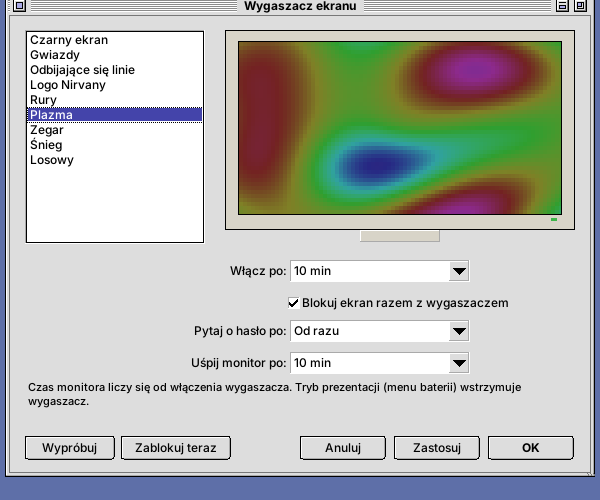

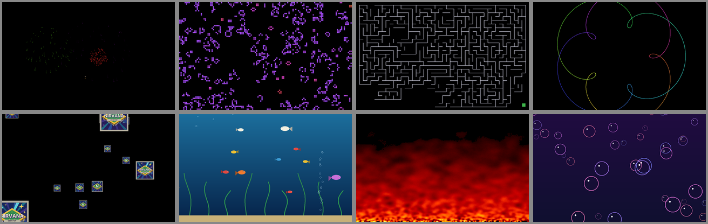

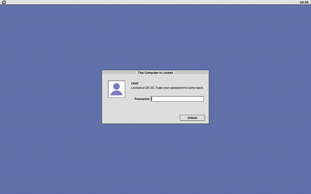

## File dialog and password window

**The file dialog.** Open, Save and Choose Folder look like the rest of Nirvana Desktop: the
places on the left (home, the user folders, Applications, the file system, mounted disks), the
folder popup with the folders up to the root, the list with icons, size and date, the type filter,
*New Folder* and *Show hidden files*. Typing `/` or `~` in the list goes to a folder by path.
The control panels use it, and so do other programs through **xdg-desktop-portal**:
`nirvana-portal` is a portal backend (`share/xdg-desktop-portal/portals/nirvana.portal`,
chosen in `nirvana-portals.conf`), so Firefox, Chromium-based browsers, GTK 3/4 and Qt programs
and Flatpaks get this dialog instead of the GTK one. The session sets `GTK_USE_PORTAL=1`,
`GDK_DEBUG=portals` and (when empty) `QT_QPA_PLATFORMTHEME=xdgdesktopportal` for that;
`NIRVANA_PORTAL_DIALOGS=0` turns it off. Programs that draw their own dialog without asking the
portal (older GTK 2 programs, some AppImages) keep theirs.

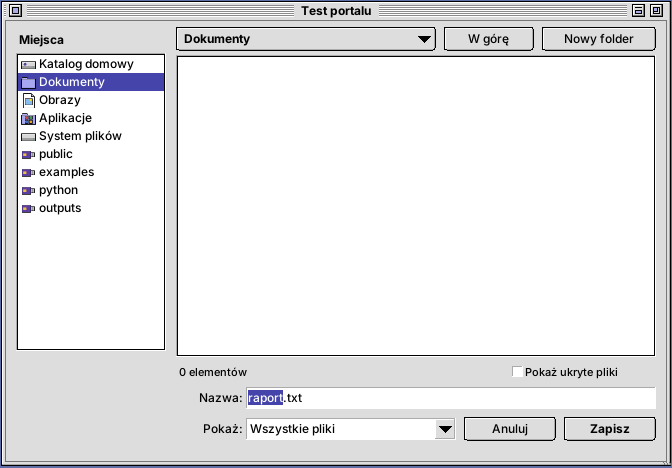

**The password window.** When a program asks for administrator rights (`pkexec`, disks, network,
updates, printers), `nirvana-polkit-agent` shows the request, the program and the account, and
passes the password to polkit's own helper (PAM) - it never keeps it. A wrong password can be typed
again; Esc cancels. The session starts it instead of lxpolkit or another agent
(`NIRVANA_POLKIT_AGENT=0`: the other agent). Nirvana's own tools (updates, date, printers, user,
libraries) go through `nirvana-pkexec`, which starts the password window for that one call - so
they work even when the session is not known to elogind (e.g. `startx` without `libpam-elogind`),
where no session agent can register and plain pkexec fails with "Error creating textual
authentication agent".

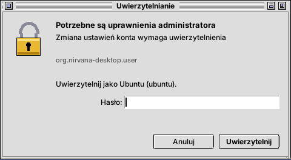

## Software updates

An icon with a parcel in the menu bar looks for system updates a minute after login and then every
6 hours, and shows their number in a red badge. The small window lists them and has **Install
Updates…**, **Check for Updates** and **Show Log**; while installing, the icon and the window show the
progress.

| Package manager | Checking (no root) | Installing |
|---|---|---|
| apt (Devuan, Debian, Ubuntu) | lists downloaded into `~/.cache/nirvana/apt` | `apt-get dist-upgrade` with progress |
| dnf (Fedora, Rocky) | `dnf check-update` | `dnf upgrade` |
| pacman (Arch) | `checkupdates` (pacman-contrib) | `pacman -Syu` |
| zypper (openSUSE) | `zypper list-updates` | `zypper update` |
| apk (Alpine), xbps (Void) | the local lists | `apk upgrade`, `xbps-install -Syu` |

Checking never needs root: on apt the package lists are downloaded into the user's cache, so the
system's lists are not touched (the idea of `checkupdates`). Installing runs
`/usr/libexec/nirvana-update-helper` through pkexec. It does only the fixed upgrade, with no
arguments passed on; the polkit rule installed with Nirvana Desktop lets administrators (the
`sudo`, `wheel` or `admin` group) sitting at the computer do it **without a password**. Other
users are asked for the administrator password. The log of the last installation is in
`~/.cache/nirvana/update.log`.

## Power and presentation mode

A battery icon (or a plug on a desktop computer) in the menu bar. Next to the battery: a lightning
bolt while charging, a down arrow while running on the battery (red below 10%), a small plug when
the adapter is connected and the battery is full. The small window shows:

- the battery state with the time until empty or full,
- a screen brightness slider (through logind, without root),
- the power profile (power saver, balanced, performance): through `power-profiles-daemon`, and
  without it (e.g. Devuan without systemd) straight through the kernel – the ACPI platform profile,
  otherwise the CPU energy preference (EPP), otherwise the cpufreq governor. That is set by
  `nirvana-power-helper` through pkexec; polkit allows it to the user at the computer without a
  password, and the choice is restored at the next login,
- a link to the Power panel.

Lock Screen, Sleep, Hibernate, Log Out, Restart and Shut Down are in the **System** menu.
They work through logind; on Devuan through elogind.

**Presentation mode** (a check box in that window) suspends at once:

- screen blanking and DPMS (`XScreenSaverSuspend`), so the screen lock does not start either,
- sleeping: a logind/elogind `idle:sleep` inhibitor,
- blanking and sleeping in GNOME, KDE and Xfce (`org.gnome.SessionManager`,
  `org.freedesktop.ScreenSaver`).

While it is on, a small monitor shows next to the battery icon.

The **Power** panel (logo → Preferences…) sets for the Nirvana Desktop session:

- screen blanking after inactivity,
- locking when the screen blanks,
- sleeping after inactivity, separately on battery and on the power adapter,
- the reaction to 3% battery; a warning appears at 10%.


## Shader: full-screen effects

**Preferences → Shader** puts an effect over the whole desktop. Choosing it in the list applies it
at once; the choice is remembered and started with the session. 17 built-in effects:
CRT monitor, Scanlines, Amber monitor, Green phosphor, Grayscale, Sepia, Night light, VHS tape
(animated), Film grain (animated), Large pixels, 64 colors (dithered), Halftone, LCD, Thermal
camera, Dreamy glow, Underwater (animated) and Inverted colors.

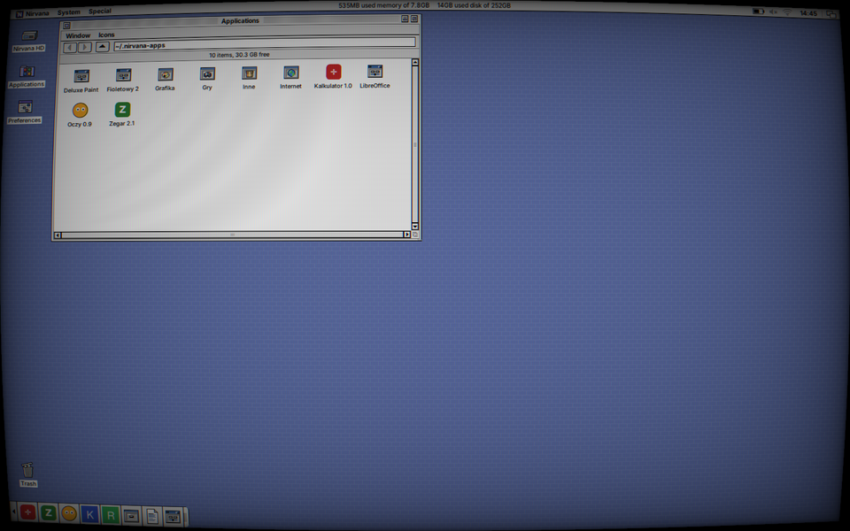
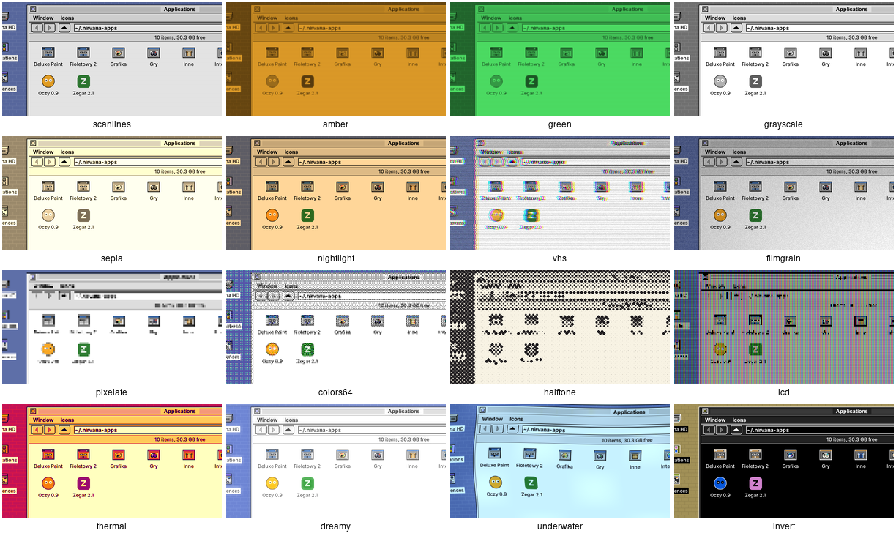

`nirvana-shader` is a small compositor: the windows are redirected off screen (Composite),
composed with XRender into one picture and drawn through a fragment shader with OpenGL
(`GLX_EXT_texture_from_pixmap`, otherwise a copy). It reads the windows through window
pictures instead of binding a texture to each window, so resizing, closing or iconifying windows
cannot leave it with a stale pixmap; X errors are logged, not fatal; and if it ends in any way,
the X server shows the windows directly again. While it runs, the window animations use the
shaped-window method instead of XOR. Mouse input is not affected (the overlay is transparent to
input).

    nirvana-shader crt          # start with an effect (or switch the running one)
    nirvana-shader --list       # the available shaders
    nirvana-shader --stop

Your own shaders: GLSL 1.20 fragment shaders in `~/.local/share/nirvana/shaders/NAME.frag`.
Before the file comes a prelude with `u_resolution`, `u_time` (a shader that uses it is animated,
30 frames per second), `v_texcoord` (0..1, origin bottom left) and `vec4 screen(vec2 uv)`; the
result goes to `gl_FragColor`. The first comment line is the description in the panel.

    // Blue tint.
    void main() { gl_FragColor = vec4(screen(v_texcoord).rgb * vec3(0.8, 0.9, 1.2), 1.0); }

Another compositor (picom, compton) cannot run at the same time. Without graphics acceleration
(e.g. in a virtual machine, llvmpipe) animated effects use a lot of CPU.

## Error windows

Errors (a file that cannot be opened, a disk, the Trash, copying, an AppImage for another
processor…) come in a window titled **Guru Meditation**: red text in a black box with a blinking
red frame and a guru number made from the message (`#00000010.6718A071`) - a nod to the error
screens of the 1980s home computers. Questions and notices keep the ordinary window.

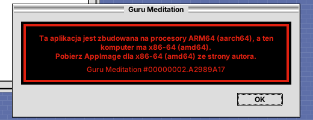

## Languages

The interface is in **English** by default (the texts in the code) and in **Polish**
(`po/pl.po`). *Automatic* in **Preferences** (logo → Preferences…) follows the system
language (`LANGUAGE`, `LC_ALL`, `LC_MESSAGES`, `LANG`): with a Polish locale (`pl_PL.UTF-8`)
the interface is Polish, with any other locale or `LANG=C` it is English. The language can
also be chosen by hand; the choice goes to `~/.config/nirvana/language` and applies after a
restart or **Special → Reset Nirvana**.

In Polish the menus are called *Okno*, *Ikony*, *Narzędzia*, numbers use a decimal comma,
and new category folders are `Gry`, `Grafika`… – folders that already exist stay in use whatever the
language, so changing it does not split installed applications.

A new language or corrections:

    tools/i18n/pot.py          # po/nirvana.pot from the code + update of po/*.po
    msginit -i po/nirvana.pot -l de -o po/de.po   # a new language
    cmake --build build        # msgfmt --check → build/locale/<lang>/…

In the code: `_("text")`, `N_("…")` in static tables, `P_("Window/Sort")` for menu paths
(each part is translated), `trn(n, "%1 item", "%1 items")` for plurals and
`fmt(_("Delete “%1”?"), name)` instead of gluing sentences together. Nirvana Desktop reads the
`.mo` catalogs itself, so no generated system locales are needed.

## Licence

Nirvana Desktop is free software under the **GNU General Public License, version 3 or later**
(GPL-3.0-or-later). The full text is in [`LICENSE`](LICENSE); it is installed to
`/usr/share/nirvana/LICENSE` and shown in **Nirvana → About This Computer → Licence**.

- FLTK is under the LGPL-2.0 with exceptions that allow static linking.
- libvterm in `third_party/libvterm` (Paul Evans) is under the MIT licence.
- The schemes in `schemes/redmond97-se/` come from Redmond97 SE (Sliver X, matthewmx86) and are GPL-3.0.

The people and projects whose work Nirvana Desktop is built on are listed in
**About This Computer → Acknowledgements**.
