# Nirvana Desktop

*[Polska wersja: README.pl.md](README.pl.md)*

A lightweight desktop environment for Linux (based on a minimal Devuan) in the spirit
of **Mac OS 9 (Platinum)** with a touch of the **Amiga**. Written in C++ and FLTK 1.4.

- **Simple mode**: the user only sees their own Nirvana HD disk (that is `$HOME`), as on Android.
  Applications are AppImage files in `~/Applications`; installing means dragging a file.
- **Root mode**: the full file system and advanced settings, started through
  `pkexec` and clearly marked (red chip in the logo, ROOT badge).
- **Rambler, a file manager** (component `nirvana-denise`): a single window that browses folders
  (back, forward, parent folder, location field), with its own Window and Icons menus.
- **English by default**, Polish when the system locale is Polish (see [Languages](#languages)).

> **Formerly LisaOS.** The installer removes the old `lisaos` package and fixes `~/.xinitrc`
> and the login screen; on the first start settings, installed applications and the cache
> move from `~/.config/lisaos`, `~/.local/share/lisaos` and `~/.cache/lisaos` to
> `…/nirvana`. The `lisaos-session` command still works.

## Components

| Package             | Role                                   | Status      |
|---------------------|----------------------------------------|-------------|
| `nirvana-platinum`  | look library: colours, frames, icons, window chrome | prototype |
| `nirvana-denise`    | Rambler: file manager + desktop         | prototype   |
| `nirvana-insight`   | X11 window manager (Xorg/XLibre), Platinum frames | works |
| `nirvana-gary`      | application switcher (for now inside the Rambler process) | works |
| `nirvana-alice`     | control panels: Appearance, Network, Power | works |
| `nirvana-shell`     | Nirvana Shell - terminal emulator       | works |
| `nirvana-paula`     | sound                                   | planned     |
| `nirvana-kickstart` | login and session start                 | planned     |
| `nirvana-guru`      | error window, root mode                 | planned     |

## Installing on Devuan 6 "Excalibur" (Debian 13)

Unpack the sources and run the installer:

    tar xzf nirvana-0.0.3.tar.gz && cd nirvana
    sudo ./install.sh                 # or: sudo ./install.sh --login-screen

The installer:

1. installs the build tools and libraries (apt),
2. builds Nirvana Desktop (the first time it downloads FLTK 1.4 from GitHub – internet needed),
3. creates the package `build-deb/nirvana_<version>_amd64.deb` and installs it with apt –
   together with the programs Nirvana Desktop uses: NetworkManager, udisks2, polkit
   with the `lxpolkit` agent, PulseAudio/PipeWire, bubblewrap, xsecurelock…
4. adds the X server if it is missing and offers PipeWire if there is no sound.

The version number is in the `VERSION` file and goes up with every released package. Running
the installer from a newer package replaces the installed version.

Options:

| option | what it does |
|---|---|
| `--login-screen` | installs LightDM and makes Nirvana Desktop the default session |
| `--xinitrc` | writes `~/.xinitrc` with `exec nirvana-session` (then `startx` is enough) |
| `--package-only` | only builds the `.deb` (e.g. for another computer: `sudo apt install ./nirvana_*.deb`) |
| `--no-x` | does not install the X server |
| `--yes` | no questions |
| `--uninstall` | `apt remove nirvana`; settings in the home folder are kept |

After installation choose the **Nirvana Desktop** session on the login screen or run
`startx /usr/bin/nirvana-session` from the console. The session starts the D-Bus session
bus itself (`dbus-run-session`), the XDG autostart programs (`nirvana-autostart`, e.g. PipeWire)
and a polkit agent. `nm-applet` is skipped – Nirvana Desktop has its own network menu
(`NIRVANA_NM_APPLET=1` brings it back).

If the network adapters are described in `/etc/network/interfaces`, NetworkManager will
not manage them – the installer reminds you; keep only `lo` there.

## Building

Dependencies (Devuan/Debian):

    sudo apt install build-essential cmake git libx11-dev libxft-dev \
        libxinerama-dev libxcursor-dev libxfixes-dev libxrender-dev \
        squashfs-tools bubblewrap libdbus-1-dev udisks2 polkitd pkexec \
        network-manager network-manager-openvpn \  # network and VPN
        libxss-dev pulseaudio-utils alsa-utils \  # sound and power applets
        gettext                                   # translations (msgfmt)

Optional: `power-profiles-daemon` (power profiles), `xsecurelock`, `i3lock`
or `slock` (screen lock). On Rocky: `libXScrnSaver-devel pulseaudio-utils`.

If FLTK 1.4 is not installed, CMake downloads and builds version 1.4.4 itself:

    cmake -S . -B build -DCMAKE_BUILD_TYPE=Release
    cmake --build build -j

With your own FLTK: `-DFLTK_DIR=/path/to/share/fltk`.

## Running

**Full session** (insight + Rambler desktop), e.g. in a nested X server:

    Xephyr :2 -screen 1024x768 &
    DISPLAY=:2 ./session/nirvana-session

After installation (see above): `startx /usr/bin/nirvana-session` or the "Nirvana Desktop"
session on the login screen (file `/usr/share/xsessions/nirvana.desktop`).

**Rambler alone under another desktop** (e.g. GNOME on Rocky/RHEL):

    ./build/nirvana-denise --center                  # the whole area under the GNOME panel
    ./build/nirvana-denise --center --size 1024x768  # a 1024x768 window in the middle

`--center` (or the variable `NIRVANA_CENTER=1`) puts the desktop in the middle of the work
area, i.e. avoiding the desktop panels, so the GNOME top bar does not cover the Nirvana
Desktop menu bar. Without `--size` the desktop fills the whole work area. Folder window
positions are saved relative to the desktop, so they move together with it.

Rambler options: `--root`, `--home DIR`, `--size 1024x768`, `--center`.
A Chicago-style system font can be set with `NIRVANA_SYSTEM_FONT`
(e.g. the free ChicagoFLF font).

## Insight: window handling

- title bar: dragging moves the window, a double click iconifies it
- buttons: close (on the left, politely via `WM_DELETE_WINDOW`), iconify and zoom (on the right)
- **Workbench-style iconification:** the window disappears and its icon appears on the
  desktop (in the left column, below the disks) – the program's picture from `_NET_WM_ICON`
  and the window title. Double-clicking the icon brings the window back. "Minimize" inside
  the program itself (Brave, Firefox…) works the same way; "Hide" from the application menu
  hides windows without icons. Icons survive Reset Nirvana.
- right and bottom frame edges and the bottom-right corner: resizing
- clicking an application window activates it and raises it; clicking the desktop deactivates
  windows, and clicking the menu bar does not change the active window (the menu acts on it)
- Rambler folders and dialogs are ordinary X windows, so they behave like any application
- windows never go under the menu bar or onto the dock: Insight publishes `_NET_WORKAREA`, so
  programs (Brave, Firefox, GTK, Qt) open inside that area and windows that are too large are
  trimmed; maximizing from a program's title bar (`_NET_WM_STATE_MAXIMIZED_*`) works like
  zoom; the Rambler desktop always stays at the bottom
- Flatpaks: the session passes the display and desktop name to D-Bus services, and
  `nirvana-portals.conf` points xdg-desktop-portal to the GTK backend
- no compositor: applications draw straight to the screen (less memory)
- **interface scale** (HiDPI): see [Appearance](#appearance-nirvana-alice-panel)

## Applications (AppImage)

- **Icons and names**: Rambler reads the icon (`.DirIcon`, PNG or SVG) straight from the
  squashfs image inside the AppImage, **without running it**. It computes the image offset
  from the ELF header and uses `unsquashfs`.
- **Name with version**: `Firefox-128.0.3-x86_64.AppImage` → "Firefox 128.0.3". When the file
  name has no version, Rambler takes it from `X-AppImage-Version` in the .desktop file. That way
  several versions of the same program can be told apart and installed side by side.
  Icons and .desktop data are cached in `~/.cache/nirvana/ikony`.
- **Installation**: opening an AppImage from outside the Applications folder (e.g. from
  Downloads) asks whether to install it. The file goes to its category folder in
  `~/Applications`, and its contents are extracted to `~/.local/share/nirvana/aplikacje/`.
  No FUSE, and the AppImage runtime is not executed.
- **Category folders** follow `Categories=` from the .desktop file inside the AppImage. A folder
  is created with the first application of its kind.

  | Category | Folder | Category | Folder |
  |-----------|--------|-----------|--------|
  | Game | Games | Office | Office |
  | Graphics | Graphics | Development | Development |
  | AudioVideo, Audio, Video | Multimedia | Education | Education |
  | Network | Internet | Science | Science |
  | System, Settings | System | Utility | Accessories |

  An AppImage without a category goes to the `Other` folder. An AppImage dragged straight into
  the Applications folder also goes to its category folder. Installing a version that is
  already installed asks whether to replace it or run it. In Polish the folders are
  `~/Aplikacje/Gry`, `Grafika`… – existing folders are kept when the language changes.

  
- **Running in a sandbox** (bubblewrap): the whole system is read-only, writing is only
  possible in Nirvana HD, other users, `/root`, `/mnt` and `/media` are invisible, with its
  own `/tmp` and its own process namespace; the application itself is read-only.
  Without bubblewrap the application starts normally and the installation dialog warns about it.
- **Different runtimes**: the squashfs image is searched for after the ELF header (with a
  superblock check), so it also works with runtimes that add padding. When there is no
  squashfs inside (e.g. DwarFS in "uruntime"), the AppImage extracts itself with
  `--appimage-extract`, but in a sandbox without network that can only write to a temporary
  directory. The icon of such an application appears after installation.
- Test AppImages: `tools/testowe-appimage.sh DIR`. "Zegar" (clock) writes
  `~/piaskownica.txt` with what it sees from inside the sandbox.

## Window animations

As in classic Mac OS: when windows open, close and zoom, rectangle outlines fly across the
screen ("zoom rects"). Rambler folders fly out of the icon they were opened from and return
to it when closed. The drawing method is chosen automatically:
- **XOR on the screen**: in the Nirvana Desktop session on Xorg/XLibre without a compositor. The lightest.
- **A window cut to the shape of the outlines** (X SHAPE extension): under XWayland
  (e.g. GNOME on Wayland in Rocky/RHEL 10) and on desktops with a compositor, where
  drawing on the root window would be invisible or painted over.

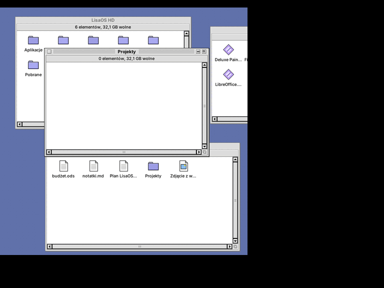

- `NIRVANA_ANIMATIONS=0`: turns animations off (overrides the Appearance panel)
- `NIRVANA_ANIM_MS=200`: slower frames (for testing; 12 ms by default)
- `NIRVANA_ANIM_NOGRAB=1`: no X server grab during the animation (for screenshots)
- `NIRVANA_ANIM_MODE=xor` or `ksztalt` (shape): forces the drawing method
- If FLTK was built with the Wayland backend, animations only work in X11 mode:
  run with `FLTK_BACKEND=x11`.

## Disks, discs and encrypted volumes

A connected USB stick, USB disk, memory card, CD/DVD or data partition appears on the desktop
below Nirvana HD, with an icon that matches the kind of medium:

- **double-click** mounts the disk and opens its window,
- **an encrypted disk (LUKS)** has a padlock icon; double-clicking asks for the password,
  unlocks and mounts it (wrong password: a message and another try),
- **dragging a disk icon to the Trash ejects it** (the Trash turns into an eject symbol,
  as in Mac OS): unmount, LUKS close, disc eject or USB disk power-off; **Eject** in the disk
  icon's context menu (right mouse button, `Ctrl+Y`) does the same,
- files dropped on a disk icon are **copied** to it (the disk mounts itself),
- windows showing a disk close when the disk is ejected or removed,
- sandboxed AppImage applications see the user's mounted media.

Removable media are shown, as well as internal partitions with a file system or LUKS,
unless they are part of the system (mounted as `/`, `/boot`, swap etc.).

Under the hood: detection through `lsblk` (udev), and mounting, unlocking and ejecting through
**UDisks2** over D-Bus (the same service GNOME and KDE use). The LUKS password is passed
directly in the D-Bus call and never ends up in the arguments of any process.
Devuan needs `udisks2` and polkit with elogind; Rocky: `udisks2`, `dbus-devel`.

## Application switcher (gary)

The top-right corner of the menu bar shows the icon and name of the frontmost application,
as in Mac OS 9. Clicking it shows:

- the list of running applications with icons; choosing one brings all its windows to the
  front, hidden applications have a greyed icon,
- **Hide …**, **Hide Others**, **Show All**, **Quit …**,
- the **Rambler Windows** submenu: open folders, collapse/expand/close all.

An application is a group of windows with the same `WM_CLASS`. AppImages started from Rambler
appear under their own name and icon (e.g. "Zegar" instead of "XClock"); the mapping is
remembered in `~/.config/nirvana/aplikacje.klasy`.

**Alt+Tab** (Insight): hold Alt and press Tab to go through the applications starting with the
most recently used; Shift goes back, Escape cancels, releasing Alt chooses.

It works on the EWMH standard (`_NET_CLIENT_LIST`, `_NET_ACTIVE_WINDOW`, `WM_CHANGE_STATE`,
`_NET_CLOSE_WINDOW`), so also under GNOME, KDE or Openbox. Under another window manager the
desktop window does not take focus, so clicking the menu bar does not change the active application.

## Rambler: working with files

- **One window**: opening a folder shows it in the same window. Above the contents there is
  the window's own menu bar (**Window**, **Icons**) and a navigation bar: back, forward,
  parent folder and the location field (`~` = home folder; type a path and press Enter –
  a file path opens its folder with the file selected). Shortcuts: `Alt+←` back, `Alt+→`
  forward, `Ctrl+↑` parent folder. Going up selects the folder you came from.
- **More windows**: **Window > New Window** (`Ctrl+Shift+N`) or `Ctrl` + double-click on a folder.
  Desktop icons (Nirvana HD, disks, Trash) open in the most recently used window.
- **Opening**: double-click or Enter. An AppImage from another folder offers installation.
- **Double-clicking the empty desktop** opens the file manager (the Nirvana HD window); if it
  is already open, it is brought to the front.
- **Desktop icons** have a context menu (right mouse button): Open, Information, Remove from Dock,
  Eject, Format Disk, Empty Trash, Restore (window icons). `Ctrl+O`, `Ctrl+I`, `Ctrl+K`, `Ctrl+Y`
  work on the selected desktop icon. On the empty desktop: Open Nirvana HD, Desktop Appearance.
- **Folder windows do not cover the desktop**: when opened and when zoomed they leave the
  column of icons at the left edge free (Nirvana HD, disks, window icons, the Trash above
  the dock) as well as the dock at the bottom. Zooming other programs does the same.
  Remembered windows that are too large are shrunk to this area when they open.
- **Selecting**: click, Shift/Ctrl+click adds or removes, rubber-band selection with the mouse, `Ctrl+A`.
- **Renaming**: `F2` or a click on the name of an item that is already selected (as in the Finder).
  Renaming a folder updates its open windows and remembered positions.
- **Dragging**: between windows moves, with `Ctrl` copies; onto a folder in a window drops into
  it; onto the Trash icon throws away, onto Nirvana HD moves to the home folder. A missed drop
  "flies" back to its place.
- **From other programs** (XDND, e.g. a browser, another file manager): files are copied
  into the folder they were dropped on; files dropped on the Trash go to the Trash.
- **Icons > Copy / Paste** (`Ctrl+C` / `Ctrl+V`), **Icons > Duplicate** (`Ctrl+D`) creates
  "name copy". Copy also puts `file://` addresses on the system clipboard.
- **Name conflicts** ask whether to replace; a folder cannot be dropped into itself.
- **View**: `Ctrl+1` icons, `Ctrl+2` list (remembered for each window). In the list, a click
  on a header sorts by name, date, size or kind; a second click reverses the order.
  Columns that do not fit are hidden.
- **Automatic refresh** (inotify): changes made elsewhere show up by themselves, the Trash
  icon switches between full and empty.

### Menu bar

On the right, packed against the edge: power, volume, network, the clock and the application
switcher (depth gadget). In the middle, as on the Workbench 3.1 screen title bar, the used
memory and the used space on the disk holding the home folder, each out of the total, e.g.
`512MB used memory of 16GB     40GB used disk of 512GB` (below 1 GB in MB, below 10 GB with one
decimal). The values refresh every 3 seconds, and the tooltip shows the free amounts. On a narrow screen the
text gets shorter.


### Menus (in the spirit of Workbench)

| Menu | Items |
|------|---------|
| **Nirvana** (logo and name) | About This Computer, Preferences (window with panels), Execute Command `Ctrl+E`, Nirvana Shell `Ctrl+T`, Open System Log, Reset Nirvana |
| **System** | Lock Screen, Sleep, Hibernate, Log Out `Ctrl+Q`, Restart, Shut Down |
| **Special** | Format Disk, Empty Trash, Root Mode |

In every file manager window:

| Menu | Items |
|------|---------|
| **Window** | New Window `Ctrl+Shift+N`, New Folder `Ctrl+N`, Back `Alt+←`, Forward `Alt+→`, Open Parent `Ctrl+↑`, Close `Ctrl+W`, Update `Ctrl+R`, Select Contents `Ctrl+A`, Clean Up `Ctrl+.`, Show Hidden Files `Ctrl+H`, View as (icons/list), Sort, Icon Size (small/normal/large) |
| **Icons** | Open `Ctrl+O`, Copy, Paste, Duplicate, Rename `F2`, Delete `Ctrl+Backspace`, Information `Ctrl+I`, Set as Wallpaper, Snapshot `Ctrl+S`, Unsnapshot, Put on Dock `Ctrl+L`, Remove from Dock `Ctrl+K` |

Items that would do nothing at the moment are greyed out, e.g. Eject without a selected disk,
Hibernate when the computer cannot hibernate,
or Back at the start of the history. The System menu asks before logging out,
restarting and shutting down, and refuses to sleep in presentation mode.

- **Icons in windows** can be moved with the mouse within the window. The others stay where
  they are.
- **Snapshot** saves positions permanently (of the selected icons or of the whole window),
  **Unsnapshot** releases them, **Clean Up** puts everything back on the grid. Positions are in
  `~/.config/nirvana/ikony.pozycje`.
- **Icon Size**: small 16 px, normal 32 px, large 64 px (pixels doubled, sharp as on the
  Amiga). The size is remembered for each window.
- **Information**: size (folders are counted), location, creation, modification and access
  dates, owner, permissions. The window can also set:
  - the *Read only* and *Program* flags (execute permission),
  - a comment (`user.xdg.comment`),
  - for programs and AppImages, start arguments ("ToolTypes"), added every time it is started.

  A file with the *Program* flag opens in Nirvana Shell.
- **Dock** (in the style of the Mac OS Control Strip): *Put on Dock* places the icon of a file,
  folder or application on the strip in the bottom-left corner of the screen, *Remove from Dock*
  takes it off (the file stays where it is).
  - Tiles in the scheme colours touch each other and the screen edges.
  - Names appear in tooltips. AppImages have their own icon and a name with the version.
  - A single click opens.
  - The tab on the left collapses the strip, and that state is remembered.

  The list of icons is in `~/.config/nirvana/dok`.

  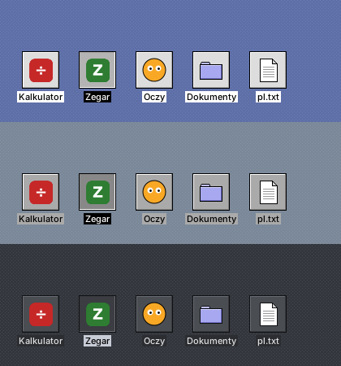
- **Format Disk**: select a disk icon on the desktop and choose FAT32, exFAT, ext4 or NTFS
  (UDisks2). Unformatted USB sticks also appear on the desktop.
- **Reset Nirvana** restarts Insight and Rambler. Program windows stay open.

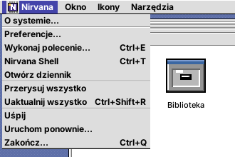
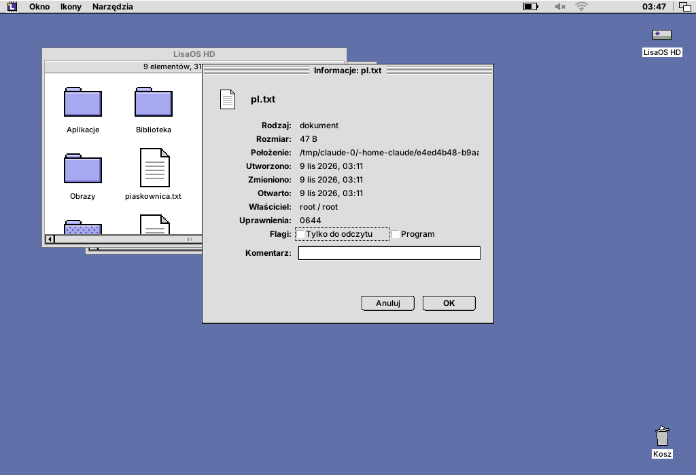

Window positions and view modes: `~/.config/nirvana/denise.okna`.

## Appearance (nirvana-alice panel)

Nirvana logo → **Preferences… → Appearance** opens a panel with the list of colour schemes and a
preview. Clicking a scheme changes the panel itself right away, and **Apply**/**OK** switches
the whole system: Rambler and Insight reload the palette without a restart.

- **Colour scheme**: built-in *Platinum*, *Graphite* (dark) and *Workbench 2* (a nod to the
  Amiga), plus over 40 schemes from
  [Redmond97 SE](https://codeberg.org/Sliver_X/Redmond97-SE) (GPL-3.0).
- **Default look**: the *In Tenebris* scheme, the *Bricks* pattern and Platinum icons.
- **Title bar**: as in the scheme, Platinum stripes, solid colour or gradient.
- **Desktop background**: *Pattern*, *Solid color* or *Gradient*.
  - Colours are picked from two swatches. The second gradient colour is by default a darker
    (or, on a dark background, lighter) version of the first one. *From scheme* returns to the
    scheme colours.
  - Gradient: vertical, horizontal, diagonal or radial. It is dithered (Bayer matrix), so even
    subtle transitions show no banding.
  - 20 patterns in two shades of the desktop colour: plain, dots, polka dots, grid, fine grid,
    checkerboard, diagonal stripes, horizontal and vertical stripes, bricks, raster (Amiga),
    diamonds, crosses, zigzag, herringbone, weave, waves, scales, stars, sand.
  - The wallpaper lies on this background: it shows in the bars with the *Fit* layout, around a
    *Center* image and under transparent parts of PNG files.

  
  

- **Wallpaper**: chosen from the list or with *Other File…* (PNG, JPEG, GIF, BMP, SVG, XPM).
  - The list contains the Nirvana Desktop wallpapers (*Nirvana Desktop*, *Góry o świcie*,
    *Miedź*, *Platyna*), system wallpapers from `/usr/share/backgrounds` and
    `/usr/share/wallpapers`, and images from `~/Pictures` (`~/Obrazy`).
  - Layouts: *Fill screen* (crops), *Fit* (the whole image, pattern in the bars),
    *Stretch*, *Center* and *Tile*.
  - Large photos are scaled down in steps, so there are no jaggies or moiré.
  - In Rambler: select an image and choose **Icons → Set as Wallpaper**.
  - Your own wallpapers can be added to `~/.local/share/nirvana/tapety`.
  - *Nirvana Desktop* (2560×1440, in the spirit of AmigaOS 4) is made by the script
    `tools/tapeta-nirvana-desktop.py [file] [width height]`, so it can be generated at the
    resolution of your own screen.
- **Icon style**: *Workbench (Amiga)*, the default, or *Platinum (Mac OS)*. The change applies
  immediately, also in open windows and on the dock.
  - Workbench: original drawings in the spirit of Workbench 2/3 and MagicWB, in a palette of
    greys, navy and beige with black outlines.
  - Folders are drawers, and documents are "projects" with a folded corner. Programs look like
    a little window with close and depth gadgets.
  - Disks are hard-drive boxes with an LED (Nirvana HD with a navy label), and removable media
    are 3.5" floppies. The Trash has a lid with a handle.
  - A selected icon has inverted colours, like the *complement* mode in Workbench.
  - A sheet with all icons: `tools/plansza-ikon.cxx`.

  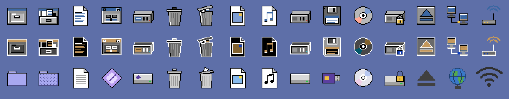
  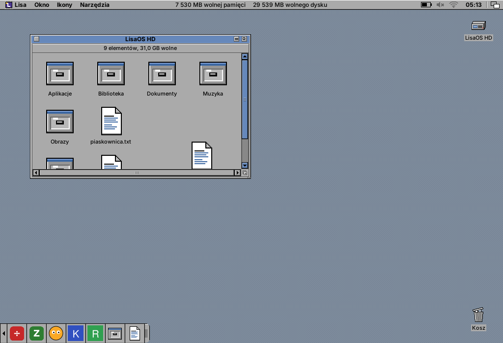
- **Window animations**: on or off.
- **Interface scale**: *Automatic* (from the `Xft.dpi` setting, e.g. 192 dpi = 200%)
  or 100–300%. It scales everything at once: the menu bar, windows, fonts, icons, frames
  and the dock; the wallpaper is rendered at the full screen resolution. After a change the
  desktop and the window manager restart (as with **Special → Reset Nirvana**), open programs
  stay. To try it: `NIRVANA_SKALA=150 nirvana-session`.

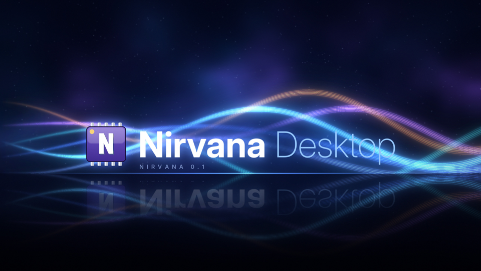


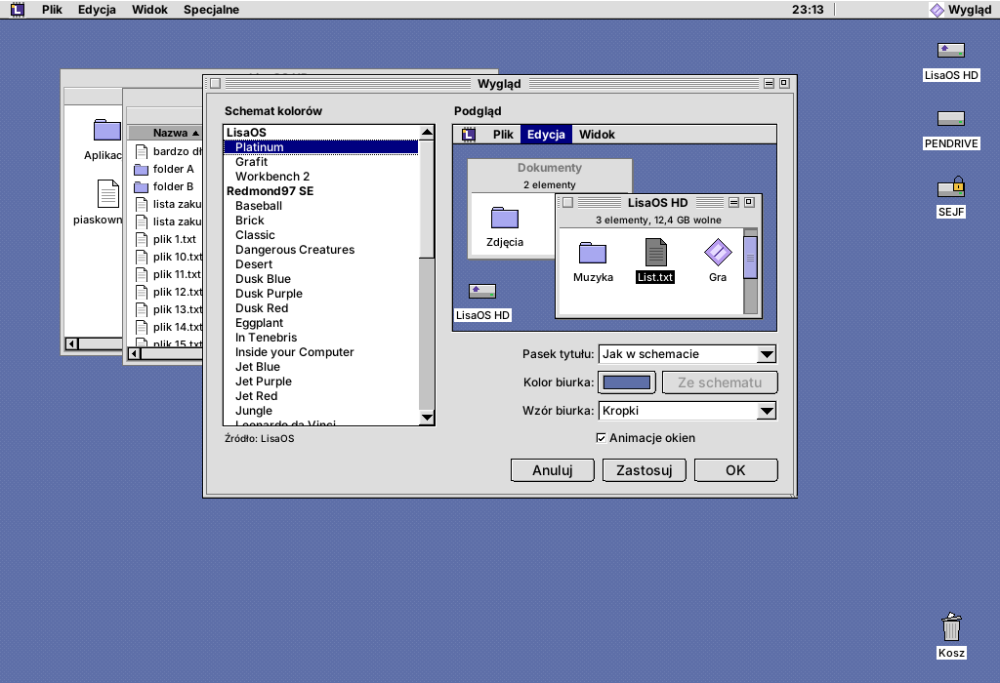
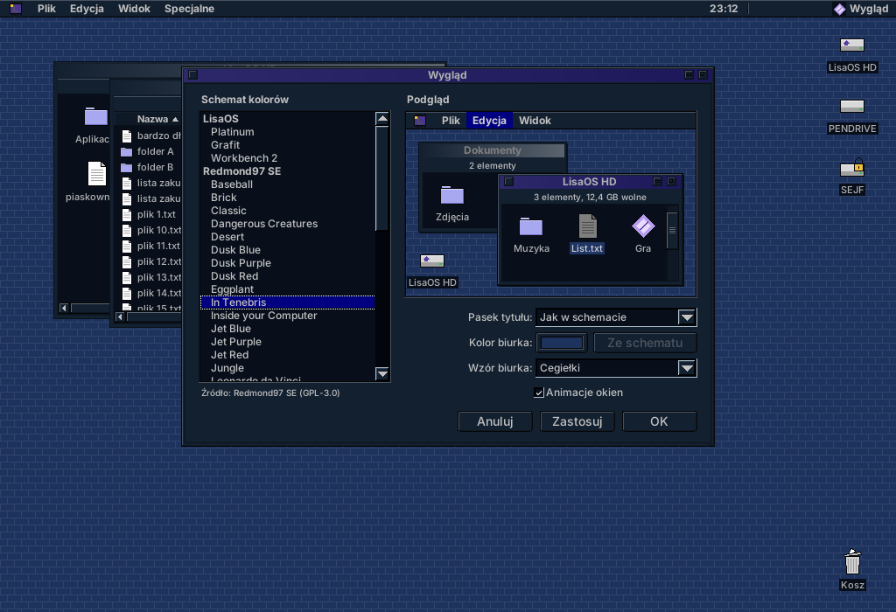

Settings: `~/.config/nirvana/wyglad.conf`. Schemes are simple `key=value` files in the
`schematy/` directory, searched in `~/.local/share/nirvana/schematy`,
`<prefix>/share/nirvana/schematy`, `/usr/local/share/...` and `/usr/share/...` in that order.
To add your own scheme just put it there, e.g. `~/.local/share/nirvana/schematy/mine.conf`
(the keys are Polish):

```ini
nazwa=My scheme              # name
styl_paska=prazki            # title bar: prazki (stripes) | kolor (colour) | gradient
okno=#DDDDDD                 # window background
tekst=#000000                # text
tresc=#FFFFFF                # inside of lists and fields
tekst_tresci=#000000         # text inside lists and fields
zaznaczenie=#4444AA          # selection
tekst_zaznaczenia=#FFFFFF    # selected text
obramowanie=#000000          # border
pasek=#4444AA                # title bar (kolor/gradient style)
pasek2=#8888DD               # second gradient colour
tekst_paska=#FFFFFF          # title bar text
pasek_nieaktywny=#AAAAAA     # inactive title bar
tekst_paska_nieaktywnego=#555555
akcent=#AAAAE6               # scroll bar thumb (optional)
biurko=#5E6FA8               # desktop (optional)
```

The Redmond97 SE schemes can be recreated with `tools/importuj-redmond97.py`
(colours from `builder/presets/theme_*.conf`).

## Network: Wi-Fi, Ethernet, VPN, hotspot

Nirvana Desktop manages the network through NetworkManager (`nmcli` and D-Bus). On Devuan:
the `network-manager` package (works without systemd, with elogind).

- **Menu bar icon**: Wi-Fi signal strength, a wired network symbol, a padlock with an active
  VPN. The menu offers:
  - Wi-Fi networks in range with a padlock and signal bars,
  - connecting and disconnecting the cable,
  - turning Wi-Fi on and off,
  - VPN,
  - airplane mode.
- **Network panel** (logo → Preferences… → Network):
  - every connection with its addresses (IPv4, gateway, DNS, IPv6, MAC, speed),
  - manual or automatic IPv4 settings,
  - the list of Wi-Fi networks: connecting, hidden networks ("Other Network…"), forgetting,
  - hotspot (sharing the internet connection over Wi-Fi),
  - airplane mode.
- **VPN**: importing a configuration file and connecting with one click:
  - WireGuard (`.conf` with `[Interface]`), built into NetworkManager,
  - OpenVPN (`.ovpn`), package `network-manager-openvpn`,
  - Cisco VPNC (`.pcf`), package `network-manager-vpnc`.

  Profiles of other plugins (OpenConnect, L2TP, PPTP, strongSwan…) are listed too and connect
  from the panel. The VPN login and password are asked for when connecting.
- **Passwords** never appear on a command line:
  - Wi-Fi and hotspot go through D-Bus (`AddAndActivateConnection`),
  - VPN goes through a temporary `passwd-file` (0600), deleted right after connecting.
- Enterprise Wi-Fi (WPA Enterprise / 802.1X) is not supported yet: use `nmtui`.

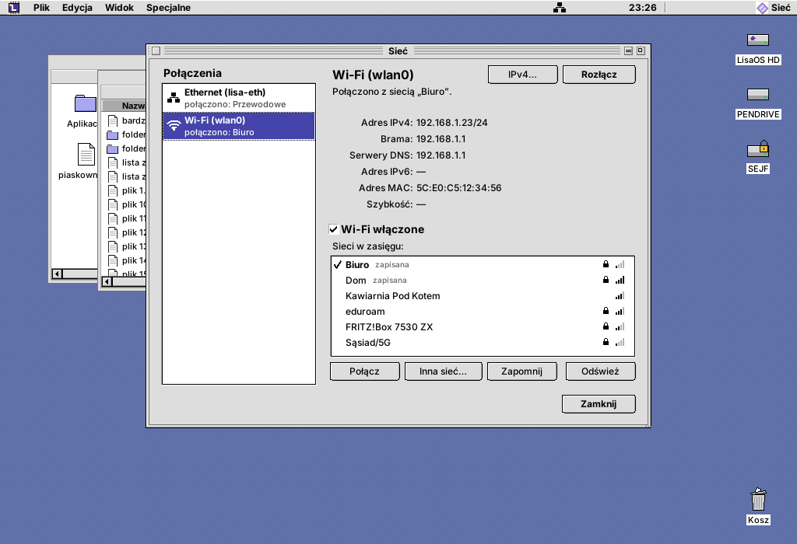
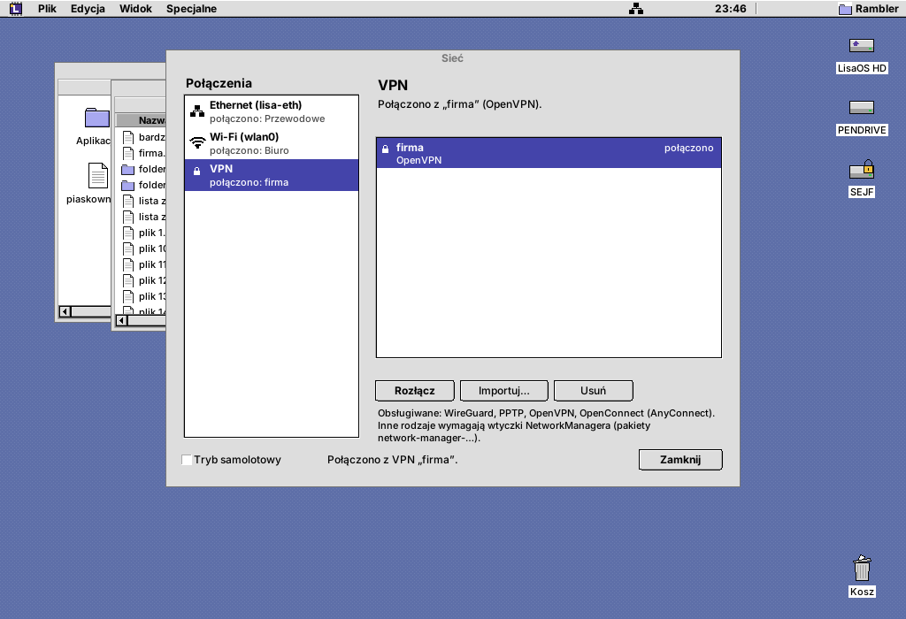

Testing without a Wi-Fi adapter: `NIRVANA_NMCLI=tools/atrapa-nmcli.sh` fakes a `wlan0` adapter
and a few networks (everything else is passed on to the real `nmcli`).

## Nirvana Shell (terminal)

`nirvana-shell` is an xterm-compatible terminal emulator (`TERM=xterm-256color`),
built on the libvterm library (bundled in `third_party/`, MIT; the system one is used
if available). Start it from the logo → Nirvana Shell, in Rambler with `Ctrl+T` (in the
folder of the active window) or with
`nirvana-shell [--katalog DIR] [-e command]`.

- **Display:** 256 colours and truecolor, bold, italic, underline, alternate screen. vim,
  htop, mc and less work in it.
- **Mouse in programs:** supported. Shift + click always selects text.
- **Scrollback:** 5000 lines, scroll bar, mouse wheel, Shift+PgUp/PgDn.
- **Selection and clipboard:**
  - the selection goes straight to the X selection; the middle button pastes,
  - a double click selects a word, a triple click a line,
  - Ctrl+Shift+C copies, Ctrl+Shift+V pastes (bracketed, if the program asks for it).
- **Windows:** Ctrl+Shift+N opens a new one in the same directory, Ctrl+Shift+W closes.
  Before closing a window where something is running, the terminal asks.
- **Look:**
  - a right click opens the menu, with colour profiles: Classic (light), Dark,
    Green phosphor, Amber, Workbench (Amiga), Like the color scheme,
  - Ctrl+Shift+= / - / 0 changes the font size.
- **Settings:** `~/.config/nirvana/terminal.conf` (profile, font, size, columns,
  rows, scrollback).

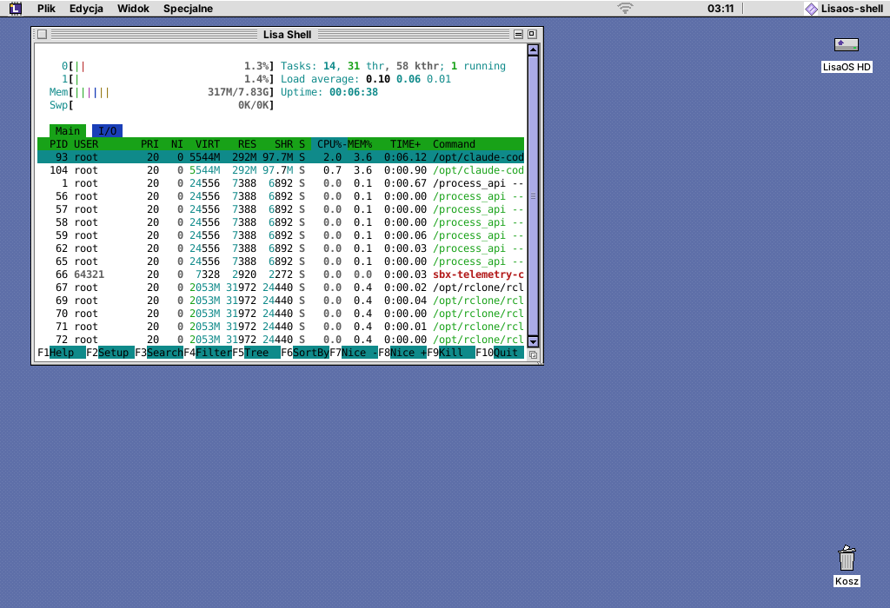

## System tray

Icons of programs running in the background (messengers, cloud, Steam, Discord, nm-applet...)
sit in the menu bar, to the left of the power applet. Rambler supports both protocols:

- **StatusNotifierItem** (D-Bus): Qt 5/6, KDE, Electron, libappindicator / Ayatana.
  - When there is no other one in the session, Rambler itself is
    `org.kde.StatusNotifierWatcher`. Under KDE it registers as an extra host of the existing one.
  - Icons come from the icon theme. If one is missing, it tries the `-symbolic` version and
    ever shorter names, and as a last resort the pixels sent by the program. Symbolic icons
    take the menu bar text colour.
  - A left click is *Activate*, and when the program does not support it, it opens the menu.
    A right click opens the program's menu (dbusmenu: check marks, submenus, separators,
    disabled items) as a Platinum menu. A middle click is *SecondaryActivate*, and the mouse
    wheel is *Scroll*.
  - The tooltip shows the title and description (without HTML). The icon disappears when the
    program sets the *Passive* status.
- **XEmbed** (`_NET_SYSTEM_TRAY_S0`): GTK 2/3 `StatusIcon`, Wine, older programs.
  - The icon window is embedded in the bar on a background in the scheme colour, and clicks go
    straight to the program.
- The bar rearranges itself as icons come and go. When a program quits, its icon disappears.
- After **Reset Nirvana** the icons come back: XEmbed programs dock again after the `MANAGER`
  announcement, and Rambler itself finds the D-Bus icons that are already on the bus.
- `NIRVANA_BEZ_ZASOBNIKA=1` turns the tray off (e.g. when the session has its own).

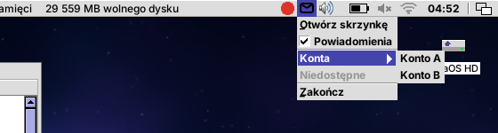

## Sound

A speaker icon in the menu bar. A click opens a small window with:

- output volume and mute, and the choice of output (including the port: speakers or
  headphones). When the output changes, programs that are playing move to the new one,
- microphone volume and mute, and the choice of input,
- the volume of every application that is playing.

The mouse wheel over the icon changes the volume. The multimedia keys (volume, mute,
microphone, brightness) show an OSD bar at the bottom of the screen. Under GNOME/KDE that
desktop handles them.

Works with PulseAudio and PipeWire (`pactl`). Without a sound server it uses plain ALSA
(`amixer`: Master and Capture).

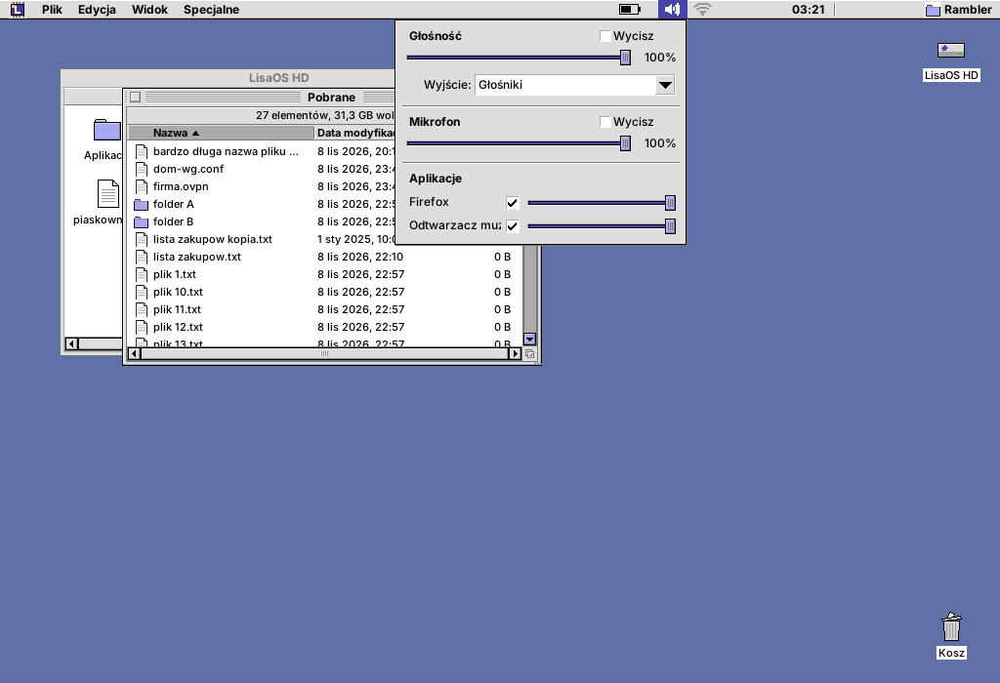

## Power and presentation mode

A battery icon (or a plug on a desktop computer) in the menu bar. The small window shows:

- the battery state with the time until empty or full,
- a screen brightness slider (through logind, without root),
- the power profile, if `power-profiles-daemon` is running,
- a link to the Power panel.

Lock Screen, Sleep, Hibernate, Log Out, Restart and Shut Down are in the **System** menu.
They work through logind; on Devuan through elogind.

**Presentation mode** (a check box in that window) suspends at once:

- screen blanking and DPMS (`XScreenSaverSuspend`), so the screen lock does not start either,
- sleeping: a logind/elogind `idle:sleep` inhibitor,
- blanking and sleeping in GNOME, KDE and Xfce (`org.gnome.SessionManager`,
  `org.freedesktop.ScreenSaver`).

While it is on, a small monitor shows next to the battery icon.

The **Power** panel (logo → Preferences…) sets for the Nirvana Desktop session:

- screen blanking after inactivity,
- locking when the screen blanks,
- sleeping after inactivity, separately on battery and on the power adapter,
- the reaction to 3% battery; a warning appears at 10%.

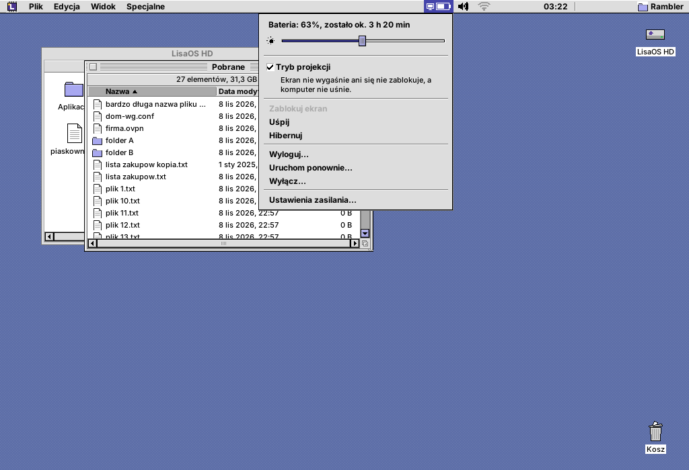

## Languages

The interface is in **English** by default (the texts in the code) and in **Polish**
(`po/pl.po`). *Automatic* in **Preferences** (logo → Preferences…) follows the system
language (`LANGUAGE`, `LC_ALL`, `LC_MESSAGES`, `LANG`): with a Polish locale (`pl_PL.UTF-8`)
the interface is Polish, with any other locale or `LANG=C` it is English. The language can
also be chosen by hand; the choice goes to `~/.config/nirvana/jezyk` and applies after a
restart or **Special → Reset Nirvana**.

In Polish the menus are called *Okno*, *Ikony*, *Narzędzia*, numbers use a decimal comma,
and new folders are `~/Aplikacje/Gry`… – folders that already exist stay in use whatever the
language, so changing it does not split installed applications.

A new language or corrections:

    tools/i18n/pot.py          # po/nirvana.pot from the code + update of po/*.po
    msginit -i po/nirvana.pot -l de -o po/de.po   # a new language
    cmake --build build        # msgfmt --check → build/locale/<lang>/…

In the code: `_("text")`, `N_("…")` in static tables, `P_("Window/Sort")` for menu paths
(each part is translated), `trn(n, "%1 item", "%1 items")` for plurals and
`fmt(_("Delete “%1”?"), name)` instead of gluing sentences together. Nirvana Desktop reads the
`.mo` catalogs itself, so no generated system locales are needed.

## Licence

To be decided (proposed: GPL-3.0-or-later; FLTK is LGPL with an exception that allows
static linking).
libvterm in `third_party/libvterm` (Paul Evans) is under the MIT licence.
The schemes in `schematy/redmond97-se/` come from Redmond97 SE (Sliver X, matthewmx86) and are GPL-3.0.
