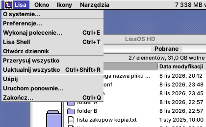
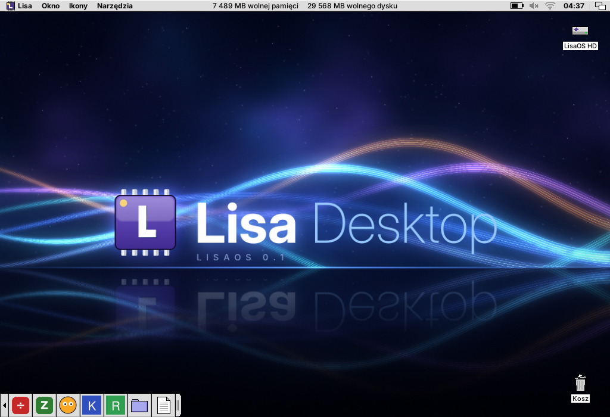

# LisaOS

Lekkie środowisko graficzne dla Linuksa (baza: minimalny Devuan) w duchu
**Mac OS 9 (Platinum)** z nutą **Amigi**. Napisane w C++ i FLTK 1.4.

- **Tryb prosty**: użytkownik widzi tylko swój dysk LisaOS HD (czyli `$HOME`), jak w Androidzie.
  Aplikacje to pliki AppImage leżące w `~/Aplikacje`; instalacja = przeciągnięcie pliku.
- **Tryb root**: pełny system plików i ustawienia zaawansowane, uruchamiany przez
  `pkexec`, wyraźnie oznaczony (czerwony chip w logo, plakietka ROOT).
- **Rambler, przestrzenny menedżer plików** (komponent `lisaos-denise`): jeden folder = jedno okno, które pamięta swoje położenie.

## Komponenty

| Pakiet              | Rola                                   | Stan        |
|---------------------|----------------------------------------|-------------|
| `lisaos-platinum`   | biblioteka wyglądu: kolory, ramki, ikony, chrome okien | prototyp |
| `lisaos-denise`     | Rambler: menedżer plików + biurko        | prototyp    |
| `lisaos-insight`      | menedżer okien X11 (Xorg/XLibre), ramki Platinum | działa (0.1) |
| `lisaos-gary`       | przełącznik aplikacji (na razie w procesie Ramblera) | działa (0.1) |
| `lisaos-alice`      | panele sterowania: Wygląd, Sieć, Zasilanie | działa (0.1) |
| `lisaos-shell`      | Lisa Shell - emulator terminala          | działa (0.1) |
| `lisaos-paula`      | dźwięk                                  | planowany   |
| `lisaos-kickstart`  | logowanie i start sesji                 | planowany   |
| `lisaos-guru`       | okno błędów, tryb root                  | planowany   |

## Budowanie

Zależności (Devuan/Debian):

    sudo apt install build-essential cmake git libx11-dev libxft-dev \
        libxinerama-dev libxcursor-dev libxfixes-dev libxrender-dev \
        squashfs-tools bubblewrap libdbus-1-dev udisks2 policykit-1 \
        network-manager network-manager-openvpn \  # sieć i VPN
        libxss-dev pulseaudio-utils alsa-utils    # aplety dźwięku i zasilania

Opcjonalnie: `power-profiles-daemon` (profile zasilania), `xsecurelock`, `i3lock`
albo `slock` (blokada ekranu). Na Rocky: `libXScrnSaver-devel pulseaudio-utils`.

Jeśli FLTK 1.4 nie jest zainstalowany, CMake sam pobierze i zbuduje wersję 1.4.4:

    cmake -S . -B build -DCMAKE_BUILD_TYPE=Release
    cmake --build build -j

Z własnym FLTK: `-DFLTK_DIR=/ścieżka/do/share/fltk`.

## Uruchamianie

**Pełna sesja** (insight + biurko Ramblera), np. w zagnieżdżonym serwerze X:

    Xephyr :2 -screen 1024x768 &
    DISPLAY=:2 ./session/lisaos-session

Na Devuanie po `sudo cmake --install build`:

    startx /usr/local/bin/lisaos-session

albo wybierz „LisaOS” na ekranie logowania (plik `share/xsessions/lisaos.desktop`).

**Sam Rambler pod innym pulpitem** (np. GNOME na Rocky/RHEL):

    ./build/lisaos-denise --center                  # cały obszar pod paskiem GNOME
    ./build/lisaos-denise --center --size 1024x768  # okno 1024x768 na środku

`--center` (albo zmienna `LISAOS_CENTER=1`) stawia biurko na środku obszaru roboczego,
czyli z ominięciem pasków pulpitu, więc górny pasek GNOME nie zasłania paska menu LisaOS.
Bez `--size` biurko wypełnia cały obszar roboczy. Pozycje okien folderów są zapisywane
względem biurka, więc przesuwają się razem z nim.

Opcje Ramblera: `--root`, `--home KATALOG`, `--size 1024x768`, `--center`.
Czcionkę systemową w stylu Chicago można podać przez `LISAOS_SYSTEM_FONT`
(np. wolny font ChicagoFLF).

## Insight: obsługa okien

- pasek tytułu: przeciąganie przesuwa okno, podwójne kliknięcie je zwija
- przyciski: zamknij (z lewej, uprzejmie przez `WM_DELETE_WINDOW`), zwiń i zoom (z prawej)
- prawa i dolna krawędź ramki oraz prawy dolny róg: zmiana rozmiaru
- klik w okno aplikacji aktywuje je i wyciąga na wierzch; klik w biurko dezaktywuje okna,
  a klik w pasek menu nie zmienia aktywnego okna (menu działa na nie)
- foldery i dialogi Ramblera to zwykłe okna X, więc zachowują się jak każda aplikacja
- okna nie wchodzą pod pasek menu; biurko Ramblera zawsze leży na dole
- bez kompozytora: aplikacje rysują prosto na ekran (mniej pamięci)

## Aplikacje (AppImage)

- **Ikony i nazwy**: Rambler czyta ikonę (`.DirIcon`, PNG lub SVG) prosto z obrazu
  squashfs wewnątrz AppImage, **bez uruchamiania go**. Offset obrazu liczy z nagłówka
  ELF i używa `unsquashfs`.
- **Nazwa z wersją**: `Firefox-128.0.3-x86_64.AppImage` → „Firefox 128.0.3”. Gdy nazwa pliku
  nie ma wersji, Rambler bierze ją z `X-AppImage-Version` w pliku .desktop. Dzięki temu kilka
  wersji tego samego programu da się rozróżnić i mieć zainstalowane jednocześnie.
  Ikony i dane z .desktop są zapamiętywane w `~/.cache/lisaos/ikony`.
- **Instalacja**: otwarcie AppImage spoza folderu Aplikacje (np. z Pobranych) pyta,
  czy zainstalować. Plik trafia do folderu swojej kategorii w `~/Aplikacje`, a jego zawartość
  jest rozpakowywana do `~/.local/share/lisaos/aplikacje/`. Bez FUSE i bez wykonywania
  runtime'u AppImage.
- **Foldery kategorii** według `Categories=` z pliku .desktop wewnątrz AppImage. Folder
  powstaje przy pierwszej aplikacji danego rodzaju.

  | Kategoria | Folder | Kategoria | Folder |
  |-----------|--------|-----------|--------|
  | Game | Gry | Office | Biuro |
  | Graphics | Grafika | Development | Programowanie |
  | AudioVideo, Audio, Video | Multimedia | Education | Edukacja |
  | Network | Internet | Science | Nauka |
  | System, Settings | System | Utility | Akcesoria |

  AppImage bez kategorii trafia do folderu `Inne`. AppImage przeciągnięty prosto do folderu
  Aplikacje też trafia do folderu swojej kategorii. Próba instalacji wersji, która już jest
  zainstalowana, pyta, czy ją zastąpić albo uruchomić.

  
- **Uruchamianie w piaskownicy** (bubblewrap): cały system tylko do odczytu, zapis
  wyłącznie w LisaOS HD, inni użytkownicy, `/root`, `/mnt` i `/media` niewidoczne,
  własny `/tmp` i własna przestrzeń procesów; sama aplikacja jest tylko do odczytu.
  Bez bubblewrap aplikacja startuje normalnie, a dialog instalacji o tym ostrzega.
- **Różne runtime'y**: obraz squashfs jest szukany za nagłówkiem ELF (z weryfikacją
  superbloku), więc działa też z runtime'ami, które dodają wyrównanie. Gdy w środku
  nie ma squashfs (np. DwarFS w „uruntime”), AppImage rozpakowuje się sam przez
  `--appimage-extract`, ale w piaskownicy bez sieci i z zapisem tylko do katalogu
  tymczasowego. Ikona takiej aplikacji pojawia się po instalacji.
- Testowe AppImage: `tools/testowe-appimage.sh KATALOG`. „Zegar” zapisuje
  `~/piaskownica.txt` z tym, co widzi z wnętrza piaskownicy.

## Animacje okien

Jak w klasycznym Mac OS: przy otwieraniu, zamykaniu, zwijaniu i powiększaniu
okien po ekranie przelatują kontury prostokątów („zoom rects”). Foldery w Ramblerze
wylatują z ikony, z której je otwarto, i wracają do niej przy zamknięciu.
Sposób rysowania dobiera się sam:
- **XOR na ekranie**: w sesji LisaOS na Xorg/XLibre bez kompozytora. Najlżejszy.
- **Okno wycięte w kształt konturów** (rozszerzenie X SHAPE): pod XWaylandem
  (np. GNOME na Waylandzie w Rocky/RHEL 10) i na pulpitach z kompozytorem, gdzie
  rysunek na głównym oknie X byłby niewidoczny albo zamalowany.


- `LISAOS_ANIMATIONS=0`: wyłącza animacje (ma pierwszeństwo przed panelem Wygląd)
- `LISAOS_ANIM_MS=200`: wolniejsze klatki (do testów; domyślnie 12 ms)
- `LISAOS_ANIM_NOGRAB=1`: bez blokady serwera X na czas animacji (do zrzutów ekranu)
- `LISAOS_ANIM_MODE=xor` lub `ksztalt`: wymusza sposób rysowania
- Jeśli FLTK zbudowano z backendem Wayland, animacje działają tylko w trybie X11:
  uruchom z `FLTK_BACKEND=x11`.

## Dyski, płyty i zaszyfrowane wolumeny

Podłączony pendrive, dysk USB, karta pamięci, płyta CD/DVD albo partycja z danymi
pojawia się na biurku pod LisaOS HD, z ikoną pasującą do rodzaju nośnika:

- **podwójne kliknięcie** montuje dysk i otwiera jego okno,
- **dysk zaszyfrowany (LUKS)** ma ikonę z kłódką; po podwójnym kliknięciu pyta o hasło,
  odblokowuje i montuje (złe hasło: komunikat i ponowne pytanie),
- **przeciągnięcie ikony dysku do kosza wysuwa go** (kosz zmienia się w symbol
  wysuwania, jak w Mac OS): odmontowanie, zamknięcie LUKS, wysunięcie płyty albo
  wyłączenie dysku USB; to samo robi **Specjalne > Wysuń** (`Ctrl+E`),
- pliki upuszczone na ikonę dysku są **kopiowane** na niego (dysk montuje się sam),
- okna z zawartością dysku zamykają się, gdy dysk zostanie wysunięty lub wyjęty,
- aplikacje AppImage w piaskownicy widzą zamontowane nośniki użytkownika.

Pokazywane są nośniki wymienne oraz partycje wewnętrzne z systemem plików lub LUKS,
o ile nie są częścią systemu (nie są zamontowane jako `/`, `/boot`, swap itd.).

Pod spodem: wykrywanie przez `lsblk` (udev), a montowanie, odblokowywanie i wysuwanie
przez **UDisks2** po D-Bus (ta sama usługa, której używają GNOME i KDE). Hasło LUKS jest
przekazywane bezpośrednio w wywołaniu D-Bus i nie trafia do argumentów żadnego procesu.
Na Devuanie potrzebne są `udisks2` i polkit z elogind; na Rocky: `udisks2`, `dbus-devel`.

## Przełącznik aplikacji (gary)

Prawy górny róg paska menu pokazuje ikonę i nazwę aplikacji na pierwszym planie,
jak w Mac OS 9. Po kliknięciu:

- lista uruchomionych aplikacji z ikonami; wybór wyciąga wszystkie jej okna na wierzch,
  ukryte aplikacje mają wyszarzoną ikonę,
- **Ukryj …**, **Ukryj inne**, **Pokaż wszystkie**, **Zakończ …**,
- podmenu **Okna Ramblera**: otwarte foldery, zwiń/rozwiń/zamknij wszystkie.

Aplikacja to grupa okien o tej samej klasie `WM_CLASS`. AppImage uruchomione z Ramblera
pojawiają się pod swoją nazwą i ikoną (np. „Zegar” zamiast „XClock”); przypisanie jest
zapamiętywane w `~/.config/lisaos/aplikacje.klasy`.

**Alt+Tab** (Insight): przytrzymaj Alt i naciskaj Tab, żeby przechodzić po aplikacjach
od ostatnio używanej; Shift cofa, Escape przerywa, puszczenie Alt wybiera.

Działa na standardzie EWMH (`_NET_CLIENT_LIST`, `_NET_ACTIVE_WINDOW`, `WM_CHANGE_STATE`,
`_NET_CLOSE_WINDOW`), więc także pod GNOME, KDE czy Openboksem. Pod obcym menedżerem
okno biurka nie przyjmuje fokusu, żeby klik w pasek menu nie zmieniał aktywnej aplikacji.

## Rambler: praca z plikami

- **Otwieranie**: podwójne kliknięcie lub Enter. AppImage z innego folderu proponuje instalację.
- **Zaznaczanie**: klik, Shift/Ctrl+klik dodaje lub odejmuje, ramka zaznaczania myszą, `Ctrl+A`.
- **Zmiana nazwy**: `F2` albo klik w nazwę już zaznaczonego elementu (jak w Finderze).
  Zmiana nazwy folderu aktualizuje jego otwarte okna i zapamiętane pozycje.
- **Przeciąganie**: między oknami przenosi, z `Ctrl` kopiuje; na folder w oknie wrzuca do
  środka; na ikonę Kosza wyrzuca, na LisaOS HD przenosi do katalogu domowego. Nietrafione
  upuszczenie „odlatuje” z powrotem na miejsce.
- **Z innych programów** (XDND, np. przeglądarka, inny menedżer plików): pliki są kopiowane
  do folderu, na którym je upuszczono; upuszczone na Kosz trafiają do kosza.
- **Ikony > Kopiuj / Wklej** (`Ctrl+C` / `Ctrl+V`), **Ikony > Duplikuj** (`Ctrl+D`) tworzy
  „nazwa kopia”. Kopiuj zapisuje też adresy `file://` w schowku systemowym.
- **Konflikty nazw** pytają o zastąpienie; folderu nie da się wrzucić w niego samego.
- **Widok**: `Ctrl+1` ikony, `Ctrl+2` lista (zapamiętywane dla każdego okna). W liście klik
  w nagłówek sortuje po nazwie, dacie, rozmiarze lub rodzaju; drugi klik odwraca kolejność.
  Kolumny, które się nie mieszczą, są chowane.
- **Automatyczne odświeżanie** (inotify): zmiany z zewnątrz pojawiają się same, ikona kosza
  zmienia się na pełny/pusty.

### Pasek menu

Po prawej, ciasno przy krawędzi: zasilanie, głośność, sieć, zegar i przełącznik aplikacji
(gadżet głębi). Na środku, jak na pasku ekranu Workbencha 3.1, widać wolną pamięć
(`MemAvailable`) i wolne miejsce na dysku z katalogiem domowym. Wartości odświeżają się co
3 sekundy, a podpowiedź pokazuje też całkowite rozmiary. Na wąskim ekranie napis się skraca.


### Menu (w duchu Workbencha)

| Menu | Pozycje |
|------|---------|
| **Lisa** (logo i napis) | O systemie, Preferencje (okno z panelami), Wykonaj polecenie `Ctrl+E`, Lisa Shell `Ctrl+T`, Otwórz dziennik, Przerysuj wszystko, Uaktualnij wszystko `Ctrl+Shift+R`, Uśpij, Uruchom ponownie, Zakończ `Ctrl+Q` |
| **Okno** | Nowy folder `Ctrl+N`, Otwórz katalog nadrzędny `Ctrl+↑`, Zamknij `Ctrl+W`, Uaktualnij `Ctrl+R`, Zaznacz zawartość `Ctrl+A`, Uporządkuj `Ctrl+.`, Pokaż ukryte pliki `Ctrl+H`, Pokaż jako (ikony/listę), Sortuj, Wielkość ikon (małe/normalne/duże) |
| **Ikony** | Otwórz `Ctrl+O`, Kopiuj, Wklej, Duplikuj, Zmień nazwę `F2`, Usuń `Ctrl+Backspace`, Informacje `Ctrl+I`, Zamroź `Ctrl+S`, Odmroź, Połóż na doku `Ctrl+L`, Zdejmij z doku `Ctrl+K`, Wysuń `Ctrl+Y` |
| **Narzędzia** | Formatuj dysk, Opróżnij kosz, Tryb root, Resetuj LISA |

Pozycje, które w danej chwili nic by nie zrobiły, są wyszarzone, np. Wysuń bez zaznaczonego dysku.

- **Ikony w oknach** można przestawiać myszą w obrębie okna. Pozostałe zostają na swoich
  miejscach.
- **Zamroź** zapisuje pozycje na stałe (zaznaczonych ikon albo całego okna), **Odmroź** je
  zwalnia, **Uporządkuj** ustawia wszystko z powrotem w siatce. Pozycje są w
  `~/.config/lisaos/ikony.pozycje`.
- **Wielkość ikon**: małe 16 px, normalne 32 px, duże 64 px (piksele powiększone 2×, ostre jak
  na Amidze). Wielkość jest zapamiętywana dla każdego okna.
- **Informacje**: rozmiar (foldery liczone), położenie, daty utworzenia, zmiany i otwarcia,
  właściciel, uprawnienia. W oknie można też ustawić:
  - flagi *Tylko do odczytu* i *Program* (prawo uruchamiania),
  - komentarz (`user.xdg.comment`),
  - dla programów i AppImage parametry uruchamiania („ToolTypes”), dodawane przy każdym
    uruchomieniu.

  Plik z flagą *Program* otwiera się w Lisa Shell.
- **Dok** (w stylu Control Strip z Mac OS): *Połóż na doku* wystawia ikonę pliku, folderu
  albo aplikacji na pasek w lewym dolnym rogu ekranu, *Zdejmij z doku* ją chowa (plik zostaje
  na miejscu).
  - Kafelki w kolorach schematu przylegają do siebie i do krawędzi ekranu.
  - Nazwy pokazują się w podpowiedziach. AppImage mają swoją ikonę i nazwę z wersją.
  - Jedno kliknięcie otwiera.
  - Zakładka po lewej zwija pasek, a stan jest zapamiętywany.

  Lista ikon jest w `~/.config/lisaos/dok`.

  
- **Formatuj dysk**: zaznacz ikonę dysku na biurku i wybierz FAT32, exFAT, ext4 albo NTFS
  (UDisks2). Niesformatowane pendrive'y też pojawiają się na biurku.
- **Resetuj LISA** uruchamia Insighta i Ramblera od nowa. Okna programów zostają.




Pozycje i tryb widoku okien: `~/.config/lisaos/denise.okna`.

## Wygląd (panel lisaos-alice)

Logo LisaOS → **Panele sterowania → Wygląd…** otwiera panel z listą schematów
kolorów i podglądem. Klik na schemacie zmienia od razu sam panel, a **Zastosuj**/**OK**
przestawia cały system: Rambler i Insight przeładowują paletę bez restartu.

- **Schemat kolorów**: wbudowane *Platinum*, *Grafit* (ciemny) i *Workbench 2*
  (ukłon w stronę Amigi) oraz ponad 40 schematów z
  [Redmond97 SE](https://codeberg.org/Sliver_X/Redmond97-SE) (GPL-3.0).
- **Pasek tytułu**: jak w schemacie, prążki Platinum, jednolity kolor albo gradient.
- **Tło biurka**: *Wzór*, *Jednolity kolor* albo *Gradient*.
  - Kolory wybiera się z dwóch próbek. Drugi kolor gradientu domyślnie jest ciemniejszą
    (albo, na ciemnym tle, jaśniejszą) wersją pierwszego. *Ze schematu* wraca do kolorów
    schematu.
  - Gradient: pionowy, poziomy, ukośny albo promienisty. Ma dithering (macierz Bayera),
    więc nawet przy subtelnych przejściach nie widać pasów.
  - 20 wzorów w dwóch odcieniach koloru biurka: gładki, kropki, groszki, krata, drobna
    kratka, szachownica, ukośne prążki, paski poziome i pionowe, cegiełki, raster (Amiga),
    romby, krzyżyki, zygzak, jodełka, tkanina, fale, łuski, gwiazdki, piasek.
  - Tapeta leży na tym tle: widać je w pasach przy układzie *Dopasuj*, wokół obrazu
    *Na środku* i pod przezroczystymi fragmentami PNG.

  
  

- **Tapeta**: wybierana z listy albo przez *Inny plik…* (PNG, JPEG, GIF, BMP, SVG, XPM).
  - Lista zawiera tapety LisaOS (*Lisa Desktop*, *Góry o świcie*, *Miedź*, *Platyna*), tapety systemowe
    z `/usr/share/backgrounds` i `/usr/share/wallpapers` oraz obrazy z `~/Obrazy`.
  - Układy: *Wypełnij ekran* (przycina), *Dopasuj* (cały obraz, wzór w pasach),
    *Rozciągnij*, *Na środku* i *Sąsiadująco*.
  - Duże zdjęcia są zmniejszane stopniowo, więc nie powstają schodki ani mora.
  - Pod przezroczystymi fragmentami PNG widać wzór biurka.
  - W Ramblerze: zaznacz obraz i wybierz **Ikony → Ustaw jako tapetę**.
  - Własne tapety można dodać do `~/.local/share/lisaos/tapety`.
- **Animacje okien**: włączone lub wyłączone.

  - *Lisa Desktop* (2560×1440, w duchu AmigaOS 4) powstaje ze skryptu
    `tools/tapeta-lisa-desktop.py [plik] [szerokość wysokość]`. Można ją wygenerować
    w rozdzielczości własnego ekranu.




Ustawienia: `~/.config/lisaos/wyglad.conf`. Schematy to proste pliki `klucz=wartość`
w katalogu `schematy/`, szukane kolejno w `~/.local/share/lisaos/schematy`,
`<prefiks>/share/lisaos/schematy`, `/usr/local/share/...` i `/usr/share/...`.
Własny schemat wystarczy tam wrzucić, np. `~/.local/share/lisaos/schematy/moj.conf`:

```ini
nazwa=Mój schemat
styl_paska=prazki        # prazki | kolor | gradient
okno=#DDDDDD             # tło okien
tekst=#000000
tresc=#FFFFFF            # wnętrze list i pól
tekst_tresci=#000000
zaznaczenie=#4444AA
tekst_zaznaczenia=#FFFFFF
obramowanie=#000000
pasek=#4444AA            # pasek tytułu (styl kolor/gradient)
pasek2=#8888DD           # drugi kolor gradientu
tekst_paska=#FFFFFF
pasek_nieaktywny=#AAAAAA
tekst_paska_nieaktywnego=#555555
akcent=#AAAAE6           # suwak przewijania (opcjonalnie)
biurko=#5E6FA8           # opcjonalnie
```

Schematy Redmond97 SE odtworzysz skryptem `tools/importuj-redmond97.py`
(kolory z `builder/presets/theme_*.conf`).

## Sieć: Wi-Fi, Ethernet, VPN, hotspot

LisaOS zarządza siecią przez NetworkManagera (`nmcli` i D-Bus). Na Devuanie: pakiet
`network-manager` (działa bez systemd, z elogind).

- **Ikona na pasku menu**: siła sygnału Wi-Fi, symbol sieci przewodowej, kłódka przy
  aktywnym VPN. Menu po kliknięciu:
  - sieci Wi-Fi w zasięgu z kłódką i kreskami sygnału,
  - połącz i rozłącz kabel,
  - włącz i wyłącz Wi-Fi,
  - VPN,
  - tryb samolotowy.
- **Panel Sieć** (logo → Panele sterowania → Sieć…):
  - każde połączenie z adresami (IPv4, brama, DNS, IPv6, MAC, szybkość),
  - ręczne lub automatyczne ustawienia IPv4,
  - lista sieci Wi-Fi: łączenie, sieci ukryte („Inna sieć…”), zapominanie,
  - hotspot (udostępnianie internetu przez Wi-Fi),
  - tryb samolotowy.
- **VPN**: import pliku konfiguracji i łączenie jednym kliknięciem:
  - WireGuard (`.conf` z `[Interface]`), wbudowany w NetworkManagera,
  - OpenVPN (`.ovpn`), pakiet `network-manager-openvpn`,
  - Cisco VPNC (`.pcf`), pakiet `network-manager-vpnc`.

  Profile innych wtyczek (OpenConnect, L2TP, PPTP, strongSwan…) też są na liście i łączą
  się z panelu. Login i hasło VPN pytane są przy łączeniu.
- **Hasła** nie trafiają do linii poleceń:
  - Wi-Fi i hotspot idą przez D-Bus (`AddAndActivateConnection`),
  - VPN idzie przez tymczasowy plik `passwd-file` (0600), usuwany zaraz po połączeniu.
- Sieci firmowe Wi-Fi (WPA Enterprise / 802.1X) jeszcze nie: `nmtui`.


Testy bez karty Wi-Fi: `LISAOS_NMCLI=tools/atrapa-nmcli.sh` udaje kartę `wlan0` i kilka
sieci (resztę przekazuje do prawdziwego `nmcli`).

## Lisa Shell (terminal)

`lisaos-shell` to emulator terminala zgodny z xterm (`TERM=xterm-256color`),
zbudowany na bibliotece libvterm (dołączona w `third_party/`, MIT; systemowa
jest używana, jeśli jest). Uruchamianie: logo → Lisa Shell, w Ramblerze
Plik → Otwórz w Lisa Shell (Ctrl+T, w folderze aktywnego okna) albo
`lisaos-shell [--katalog DIR] [-e polecenie]`.

- **Wyświetlanie:** 256 kolorów i truecolor, pogrubienie, kursywa, podkreślenie, ekran
  alternatywny. Działają w nim vim, htop, mc, less.
- **Mysz w programach:** obsługiwana. Shift + klik zawsze zaznacza tekst.
- **Przewijanie wstecz:** 5000 wierszy, pasek przewijania, kółko myszy,
  Shift+PgUp/PgDn.
- **Zaznaczanie i schowek:**
  - zaznaczenie trafia od razu do schowka X; środkowy klawisz wkleja,
  - podwójny klik zaznacza słowo, potrójny wiersz,
  - Ctrl+Shift+C kopiuje, Ctrl+Shift+V wkleja (w nawiasach, jeśli program o to prosi).
- **Okna:** Ctrl+Shift+N otwiera nowe w tym samym katalogu, Ctrl+Shift+W zamyka.
  Przed zamknięciem okna, w którym coś działa, terminal pyta.
- **Wygląd:**
  - prawy klik otwiera menu, a w nim profile kolorów: Klasyczny (jasny), Ciemny,
    Zielony fosfor, Bursztynowy, Workbench (Amiga), Jak schemat kolorów,
  - Ctrl+Shift+= / - / 0 zmienia rozmiar czcionki.
- **Ustawienia:** `~/.config/lisaos/terminal.conf` (profil, czcionka, rozmiar, kolumny,
  wiersze, przewijanie).


## Zasobnik systemowy

Ikony programów działających w tle (komunikatory, chmura, Steam, Discord, nm-applet...)
stoją na pasku menu, na lewo od apletu zasilania. Rambler obsługuje oba protokoły:

- **StatusNotifierItem** (D-Bus): Qt 5/6, KDE, Electron, libappindicator / Ayatana.
  - Gdy w sesji nie ma innego, Rambler sam jest `org.kde.StatusNotifierWatcher`. Pod KDE
    zgłasza się jako dodatkowy host istniejącego.
  - Ikony bierze z motywu ikon. Jeśli jakiejś nie ma, próbuje wersji `-symbolic` i coraz
    krótszej nazwy, a w ostateczności pikseli przysłanych przez program. Ikony symboliczne
    mają kolor tekstu paska.
  - Lewy klik to *Activate*, a gdy program go nie obsługuje, otwiera menu. Prawy klik
    otwiera menu programu (dbusmenu: zaznaczenia, podmenu, separatory, nieaktywne pozycje)
    jako menu Platinum. Środkowy klik to *SecondaryActivate*, a kółko myszy to *Scroll*.
  - Podpowiedź pokazuje tytuł i opis (bez HTML-a). Ikona znika, gdy program ustawi status
    *Passive*.
- **XEmbed** (`_NET_SYSTEM_TRAY_S0`): GTK 2/3 `StatusIcon`, Wine, starsze programy.
  - Okienko ikony jest osadzane w pasku na tle w kolorze schematu, a kliknięcia trafiają
    prosto do programu.
- Pasek przestawia się sam, gdy ikon przybywa albo ubywa. Po zakończeniu programu jego
  ikona znika.
- Po **Resetuj LISA** ikony wracają: programy XEmbed dokują się ponownie po ogłoszeniu
  `MANAGER`, a Rambler sam odnajduje ikony D-Bus, które już są na szynie.
- `LISAOS_BEZ_ZASOBNIKA=1` wyłącza zasobnik (np. gdy sesja ma własny).


## Dźwięk

Ikona głośnika na pasku menu. Kliknięcie otwiera okienko z:

- głośnością i wyciszeniem wyjścia oraz wyborem wyjścia (także portu: głośniki
  albo słuchawki). Przy zmianie wyjścia grające programy przechodzą na nowe,
- głośnością i wyciszeniem mikrofonu oraz wyborem wejścia,
- głośnością każdej grającej aplikacji.

Kółko myszy nad ikoną zmienia głośność. Klawisze multimedialne (głośność, wyciszenie,
mikrofon, jasność) pokazują pasek OSD na dole ekranu. Pod GNOME/KDE obsługuje je
tamto środowisko.

Działa z PulseAudio i PipeWire (`pactl`). Bez serwera dźwięku używa czystej ALSA
(`amixer`: Master i Capture).


## Zasilanie i tryb projekcji

Ikona baterii (albo wtyczki w komputerze stacjonarnym) na pasku menu. W okienku:

- stan baterii z czasem do rozładowania lub naładowania,
- suwak jasności ekranu (przez logind, bez roota),
- profil zasilania, jeśli działa `power-profiles-daemon`,
- akcje: Zablokuj ekran, Uśpij, Hibernuj, Wyloguj, Uruchom ponownie, Wyłącz.
  Działają przez logind; na Devuanie przez elogind.

**Tryb projekcji** (pole w tym okienku) wstrzymuje naraz:

- wygaszanie ekranu i DPMS (`XScreenSaverSuspend`), więc nie uruchamia się też
  blokada ekranu,
- usypianie: blokada logind/elogind `idle:sleep`,
- wygaszanie i usypianie w GNOME, KDE i Xfce (`org.gnome.SessionManager`,
  `org.freedesktop.ScreenSaver`).

Gdy tryb jest włączony, przy ikonie baterii widać mały monitor.

Panel **Zasilanie** (logo → Panele sterowania) ustawia dla sesji LisaOS:

- wygaszanie ekranu po bezczynności,
- blokadę przy wygaszeniu,
- usypianie po bezczynności, osobno na baterii i z zasilacza,
- reakcję na 3% baterii; przy 10% pojawia się ostrzeżenie.


## Licencja

Do ustalenia (proponowana: GPL-3.0-or-later; FLTK jest na LGPL z wyjątkiem
pozwalającym na linkowanie statyczne).
libvterm w `third_party/libvterm` (Paul Evans) jest na licencji MIT.
Schematy w `schematy/redmond97-se/` pochodzą z Redmond97 SE (Sliver X, matthewmx86) i są na GPL-3.0.
