# Nirvana Desktop

*[English version: README.md](README.md)*

Lekkie środowisko graficzne dla Linuksa (baza: minimalny Devuan) w duchu
**klasycznych pulpitów lat 90.**: szare okna z fazowaniem, pasek menu u góry i ikony na biurku.
Napisane w C++ i FLTK 1.4.

- **Tryb prosty**: użytkownik widzi tylko swój dysk Nirvana HD (czyli `$HOME`), jak w Androidzie.
  Aplikacje to pliki AppImage w ukrytym `~/.nirvana-apps`, otwieranym ikoną **Aplikacje**
  na biurku; instalacja = otwarcie albo przeciągnięcie pliku.
- **Rambler, menedżer plików** (komponent `nirvana-denise`): jedno okno, w którym przechodzi się
  między folderami (wstecz, dalej, folder nadrzędny, pole położenia), z własnym menu Okno i Ikony.

> **Ustawienia ze starszych wersji** (polskie nazwy plików i kluczy do 0.0.6) są przenoszone
> na obecne, angielskie przy pierwszym starcie nowszej wersji.

## Komponenty

| Pakiet              | Rola                                   | Stan        |
|---------------------|----------------------------------------|-------------|
| `nirvana-platinum`   | biblioteka wyglądu: kolory, ramki, ikony, chrome okien | prototyp |
| `nirvana-denise`     | Rambler: menedżer plików + biurko        | prototyp    |
| `nirvana-insight`      | menedżer okien X11 (Xorg/XLibre), ramki Platinum | działa |
| `nirvana-gary`       | przełącznik aplikacji (na razie w procesie Ramblera) | działa |
| `nirvana-alice`      | panele sterowania: Wygląd, Sieć, Zasilanie, Shader | działa |
| `nirvana-shader`     | pełnoekranowe efekty GLSL (mały kompozytor) | działa |
| `nirvana-shell`      | Nirvana Shell - emulator terminala          | działa |
| `nirvana-paula`      | dźwięk                                  | planowany   |
| `nirvana-kickstart`  | logowanie i start sesji                 | planowany   |
| `nirvana-guru`       | okno błędów                             | planowany   |

## Instalacja na Devuanie 6 „Excalibur” (Debian 13)

Rozpakuj źródła i uruchom instalator:

    tar xzf nirvana-desktop-0.0.14.tar.gz && cd nirvana-desktop
    sudo ./install.sh                 # albo: sudo ./install.sh --login-screen

Instalator:

1. doinstalowuje narzędzia i biblioteki do budowania (apt),
2. buduje Nirvana Desktop (za pierwszym razem pobiera FLTK 1.4 z GitHuba – potrzebny internet),
3. tworzy paczkę `build-deb/nirvana_<wersja>_amd64.deb` i instaluje ją przez apt –
   razem z programami, z których Nirvana Desktop korzysta: NetworkManager, udisks2, polkit
   z agentem `lxpolkit`, PulseAudio/PipeWire, bubblewrap, xsecurelock…
4. dokłada serwer X, jeśli go nie ma, i proponuje PipeWire, jeśli nie ma dźwięku.

Numer wersji jest w pliku `VERSION` i rośnie z każdą wydaną paczką. Instalator z nowszej paczki
podmienia zainstalowaną wersję.

Opcje:

| opcja | co robi |
|---|---|
| `--login-screen` | instaluje LightDM i ustawia Nirvana Desktop jako domyślną sesję |
| `--xinitrc` | zapisuje `~/.xinitrc` z `exec nirvana-session` (wtedy wystarczy `startx`) |
| `--package-only` | tylko buduje `.deb` (np. na innym komputerze: `sudo apt install ./nirvana_*.deb`) |
| `--no-x` | nie instaluje serwera X |
| `--yes` | bez pytań |
| `--uninstall` | `apt remove nirvana`; ustawienia w katalogu domowym zostają |

Instalator i jego komunikaty są po angielsku.

Po instalacji wybierz sesję **Nirvana Desktop** na ekranie logowania albo uruchom
`startx /usr/bin/nirvana-session` z konsoli. Sesja sama uruchamia magistralę D-Bus
(`dbus-run-session`), programy z autostartu XDG (`nirvana-autostart`, np. PipeWire)
i agenta polkit. Aplet `nm-applet` jest pomijany – Nirvana Desktop ma własne menu sieci
(`NIRVANA_NM_APPLET=1` go przywraca).

Jeśli karty sieciowe są opisane w `/etc/network/interfaces`, NetworkManager ich
nie obsłuży – instalator o tym przypomina; zostaw tam tylko `lo`.

## Budowanie

Zależności (Devuan/Debian):

    sudo apt install build-essential cmake git libx11-dev libxft-dev \
        libxinerama-dev libxcursor-dev libxfixes-dev libxrender-dev \
        squashfs-tools bubblewrap libdbus-1-dev udisks2 policykit-1 \
        network-manager network-manager-openvpn \  # sieć i VPN
        libxss-dev pulseaudio-utils alsa-utils \ # aplety dźwięku i zasilania
        gettext \                                 # tłumaczenia (msgfmt)
        libgl-dev libxcomposite-dev libxdamage-dev # nirvana-shader (efekty pełnoekranowe)

Opcjonalnie: `power-profiles-daemon` (profile zasilania), `xsecurelock`, `i3lock`
albo `slock` (blokada ekranu). Na Rocky: `libXScrnSaver-devel pulseaudio-utils`.

Jeśli FLTK 1.4 nie jest zainstalowany, CMake sam pobierze i zbuduje wersję 1.4.4:

    cmake -S . -B build -DCMAKE_BUILD_TYPE=Release
    cmake --build build -j

Z własnym FLTK: `-DFLTK_DIR=/ścieżka/do/share/fltk`.

## Uruchamianie

**Pełna sesja** (insight + biurko Ramblera), np. w zagnieżdżonym serwerze X:

    Xephyr :2 -screen 1024x768 &
    DISPLAY=:2 ./session/nirvana-session

Po instalacji (patrz wyżej): `startx /usr/bin/nirvana-session` albo sesja „Nirvana Desktop”
na ekranie logowania (plik `/usr/share/xsessions/nirvana.desktop`).

**Sam Rambler pod innym pulpitem** (np. GNOME na Rocky/RHEL):

    ./build/nirvana-denise --center                  # cały obszar pod paskiem GNOME
    ./build/nirvana-denise --center --size 1024x768  # okno 1024x768 na środku

`--center` (albo zmienna `NIRVANA_CENTER=1`) stawia biurko na środku obszaru roboczego,
czyli z ominięciem pasków pulpitu, więc górny pasek GNOME nie zasłania paska menu Nirvana Desktop.
Bez `--size` biurko wypełnia cały obszar roboczy. Pozycje okien folderów są zapisywane
względem biurka, więc przesuwają się razem z nim.

Opcje Ramblera: `--home KATALOG`, `--size 1024x768`, `--center`.
Inną czcionkę systemową (np. wolną, w stylu bitmapowym) można podać przez `NIRVANA_SYSTEM_FONT`.

## Insight: obsługa okien

- pasek tytułu: przeciąganie przesuwa okno, podwójne kliknięcie je ikonizuje
- przyciski: zamknij (z lewej, uprzejmie przez `WM_DELETE_WINDOW`), ikonizuj i zoom (z prawej),
  w kolorach schematu, z kontrastową obwódką i symbolami wypełnionymi kolorem akcentu
  (w stylu gadżetów okien starych komputerów domowych), widoczne także w oknach nieaktywnych
- **ikonizacja na biurko:** okno znika, a na biurku (w lewej kolumnie, pod
  dyskami) pojawia się jego ikona – obrazek programu z `_NET_WM_ICON` i tytuł okna na żółtym
  tle, więc zminimalizowane okna odróżniają się od dysków i plików. Dwuklik w ikonę przywraca okno. Tak samo działa „minimalizuj” w samym programie
  (np. w przeglądarce); „Ukryj” z menu aplikacji chowa okna bez ikon. Ikony przetrwają
  Resetuj Nirvanę.
- **okna bez dekoracji** (`_MOTIF_WM_HINTS` bez dekoracji – odtwarzacze ze skórkami, np. qmmp
  czy Audacious, programy z własnym paskiem tytułu) nie dostają ramki: rysują się i przesuwają
  same, a Insight dba tylko o fokus, kolejność, ikonizację i obszar roboczy
- prawa i dolna krawędź ramki oraz prawy dolny róg: zmiana rozmiaru
- klik w okno aplikacji aktywuje je i wyciąga na wierzch; klik w biurko dezaktywuje okna,
  a klik w pasek menu nie zmienia aktywnego okna (menu działa na nie)
- foldery i dialogi Ramblera to zwykłe okna X, więc zachowują się jak każda aplikacja
- okna nie wchodzą pod pasek menu ani na dok: Insight publikuje `_NET_WORKAREA`, więc
  programy (GTK, Qt, przeglądarki) otwierają się w tym obszarze, a za duże okna są
  przycinane; maksymalizacja z paska tytułu programu (`_NET_WM_STATE_MAXIMIZED_*`)
  działa jak zoom; biurko Ramblera zawsze leży na dole
- Flatpaki: sesja przekazuje usługom D-Bus ekran i nazwę pulpitu, a
  `nirvana-portals.conf` kieruje xdg-desktop-portal do backendu GTK
- bez kompozytora: aplikacje rysują prosto na ekran (mniej pamięci)

## Aplikacje (AppImage)

- **Ikony i nazwy**: Rambler czyta ikonę (`.DirIcon`, PNG lub SVG) prosto z obrazu
  squashfs wewnątrz AppImage, **bez uruchamiania go**. Offset obrazu liczy z nagłówka
  ELF i używa `unsquashfs`.
- **Nazwa z wersją**: `Edytor-1.4.2-x86_64.AppImage` → „Edytor 1.4.2”. Gdy nazwa pliku
  nie ma wersji, Rambler bierze ją z `X-AppImage-Version` w pliku .desktop. Dzięki temu kilka
  wersji tego samego programu da się rozróżnić i mieć zainstalowane jednocześnie.
  Ikony i dane z .desktop są zapamiętywane w `~/.cache/nirvana/icons`.
- **Gdzie są aplikacje**: w ukrytym folderze `~/.nirvana-apps`, żeby nie zaśmiecały Nirvana HD.
  Otwiera go ikona **Aplikacje** na biurku. Prawy przycisk na aplikacji i **Połóż na doku**
  trzyma ją pod ręką; prawy przycisk na kafelku doku daje **Otwórz** i **Odepnij z doku**.
  Dawny folder `~/Aplikacje` (`~/Applications`) jest przenoszony tam automatycznie, razem
  z wpisami doku i zapamiętanymi oknami.
- **Instalacja**: otwarcie AppImage spoza folderu Aplikacje (np. z Pobranych) pyta, czy
  zainstalować i **do jakiej kategorii** (Gry, Internet, Biuro, Grafika, Multimedia,
  Programowanie, Edukacja, Nauka, System, Akcesoria, Inne). Kategoria z AppImage jest
  podpowiedziana. Plik trafia do folderu tej kategorii, a jego zawartość jest rozpakowywana
  do `~/.local/share/nirvana/apps/`. Bez FUSE i bez wykonywania runtime'u AppImage.
- **Foldery kategorii**: podpowiadana kategoria wynika z `Categories=` w pliku .desktop wewnątrz
  AppImage. Folder powstaje przy pierwszej aplikacji danego rodzaju. Każdy folder kategorii ma
  własną ikonę – folder (albo szufladę) z emblematem: pad, globus, kartka z ołówkiem, paleta,
  klatka filmu, `</>`, biret, kolba, zębatka, kalkulator i karton.

  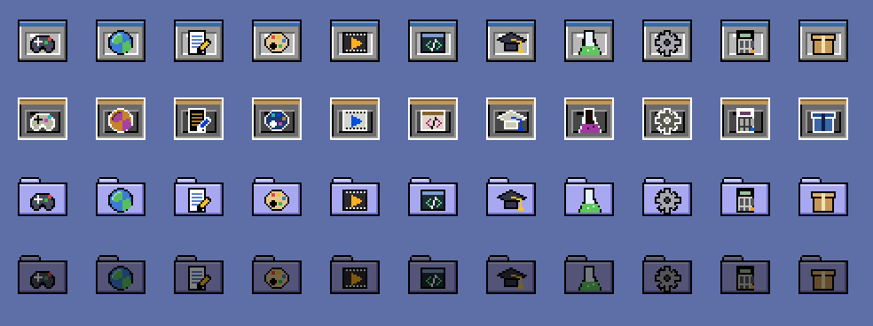

  | Kategoria | Folder | Kategoria | Folder |
  |-----------|--------|-----------|--------|
  | Game | Gry | Office | Biuro |
  | Graphics | Grafika | Development | Programowanie |
  | AudioVideo, Audio, Video | Multimedia | Education | Edukacja |
  | Network | Internet | Science | Nauka |
  | System, Settings | System | Utility | Akcesoria |

  AppImage bez kategorii trafia do folderu `Inne`. AppImage przeciągnięty prosto do folderu
  Aplikacje też trafia do folderu swojej kategorii. Próba instalacji wersji, która już jest
  zainstalowana, pyta, czy ją zastąpić albo uruchomić.

  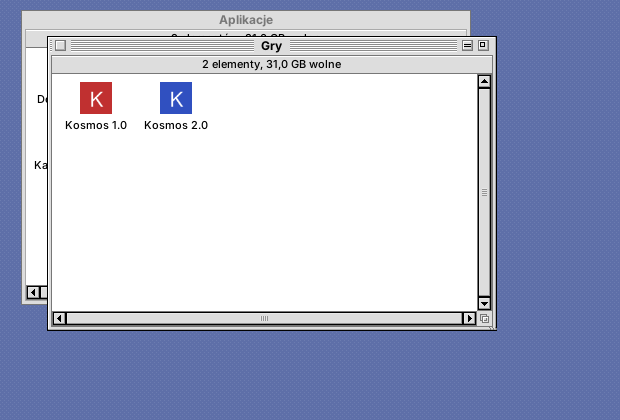
- **Uruchamianie w piaskownicy** (bubblewrap): cały system tylko do odczytu, zapis
  wyłącznie w Nirvana HD, inni użytkownicy, `/root`, `/mnt` i `/media` niewidoczne,
  własny `/tmp` i własna przestrzeń procesów; sama aplikacja jest tylko do odczytu.
  Bez bubblewrap aplikacja startuje normalnie, a dialog instalacji o tym ostrzega.
- **Różne runtime'y**: obraz squashfs jest szukany za nagłówkiem ELF (z weryfikacją
  superbloku), więc działa też z runtime'ami, które dodają wyrównanie. Gdy w środku
  nie ma squashfs (np. DwarFS w „uruntime”), AppImage rozpakowuje się sam przez
  `--appimage-extract`, ale w piaskownicy bez sieci i z zapisem tylko do katalogu
  tymczasowego. Ikona takiej aplikacji pojawia się po instalacji.
- Testowe AppImage: `tools/test-appimages.sh KATALOG`. „Clock” zapisuje
  `~/sandbox.txt` z tym, co widzi z wnętrza piaskownicy.

## Animacje okien

Jak na klasycznych pulpitach: przy otwieraniu, zamykaniu, zwijaniu i powiększaniu
okien po ekranie przelatują kontury prostokątów („zoom rects”). Foldery w Ramblerze
wylatują z ikony, z której je otwarto, i wracają do niej przy zamknięciu.
Sposób rysowania dobiera się sam:
- **XOR na ekranie**: w sesji Nirvana Desktop na Xorg/XLibre bez kompozytora. Najlżejszy.
- **Okno wycięte w kształt konturów** (rozszerzenie X SHAPE): pod XWaylandem
  (np. GNOME na Waylandzie w Rocky/RHEL 10) i na pulpitach z kompozytorem, gdzie
  rysunek na głównym oknie X byłby niewidoczny albo zamalowany.


- `NIRVANA_ANIMATIONS=0`: wyłącza animacje (ma pierwszeństwo przed panelem Wygląd)
- `NIRVANA_ANIM_MS=200`: wolniejsze klatki (do testów; domyślnie 12 ms)
- `NIRVANA_ANIM_NOGRAB=1`: bez blokady serwera X na czas animacji (do zrzutów ekranu)
- `NIRVANA_ANIM_MODE=xor` lub `shape`: wymusza sposób rysowania
- Jeśli FLTK zbudowano z backendem Wayland, animacje działają tylko w trybie X11:
  uruchom z `FLTK_BACKEND=x11`.

## Dyski, płyty i zaszyfrowane wolumeny

Podłączony pendrive, dysk USB, karta pamięci, płyta CD/DVD albo partycja z danymi
pojawia się na biurku pod Nirvana HD, z ikoną pasującą do rodzaju nośnika:

- **podwójne kliknięcie** montuje dysk i otwiera jego okno,
- **dysk zaszyfrowany (LUKS)** ma ikonę z kłódką; po podwójnym kliknięciu pyta o hasło,
  odblokowuje i montuje (złe hasło: komunikat i ponowne pytanie),
- **przeciągnięcie ikony dysku do kosza wysuwa go** (kosz zmienia się w symbol
  wysuwania): odmontowanie, zamknięcie LUKS, wysunięcie płyty albo
  wyłączenie dysku USB; to samo robi **Wysuń** w menu
  podręcznym ikony dysku (prawy przycisk myszy, `Ctrl+Y`),
- pliki upuszczone na ikonę dysku są **kopiowane** na niego (dysk montuje się sam),
- okna z zawartością dysku zamykają się, gdy dysk zostanie wysunięty lub wyjęty,
- aplikacje AppImage w piaskownicy widzą zamontowane nośniki użytkownika.

Pokazywane są nośniki wymienne oraz partycje wewnętrzne z systemem plików lub LUKS,
o ile nie są częścią systemu (nie są zamontowane jako `/`, `/boot`, swap itd.).

Pod spodem: wykrywanie przez `lsblk` (udev), a montowanie, odblokowywanie i wysuwanie
przez **UDisks2** po D-Bus (ta sama usługa, której używają GNOME i KDE). Hasło LUKS jest
przekazywane bezpośrednio w wywołaniu D-Bus i nie trafia do argumentów żadnego procesu.
Na Devuanie potrzebne są `udisks2` i polkit z elogind; na Rocky: `udisks2`, `dbus-devel`.

## Przełącznik aplikacji (gary)

Prawy górny róg paska menu pokazuje ikonę i nazwę aplikacji na pierwszym planie.
Po kliknięciu:

- lista uruchomionych aplikacji z ikonami; wybór wyciąga wszystkie jej okna na wierzch,
  ukryte aplikacje mają wyszarzoną ikonę,
- **Ukryj …**, **Ukryj inne**, **Pokaż wszystkie**, **Zakończ …**,
- podmenu **Okna Ramblera**: otwarte foldery, zwiń/rozwiń/zamknij wszystkie.

Aplikacja to grupa okien o tej samej klasie `WM_CLASS`. AppImage uruchomione z Ramblera
pojawiają się pod swoją nazwą i ikoną (np. „Clock” zamiast „XClock”); przypisanie jest
zapamiętywane w `~/.config/nirvana/app-classes`.

**Alt+Tab** (Insight): przytrzymaj Alt i naciskaj Tab, żeby przechodzić po aplikacjach
od ostatnio używanej; Shift cofa, Escape przerywa, puszczenie Alt wybiera.

Działa na standardzie EWMH (`_NET_CLIENT_LIST`, `_NET_ACTIVE_WINDOW`, `WM_CHANGE_STATE`,
`_NET_CLOSE_WINDOW`), więc także pod GNOME, KDE czy Openboksem. Pod obcym menedżerem
okno biurka nie przyjmuje fokusu, żeby klik w pasek menu nie zmieniał aktywnej aplikacji.

## Rambler: praca z plikami

- **Jedno okno**: otwarty folder pojawia się w tym samym oknie. Nad zawartością jest własny
  pasek menu okna (**Okno**, **Ikony**) i pasek nawigacji: wstecz, dalej, folder nadrzędny
  i pole położenia (`~` = folder domowy; wpisz ścieżkę i naciśnij Enter – ścieżka pliku
  otwiera jego folder z zaznaczonym plikiem). Skróty: `Alt+←` wstecz, `Alt+→` dalej,
  `Ctrl+↑` folder nadrzędny. Po wyjściu w górę zaznaczony jest folder, z którego przyszliśmy.
- **Więcej okien**: **Okno > Nowe okno** (`Ctrl+Shift+N`) albo `Ctrl` + dwuklik na folderze.
  Ikony biurka (Nirvana HD, dyski, Kosz) otwierają się w ostatnio używanym oknie.
- **Ikony biurka** w lewej kolumnie: Nirvana HD, **Aplikacje**, **Preferencje**, dyski,
  zikonizowane okna; **Kosz** stoi zawsze w tym samym miejscu na dole, nad dokiem – dodanie
  czegoś do doku ani jego opróżnienie go nie przesuwa.
- **Menu podręczne** (prawy przycisk myszy):
  - ikony biurka: Otwórz, Informacje, Wysuń, Formatuj dysk, Opróżnij kosz, Przywróć (ikony
    okien); `Ctrl+O`, `Ctrl+I`, `Ctrl+Y` działają na zaznaczoną ikonę biurka,
  - kafelki doku: Otwórz, Odepnij z doku,
  - ikony w oknie folderu: Otwórz, Połóż na doku / Odepnij z doku, Informacje, Zmień nazwę,
    Duplikuj, Kopiuj, Usuń; puste miejsce w oknie: Nowy folder, Wklej, Uaktualnij, Zaznacz
    zawartość,
  - puste biurko: Otwórz Nirvana HD, Wygląd biurka.
- **Otwieranie**: podwójne kliknięcie lub Enter. AppImage z innego folderu proponuje instalację.
- **Dwuklik na pustym biurku** otwiera menedżer plików (okno Nirvana HD); gdy jest już
  otwarte, wysuwa je na wierzch.
- **Okna folderów nie zasłaniają biurka**: otwierane i powiększane przyciskiem zoom
  zostawiają wolną kolumnę ikon przy lewej krawędzi (Nirvana HD, dyski, ikony okien,
  Kosz nad dokiem) oraz pasek doku na dole. Zoom innych programów też.
  Za duże zapamiętane okna są przy otwarciu zmniejszane do tego obszaru.
- **Zaznaczanie**: klik, Shift/Ctrl+klik dodaje lub odejmuje, ramka zaznaczania myszą, `Ctrl+A`.
- **Zmiana nazwy**: `F2` albo klik w nazwę już zaznaczonego elementu.
  Zmiana nazwy folderu aktualizuje jego otwarte okna i zapamiętane pozycje.
- **Przeciąganie**: między oknami przenosi, z `Ctrl` kopiuje; na folder w oknie wrzuca do
  środka; na ikonę Kosza wyrzuca, na Nirvana HD przenosi do katalogu domowego. Nietrafione
  upuszczenie „odlatuje” z powrotem na miejsce.
- **Z innych programów** (XDND, np. przeglądarka, inny menedżer plików): pliki są kopiowane
  do folderu, na którym je upuszczono; upuszczone na Kosz trafiają do kosza.
- **Ikony > Kopiuj / Wklej** (`Ctrl+C` / `Ctrl+V`), **Ikony > Duplikuj** (`Ctrl+D`) tworzy
  „nazwa kopia”. Kopiuj zapisuje też adresy `file://` w schowku systemowym.
- **Konflikty nazw** pytają o zastąpienie; folderu nie da się wrzucić w niego samego.
- **Widok**: `Ctrl+1` ikony, `Ctrl+2` lista (zapamiętywane dla każdego okna). W liście klik
  w nagłówek sortuje po nazwie, dacie, rozmiarze lub rodzaju; drugi klik odwraca kolejność.
  Kolumny, które się nie mieszczą, są chowane.
- **Automatyczne odświeżanie** (inotify): zmiany z zewnątrz pojawiają się same, ikona kosza
  zmienia się na pełny/pusty.

### Pasek menu

Po prawej, ciasno przy krawędzi: zasilanie, głośność, sieć, zegar i przełącznik aplikacji
(gadżet głębi). Na środku, jak na paskach ekranu starych komputerów domowych, widać zajętą pamięć
i zajęte miejsce na dysku z katalogiem domowym, każde z całości, np.
`512MB zajętej pamięci z 16GB     40GB zajętego dysku z 512GB` (poniżej 1 GB w MB, poniżej 10 GB
z jednym miejscem po przecinku). Wartości odświeżają się co 3 sekundy, a podpowiedź pokazuje
ilości wolne. Na wąskim ekranie napis się skraca.

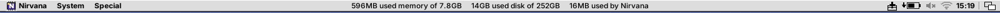

### Menu

| Menu | Pozycje |
|------|---------|
| **Nirvana** (logo i napis) | O systemie, Preferencje (okno z panelami), Wykonaj polecenie `Ctrl+E`, Nirvana Shell `Ctrl+T`, Otwórz dziennik, Resetuj Nirvanę |

**Otwórz dziennik** pokazuje pierwszy dziennik, który da się przeczytać: `journalctl`,
`/var/log/syslog` albo `/var/log/messages` (czytelne dla grupy `adm`), `dmesg`; gdy żaden nie jest
dostępny, prosi o hasło administratora (pkexec – jako root działa tylko odczyt pliku), a w
ostateczności pokazuje dziennik sesji (`~/.xsession-errors`).
| **System** | Zablokuj ekran, Uśpij, Hibernuj, Wyloguj `Ctrl+Q`, Uruchom ponownie, Wyłącz |
| **Narzędzia** | Formatuj dysk, Opróżnij kosz |

**O systemie** pokazuje system na wzór neofetch: po lewej duże logo z próbkami kolorów,
po prawej `użytkownik@komputer` i parametry – system, komputer, jądro, czas pracy, pakiety
(dpkg/rpm, Flatpak, AppImage), powłoka, rozdzielczość, środowisko, menedżer okien i jego motyw,
motyw, ikony, czcionka, kursor, terminal i jego czcionka, procesor, grafika, pamięć, dysk,
bateria, lokalny IP i ustawienia regionalne. Dwie pozostałe karty to **Licencja** (GPL-3.0)
i **Podziękowania**.

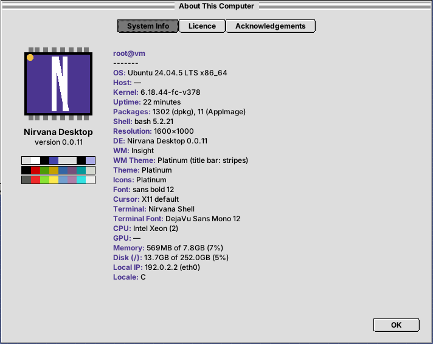

W każdym oknie menedżera plików:

| Menu | Pozycje |
|------|---------|
| **Okno** | Nowe okno `Ctrl+Shift+N`, Nowy folder `Ctrl+N`, Wstecz `Alt+←`, Dalej `Alt+→`, Otwórz katalog nadrzędny `Ctrl+↑`, Zamknij `Ctrl+W`, Uaktualnij `Ctrl+R`, Zaznacz zawartość `Ctrl+A`, Uporządkuj `Ctrl+.`, Pokaż ukryte pliki `Ctrl+H`, Pokaż jako (ikony/listę), Sortuj, Wielkość ikon (małe/normalne/duże) |
| **Ikony** | Otwórz `Ctrl+O`, Kopiuj, Wklej, Duplikuj, Zmień nazwę `F2`, Usuń `Ctrl+Backspace`, Informacje `Ctrl+I`, Ustaw jako tapetę, Zamroź `Ctrl+S`, Odmroź, Połóż na doku `Ctrl+L`, Zdejmij z doku `Ctrl+K` |

Pozycje, które w danej chwili nic by nie zrobiły, są wyszarzone, np. Wysuń bez zaznaczonego dysku albo Wstecz na początku historii.

- **Ikony w oknach** można przestawiać myszą w obrębie okna. Pozostałe zostają na swoich
  miejscach.
- **Zamroź** zapisuje pozycje na stałe (zaznaczonych ikon albo całego okna), **Odmroź** je
  zwalnia, **Uporządkuj** ustawia wszystko z powrotem w siatce. Pozycje są w
  `~/.config/nirvana/icon-positions`.
- **Wielkość ikon**: małe 16 px, normalne 32 px, duże 64 px (piksele powiększone 2×, ostre, w stylu
  retro). Wielkość jest zapamiętywana dla każdego okna.
- **Informacje**: rozmiar (foldery liczone), położenie, daty utworzenia, zmiany i otwarcia,
  właściciel, uprawnienia. W oknie można też ustawić:
  - flagi *Tylko do odczytu* i *Program* (prawo uruchamiania),
  - komentarz (`user.xdg.comment`),
  - dla programów i AppImage parametry uruchamiania („ToolTypes”), dodawane przy każdym
    uruchomieniu.

  Plik z flagą *Program* otwiera się w Nirvana Shell.
- **Dok** (pasek kafelków): *Połóż na doku* wystawia ikonę pliku, folderu
  albo aplikacji na pasek w lewym dolnym rogu ekranu, *Zdejmij z doku* ją chowa (plik zostaje
  na miejscu).
  - Kafelki w kolorach schematu przylegają do siebie i do krawędzi ekranu.
  - Nazwy pokazują się w podpowiedziach. AppImage mają swoją ikonę i nazwę z wersją.
  - Jedno kliknięcie otwiera.
  - Zakładka po lewej zwija pasek, a stan jest zapamiętywany.

  Lista ikon jest w `~/.config/nirvana/dock`.

  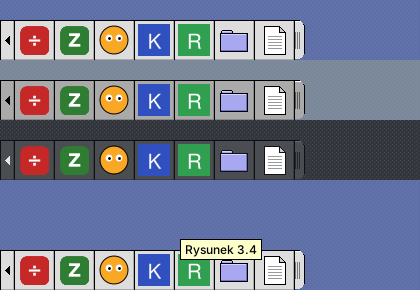
- **Formatuj dysk**: zaznacz ikonę dysku na biurku i wybierz FAT32, exFAT, ext4 albo NTFS
  (UDisks2). Niesformatowane pendrive'y też pojawiają się na biurku.
- **Resetuj Nirvanę** uruchamia Insighta i Ramblera od nowa. Okna programów zostają.
- **Gdy Rambler się wywróci**, sesja uruchamia go ponownie zamiast wylogowywać (przyczyna trafia
  do `~/.xsession-errors`). Dopiero pięć wywrotek w ciągu 30 sekund kończy sesję.

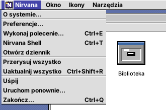

Pozycje i tryb widoku okien: `~/.config/nirvana/windows`.

## Wygląd (panel nirvana-alice)

Logo Nirvana Desktop → **Panele sterowania → Wygląd…** otwiera panel z listą schematów
kolorów i podglądem. Klik na schemacie zmienia od razu sam panel, a **Zastosuj**/**OK**
przestawia cały system: Rambler i Insight przeładowują paletę bez restartu.

- **Schemat kolorów**: wbudowane *Platinum*, *Grafit* (ciemny) i *Retro niebieski*
  (szary z niebieskim akcentem) oraz ponad 40 schematów z
  [Redmond97 SE](https://codeberg.org/Sliver_X/Redmond97-SE) (GPL-3.0).
- **Wygląd domyślny**: schemat *In Tenebris*, wzór *Cegiełki* i ikony Platinum.
- **Pasek tytułu**: jak w schemacie, prążki Platinum, jednolity kolor albo gradient.
- **Tło biurka**: *Wzór*, *Jednolity kolor* albo *Gradient*.
  - Kolory wybiera się z dwóch próbek. Drugi kolor gradientu domyślnie jest ciemniejszą
    (albo, na ciemnym tle, jaśniejszą) wersją pierwszego. *Ze schematu* wraca do kolorów
    schematu.
  - Gradient: pionowy, poziomy, ukośny albo promienisty. Ma dithering (macierz Bayera),
    więc nawet przy subtelnych przejściach nie widać pasów.
  - 20 wzorów w dwóch odcieniach koloru biurka: gładki, kropki, groszki, krata, drobna
    kratka, szachownica, ukośne prążki, paski poziome i pionowe, cegiełki, raster,
    romby, krzyżyki, zygzak, jodełka, tkanina, fale, łuski, gwiazdki, piasek.
  - Tapeta leży na tym tle: widać je w pasach przy układzie *Dopasuj*, wokół obrazu
    *Na środku* i pod przezroczystymi fragmentami PNG.

  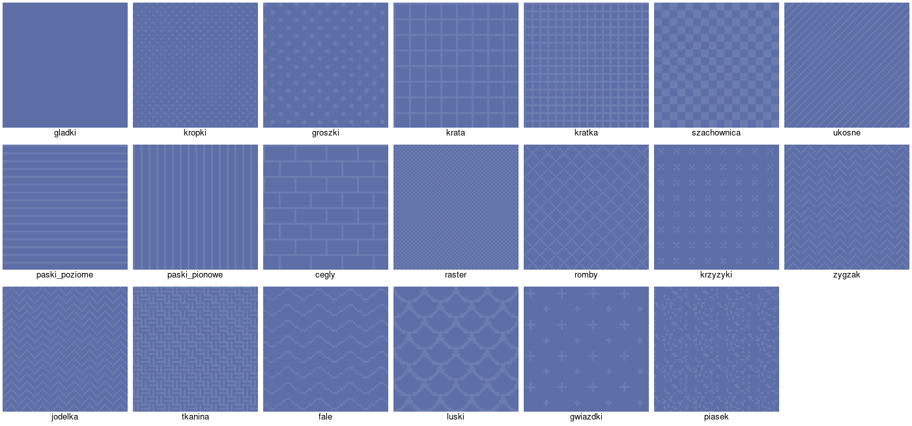
  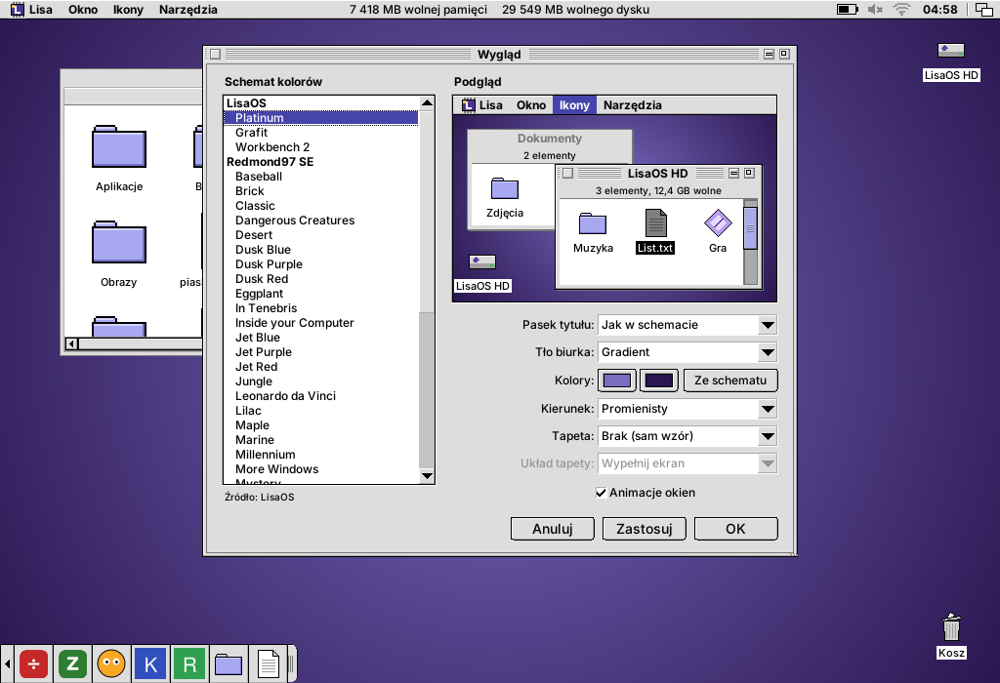

- **Tapeta**: wybierana z listy albo przez *Inny plik…* (PNG, JPEG, GIF, BMP, SVG, XPM).
  - Lista zawiera tapety Nirvana Desktop (*Nirvana Desktop*, *Mountains at Dawn*, *Copper*, *Platinum*), tapety systemowe
    z `/usr/share/backgrounds` i `/usr/share/wallpapers` oraz obrazy z `~/Obrazy`.
  - Układy: *Wypełnij ekran* (przycina), *Dopasuj* (cały obraz, wzór w pasach),
    *Rozciągnij*, *Na środku* i *Sąsiadująco*.
  - Duże zdjęcia są zmniejszane stopniowo, więc nie powstają schodki ani mora.
  - Pod przezroczystymi fragmentami PNG widać wzór biurka.
  - W Ramblerze: zaznacz obraz i wybierz **Ikony → Ustaw jako tapetę**.
  - Własne tapety można dodać do `~/.local/share/nirvana/wallpapers`.
- **Styl ikon**: *Retro* albo *Platinum*. Zmiana działa
  od razu, także w otwartych oknach i na doku.
  - Retro: własne rysunki w stylu komputerów domowych z początku lat 90., w palecie szarości,
    granatu i beżu z czarnymi obrysami.
  - Foldery to szuflady, a dokumenty to „projekty” z zagiętym rogiem. Programy wyglądają
    jak okienko z gadżetami zamykania i głębi.
  - Dyski to kostki twardych dysków z diodą (Nirvana HD z granatową tabliczką), a nośniki
    wymienne to dyskietki 3,5". Kosz ma pokrywę z uchwytem.
  - Zaznaczona ikona ma odwrócone kolory (podświetlenie *complement*).
  - Plansza wszystkich ikon: `tools/icon-sheet.cxx`.

  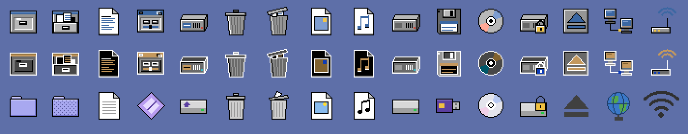
  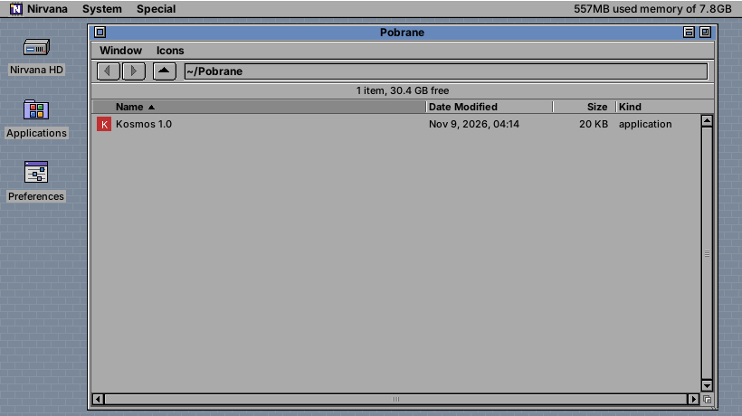
- **Animacje okien**: włączone lub wyłączone.
- **Skala interfejsu**: *Automatycznie* (z ustawienia `Xft.dpi`, np. 192 dpi = 200%)
  albo 100–300%. Skaluje wszystko naraz: pasek menu, okna, czcionki, ikony, ramki
  i dok; tapeta jest liczona w pełnej rozdzielczości ekranu. Po zmianie biurko
  i menedżer okien uruchamiają się od nowa (jak **Narzędzia → Resetuj Nirvanę**),
  otwarte programy zostają. Na próbę: `NIRVANA_SCALE=150 nirvana-session`.

  - *Nirvana Desktop* (2560×1440, błyszcząca, ze świetlnymi wstęgami i lustrzaną podłogą) powstaje ze skryptu
    `tools/wallpaper-nirvana-desktop.py [plik] [szerokość wysokość]`. Można ją wygenerować
    w rozdzielczości własnego ekranu.

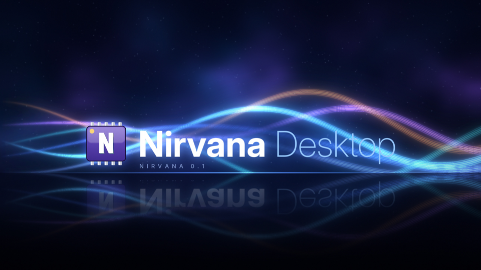
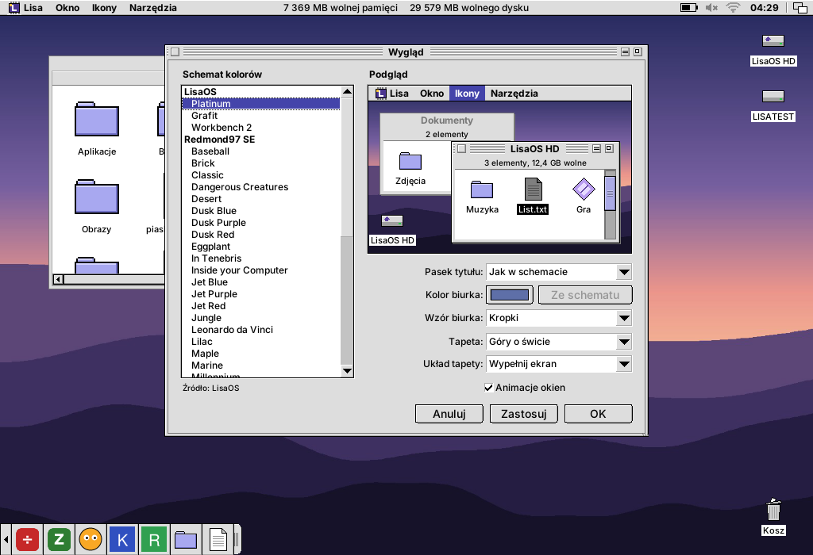
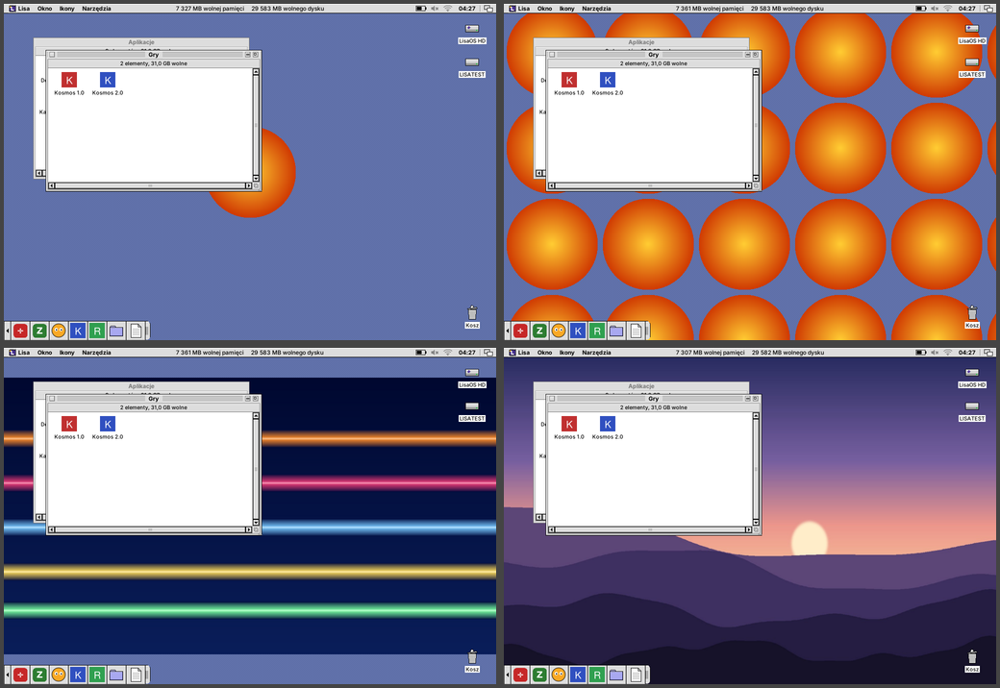

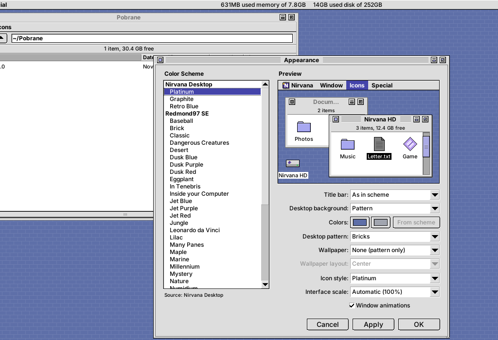
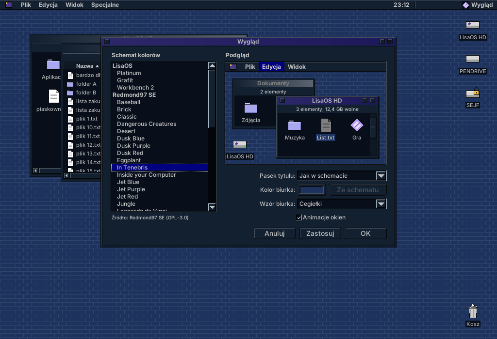

Ustawienia: `~/.config/nirvana/appearance.conf`. Schematy to proste pliki `klucz=wartość`
w katalogu `schemes/`, szukane kolejno w `~/.local/share/nirvana/schemes`,
`<prefiks>/share/nirvana/schemes`, `/usr/local/share/...` i `/usr/share/...`.
Własny schemat wystarczy tam wrzucić, np. `~/.local/share/nirvana/schemes/moj.conf`:

```ini
name=Mój schemat
title_style=stripes      # stripes (prążki) | solid (jednolity) | gradient
window=#DDDDDD           # tło okien
text=#000000
content=#FFFFFF          # wnętrze list i pól
content_text=#000000
selection=#4444AA
selection_text=#FFFFFF
border=#000000
title=#4444AA            # pasek tytułu (styl solid/gradient)
title2=#8888DD           # drugi kolor gradientu
title_text=#FFFFFF
title_inactive=#AAAAAA
title_inactive_text=#555555
accent=#AAAAE6           # suwak przewijania (opcjonalnie)
desktop=#5E6FA8          # opcjonalnie
```

Schematy Redmond97 SE odtworzysz skryptem `tools/import-redmond97.py`
(kolory z `builder/presets/theme_*.conf`).

## Sieć: Wi-Fi, Ethernet, VPN, hotspot

Nirvana Desktop zarządza siecią przez NetworkManagera (`nmcli` i D-Bus). Na Devuanie: pakiet
`network-manager` (działa bez systemd, z elogind).

- **Ikona na pasku menu**: siła sygnału Wi-Fi, symbol sieci przewodowej, kłódka przy
  aktywnym VPN. Menu po kliknięciu:
  - sieci Wi-Fi w zasięgu z kłódką i kreskami sygnału,
  - połącz i rozłącz kabel,
  - włącz i wyłącz Wi-Fi,
  - VPN,
  - tryb samolotowy.
- **Panel Sieć** (logo → Panele sterowania → Sieć…):
  - każde połączenie z adresami (IPv4, brama, DNS, IPv6, MAC, szybkość),
  - ręczne lub automatyczne ustawienia IPv4,
  - lista sieci Wi-Fi: łączenie, sieci ukryte („Inna sieć…”), zapominanie,
  - hotspot (udostępnianie internetu przez Wi-Fi),
  - tryb samolotowy.
- **VPN**: import pliku konfiguracji i łączenie jednym kliknięciem:
  - WireGuard (`.conf` z `[Interface]`), wbudowany w NetworkManagera,
  - OpenVPN (`.ovpn`), pakiet `network-manager-openvpn`,
  - Cisco VPNC (`.pcf`), pakiet `network-manager-vpnc`.

  Profile innych wtyczek (OpenConnect, L2TP, PPTP, strongSwan…) też są na liście i łączą
  się z panelu. Login i hasło VPN pytane są przy łączeniu.
- **Hasła** nie trafiają do linii poleceń:
  - Wi-Fi i hotspot idą przez D-Bus (`AddAndActivateConnection`),
  - VPN idzie przez tymczasowy plik `passwd-file` (0600), usuwany zaraz po połączeniu.
- Sieci firmowe Wi-Fi (WPA Enterprise / 802.1X) jeszcze nie: `nmtui`.


Testy bez karty Wi-Fi: `NIRVANA_NMCLI=tools/fake-nmcli.sh` udaje kartę `wlan0` i kilka
sieci (resztę przekazuje do prawdziwego `nmcli`).

## Nirvana Shell (terminal)

`nirvana-shell` to emulator terminala zgodny z xterm (`TERM=xterm-256color`),
zbudowany na bibliotece libvterm (dołączona w `third_party/`, MIT; systemowa
jest używana, jeśli jest). Uruchamianie: logo → Nirvana Shell, w Ramblerze
Plik → Otwórz w Nirvana Shell (Ctrl+T, w folderze aktywnego okna) albo
`nirvana-shell [--working-directory KATALOG] [-e polecenie]`.

- **Wyświetlanie:** 256 kolorów i truecolor, pogrubienie, kursywa, podkreślenie, ekran
  alternatywny. Działają w nim vim, htop, mc, less.
- **Mysz w programach:** obsługiwana. Shift + klik zawsze zaznacza tekst.
- **Przewijanie wstecz:** 5000 wierszy, pasek przewijania, kółko myszy,
  Shift+PgUp/PgDn.
- **Zaznaczanie i schowek:**
  - zaznaczenie trafia od razu do schowka X; środkowy klawisz wkleja,
  - podwójny klik zaznacza słowo, potrójny wiersz,
  - Ctrl+Shift+C kopiuje, Ctrl+Shift+V wkleja (w nawiasach, jeśli program o to prosi).
- **Okna:** Ctrl+Shift+N otwiera nowe w tym samym katalogu, Ctrl+Shift+W zamyka.
  Przed zamknięciem okna, w którym coś działa, terminal pyta.
- **Wygląd:**
  - prawy klik otwiera menu, a w nim profile kolorów: Klasyczny (jasny), Ciemny,
    Zielony fosfor, Bursztynowy, Retro niebieski, Jak schemat kolorów,
  - Ctrl+Shift+= / - / 0 zmienia rozmiar czcionki.
- **Ustawienia:** `~/.config/nirvana/terminal.conf` (profil, czcionka, rozmiar, kolumny,
  wiersze, przewijanie).


## Zasobnik systemowy

Ikony programów działających w tle (komunikatory, chmura, launchery gier, nm-applet...)
stoją na pasku menu, na lewo od apletu zasilania. Rambler obsługuje oba protokoły:

- **StatusNotifierItem** (D-Bus): Qt 5/6, KDE, Electron, libappindicator / Ayatana.
  - Gdy w sesji nie ma innego, Rambler sam jest `org.kde.StatusNotifierWatcher`. Pod KDE
    zgłasza się jako dodatkowy host istniejącego.
  - Ikony bierze z motywu ikon. Jeśli jakiejś nie ma, próbuje wersji `-symbolic` i coraz
    krótszej nazwy, a w ostateczności pikseli przysłanych przez program. Ikony symboliczne
    mają kolor tekstu paska.
  - Lewy klik to *Activate*, a gdy program go nie obsługuje, otwiera menu. Prawy klik
    otwiera menu programu (dbusmenu: zaznaczenia, podmenu, separatory, nieaktywne pozycje)
    jako menu Platinum. Środkowy klik to *SecondaryActivate*, a kółko myszy to *Scroll*.
  - Podpowiedź pokazuje tytuł i opis (bez HTML-a). Ikona znika, gdy program ustawi status
    *Passive*.
- **XEmbed** (`_NET_SYSTEM_TRAY_S0`): GTK 2/3 `StatusIcon`, Wine, starsze programy.
  - Okienko ikony jest osadzane w pasku na tle w kolorze schematu, a kliknięcia trafiają
    prosto do programu.
- Pasek przestawia się sam, gdy ikon przybywa albo ubywa. Po zakończeniu programu jego
  ikona znika.
- Po **Resetuj Nirvanę** ikony wracają: programy XEmbed dokują się ponownie po ogłoszeniu
  `MANAGER`, a Rambler sam odnajduje ikony D-Bus, które już są na szynie.
- `NIRVANA_NO_TRAY=1` wyłącza zasobnik (np. gdy sesja ma własny).


## Dźwięk

Ikona głośnika na pasku menu. Kliknięcie otwiera okienko z:

- głośnością i wyciszeniem wyjścia oraz wyborem wyjścia (także portu: głośniki
  albo słuchawki). Przy zmianie wyjścia grające programy przechodzą na nowe,
- głośnością i wyciszeniem mikrofonu oraz wyborem wejścia,
- głośnością każdej grającej aplikacji.

Kółko myszy nad ikoną zmienia głośność. Klawisze multimedialne (głośność, wyciszenie,
mikrofon, jasność) pokazują pasek OSD na dole ekranu. Pod GNOME/KDE obsługuje je
tamto środowisko.

Działa z PulseAudio i PipeWire (`pactl`). Bez serwera dźwięku używa czystej ALSA
(`amixer`: Master i Capture).


## Aktualizacje oprogramowania

Ikona z paczką na pasku menu szuka aktualizacji systemu minutę po zalogowaniu, a potem co
6 godzin, i pokazuje ich liczbę na czerwonym znaczku. Okienko wymienia je i ma **Zainstaluj
aktualizacje…**, **Sprawdź aktualizacje** i **Pokaż dziennik**; podczas instalacji ikona i okienko
pokazują postęp.

| Menedżer pakietów | Sprawdzanie (bez roota) | Instalacja |
|---|---|---|
| apt (Devuan, Debian, Ubuntu) | listy pobierane do `~/.cache/nirvana/apt` | `apt-get dist-upgrade` z postępem |
| dnf (Fedora, Rocky) | `dnf check-update` | `dnf upgrade` |
| pacman (Arch) | `checkupdates` (pacman-contrib) | `pacman -Syu` |
| zypper (openSUSE) | `zypper list-updates` | `zypper update` |
| apk (Alpine), xbps (Void) | lokalne listy | `apk upgrade`, `xbps-install -Syu` |
| Flatpak | `flatpak remote-ls --updates` | `flatpak update --system` |

Sprawdzanie nigdy nie wymaga roota: przy apt listy pakietów są pobierane do pamięci podręcznej
użytkownika, więc listy systemu zostają nietknięte (pomysł z `checkupdates`). Instalacja uruchamia
`/usr/libexec/nirvana-update-helper` przez pkexec. Robi on tylko stałą aktualizację, bez
przekazywania żadnych argumentów; reguła polkit instalowana z Nirvana Desktop pozwala
administratorom (grupa `sudo`, `wheel` albo `admin`) siedzącym przy komputerze robić to **bez
hasła**. Inni użytkownicy są pytani o hasło administratora. Dziennik ostatniej instalacji jest
w `~/.cache/nirvana/update.log`.

## Zasilanie i tryb projekcji

Ikona baterii (albo wtyczki w komputerze stacjonarnym) na pasku menu. Obok baterii: błyskawica
podczas ładowania, strzałka w dół przy pracy na baterii (czerwona poniżej 10%), mała wtyczka, gdy
zasilacz jest podłączony, a bateria pełna. W okienku:

- stan baterii z czasem do rozładowania lub naładowania,
- suwak jasności ekranu (przez logind, bez roota),
- profil zasilania (oszczędzanie energii, zrównoważony, wydajność): przez `power-profiles-daemon`,
  a bez niego (np. Devuan bez systemd) prosto przez jądro – profil platformy ACPI, w przeciwnym
  razie preferencja energetyczna procesora (EPP), a w ostateczności governor cpufreq. Ustawia go
  `nirvana-power-helper` przez pkexec; polkit pozwala na to użytkownikowi przy komputerze bez
  hasła, a wybór jest przywracany przy następnym logowaniu,
- odnośnik do panelu Zasilanie.

Zablokuj ekran, Uśpij, Hibernuj, Wyloguj, Uruchom ponownie i Wyłącz są w menu **System**.
Działają przez logind; na Devuanie przez elogind.

**Tryb projekcji** (pole w tym okienku) wstrzymuje naraz:

- wygaszanie ekranu i DPMS (`XScreenSaverSuspend`), więc nie uruchamia się też
  blokada ekranu,
- usypianie: blokada logind/elogind `idle:sleep`,
- wygaszanie i usypianie w GNOME, KDE i Xfce (`org.gnome.SessionManager`,
  `org.freedesktop.ScreenSaver`).

Gdy tryb jest włączony, przy ikonie baterii widać mały monitor.

Panel **Zasilanie** (logo → Panele sterowania) ustawia dla sesji Nirvana Desktop:

- wygaszanie ekranu po bezczynności,
- blokadę przy wygaszeniu,
- usypianie po bezczynności, osobno na baterii i z zasilacza,
- reakcję na 3% baterii; przy 10% pojawia się ostrzeżenie.


## Shader: efekty pełnoekranowe

**Preferencje → Shader** nakłada efekt na cały pulpit. Wybór z listy działa od razu, jest
zapamiętywany i uruchamiany razem z sesją. 17 wbudowanych efektów: Monitor CRT, Linie
kineskopu, Monitor bursztynowy, Zielony fosfor, Skala szarości, Sepia, Światło nocne, Kaseta VHS
(animowany), Ziarno filmu (animowany), Duże piksele, 64 kolory (z ditheringiem), Raster
drukarski, LCD, Kamera termowizyjna, Senna poświata, Pod wodą (animowany) i Odwrócone kolory.

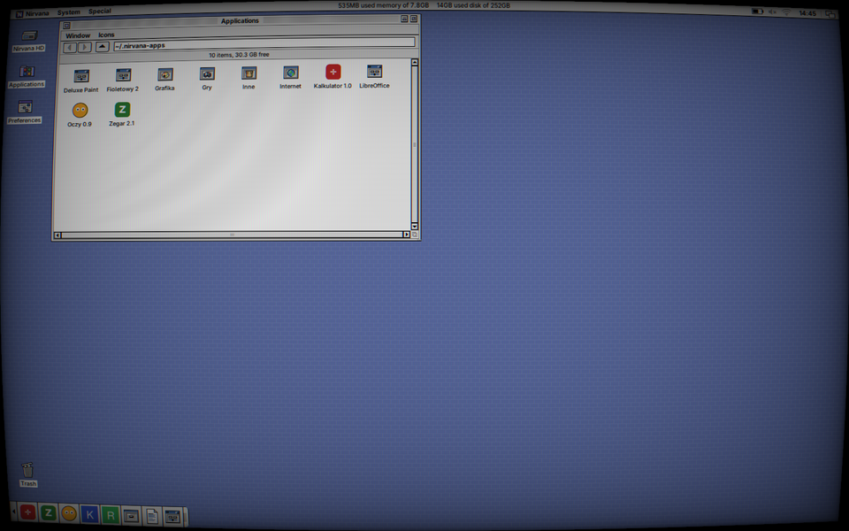
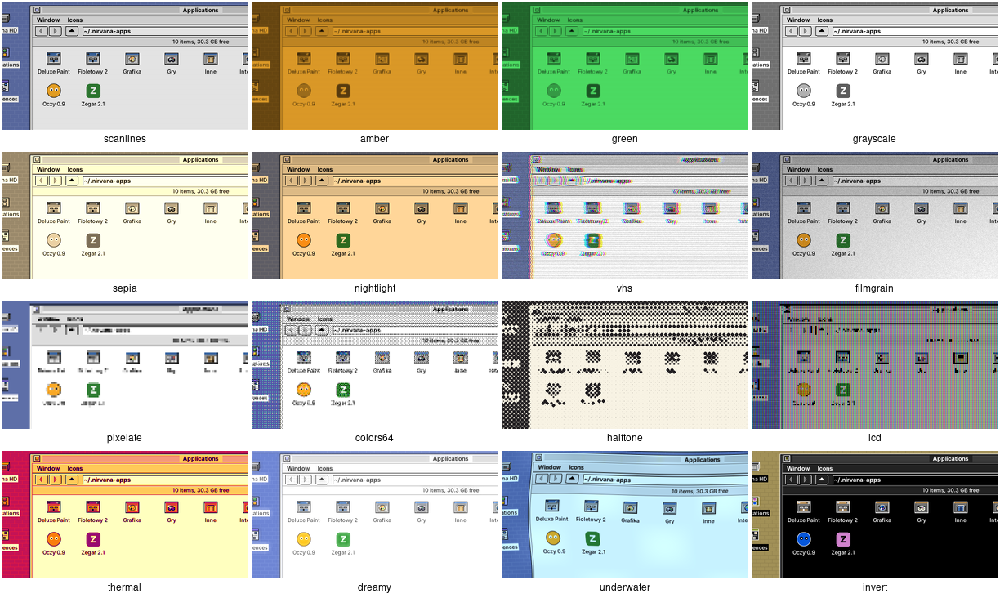

`nirvana-shader` to mały kompozytor: okna są przekierowane poza ekran (Composite), składane
przez XRender w jeden obraz i rysowane przez shader fragmentów w OpenGL
(`GLX_EXT_texture_from_pixmap`, a bez niego przez kopię). Okna czyta przez obrazy okien
(window pictures), a nie przez tekstury przypięte do każdego okna, więc zmiana rozmiaru,
zamknięcie czy zwinięcie okna nie zostawia mu nieaktualnej pixmapy; błędy X są zapisywane w
logu, a nie kończą programu; a gdy program się zakończy w jakikolwiek sposób, serwer X
z powrotem pokazuje okna bezpośrednio. Podczas jego pracy animacje okien używają metody
z kształtowanym oknem zamiast XOR. Mysz działa normalnie (nakładka jest przezroczysta dla wejścia).

    nirvana-shader crt          # uruchom z efektem (albo przełącz działający)
    nirvana-shader --list       # dostępne shadery
    nirvana-shader --stop

Własne shadery: shadery fragmentów GLSL 1.20 w `~/.local/share/nirvana/shaders/NAZWA.frag`.
Przed plikiem jest wstęp z `u_resolution`, `u_time` (shader, który go używa, jest animowany,
30 klatek na sekundę), `v_texcoord` (0..1, początek w lewym dolnym rogu) i `vec4 screen(vec2 uv)`;
wynik idzie do `gl_FragColor`. Pierwsza linia komentarza to opis w panelu.

    // Niebieski odcień.
    void main() { gl_FragColor = vec4(screen(v_texcoord).rgb * vec3(0.8, 0.9, 1.2), 1.0); }

Inny kompozytor (picom, compton) nie może działać w tym samym czasie. Bez akceleracji grafiki
(np. w maszynie wirtualnej, llvmpipe) efekty animowane mocno obciążają procesor.

## Języki

Interfejs jest domyślnie **po angielsku** (teksty w kodzie) i **po polsku**
(`po/pl.po`). *Automatycznie* w **Preferencjach** (logo → Preferencje…) bierze
język systemu (`LANGUAGE`, `LC_ALL`, `LC_MESSAGES`, `LANG`): przy polskich locale
(`pl_PL.UTF-8`) interfejs jest po polsku, przy innych i przy `LANG=C` po angielsku.
Język można też wybrać ręcznie; wybór trafia do `~/.config/nirvana/language` i działa
po ponownym uruchomieniu albo **Narzędzia → Resetuj Nirvanę**.

Po polsku menu nazywają się *Okno*, *Ikony*, *Narzędzia*, liczby mają przecinek
dziesiętny, a nowe foldery kategorii to `Gry`, `Grafika`… (po angielsku `Games`, `Graphics`).
Foldery, które już istnieją, zostają w użyciu bez względu na język, więc jego zmiana
nie rozdziela zainstalowanych aplikacji.

Nowy język albo poprawki:

    tools/i18n/pot.py          # po/nirvana.pot z kodu + aktualizacja po/*.po
    msginit -i po/nirvana.pot -l de -o po/de.po   # nowy język
    cmake --build build        # msgfmt --check → build/locale/<język>/…

W kodzie: `_("text")`, `N_("…")` w tablicach statycznych, `P_("Window/Sort")`
dla ścieżek menu (tłumaczony każdy człon), `trn(n, "%1 item", "%1 items")` dla
liczby mnogiej i `fmt(_("Delete “%1”?"), name)` zamiast sklejania zdań. Katalogi
`.mo` Nirvana Desktop czyta sam, więc nie potrzeba wygenerowanych locale systemu.

## Licencja

Nirvana Desktop jest wolnym oprogramowaniem na licencji **GNU General Public License w wersji 3
lub późniejszej** (GPL-3.0-or-later). Pełny tekst jest w pliku [`LICENSE`](LICENSE); instaluje się
do `/usr/share/nirvana/LICENSE` i jest widoczny w **Nirvana → O systemie → Licencja**.

- FLTK jest na LGPL-2.0 z wyjątkami pozwalającymi na linkowanie statyczne.
- libvterm w `third_party/libvterm` (Paul Evans) jest na licencji MIT.
- Schematy w `schemes/redmond97-se/` pochodzą z Redmond97 SE (Sliver X, matthewmx86) i są na GPL-3.0.

Ludzie i projekty, na których pracy zbudowano Nirvana Desktop, są wymienieni w
**O systemie → Podziękowania**.
